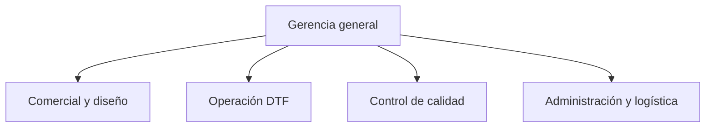

# DOC-QP-003 — Información general de la empresa QualityPrint

| Campo | Información |
|---|---|
| Proyecto | QualityPrint — Sistema de Gestión de Calidad |
| Código documental | DOC-QP-003 |
| Etapa | 2. Documentación de la empresa y del SGC |
| Apartado | 2.1. Información general de la empresa |
| Versión | 1.0 |
| Fecha de elaboración | 10 de noviembre de 2026 |
| Estado | **Aprobado para el caso de estudio** |
| Organización | QualityPrint, **empresa ficticia** |
| Tipo de documento | Caracterización organizacional |

> **Nota metodológica:** todos los datos de QualityPrint describen un escenario de simulación para un proyecto de software y portafolio. No constituyen información registrada de una empresa real ni una evaluación empresarial efectuada sobre el terreno.

## Propósito del documento

Caracterizar a QualityPrint, su actividad, sus productos, los clientes que atiende y su organización interna. Este documento define un contexto consistente para elaborar posteriormente el mapa de procesos, los procedimientos DTF, los requisitos de calidad y los permisos de la aplicación.

**Documentos relacionados:** [DOC-QP-001](../01_proyecto/DOC-QP-001_ficha_del_proyecto.md), [DOC-QP-002](../01_proyecto/DOC-QP-002_organizacion_inicial_del_proyecto.md) y [ROADMAP](../../ROADMAP_QUALITYPRINT.md).

---

## 2.1.1. Nombre y descripción de QualityPrint

### 2.1.1.1. Nombre de la empresa
**QualityPrint**.

Se utilizará este nombre tanto para la empresa ficticia como para identificar el proyecto de software. Cuando sea necesario distinguirlos se hablará de **empresa QualityPrint** y **aplicación QualityPrint-SGC**.

### 2.1.1.2. Descripción organizacional
QualityPrint es una **pequeña empresa ficticia de personalización textil**, dedicada a producir prendas con diseños estampados mediante tecnología DTF (*Direct to Film*). Trabaja principalmente **bajo pedido**, por lo que cada trabajo parte de las especificaciones y aprobación del cliente.

La empresa plantea una estructura sencilla de **cinco trabajadores** (o hasta cinco en etapas de operación reducida), **una impresora DTF** y equipos auxiliares necesarios para la transferencia a prendas, como una prensa térmica. La existencia, el modelo y las especificaciones reales de esos equipos no se han definido aún: se establecerán como supuestos técnicos cuando se elabore el procedimiento de producción.

### 2.1.1.3. Ficha organizacional

| Característica | Descripción de referencia |
|---|---|
| Nombre | QualityPrint |
| Naturaleza | Empresa ficticia para aprendizaje y portafolio |
| Tamaño | Pequeña empresa; cinco trabajadores previstos |
| Modelo de operación | Producción bajo pedido |
| Método de estampado | DTF |
| Capacidad instalada simulada | Una impresora DTF; capacidad en unidades/hora por determinar |
| Mercado de referencia | Clientes particulares y organizaciones |
| Canales comerciales propuestos | Atención directa y canales digitales |
| Localización y datos legales | No definidos; no se inventan dirección, registro ni identificación tributaria |
| Sistema de información previsto | Aplicación web QualityPrint-SGC |

---

## 2.1.2. Actividad económica

### 2.1.2.1. Actividad principal
Prestación de servicios de **personalización y estampado de prendas textiles mediante transferencia DTF**, a partir de diseños aprobados por el cliente.

### 2.1.2.2. Actividades operativas asociadas
1. Recibir solicitudes, diseños y especificaciones de pedidos.
2. Preparar o adaptar el archivo gráfico para impresión, con validación del cliente.
3. Revisar disponibilidad y condiciones de prendas, película, tinta y adhesivo.
4. Imprimir el diseño sobre película DTF.
5. Aplicar y curar el adhesivo según los insumos y el equipo seleccionados.
6. Transferir el estampado a la prenda mediante equipo térmico.
7. Realizar acabado, inspección de calidad, empaque y entrega.
8. Registrar incidencias, reprocesos y resultados de calidad.

### 2.1.2.3. Límites de la actividad
El caso de estudio **no incluye inicialmente** serigrafía, sublimación, bordado, fabricación de prendas desde materia prima, facturación electrónica ni comercio electrónico completo.

**Clasificación económica legal:** se definirá solo si el proyecto requiere una jurisdicción concreta. No se asigna un código de actividad económica sin contexto verificable.

---

## 2.1.3. Productos y servicios

### 2.1.3.1. Productos textiles propuestos

| Producto | Personalización habitual | Control de calidad de referencia |
|---|---|---|
| Camisetas | Logos, ilustraciones, textos | Diseño, ubicación, color, adherencia y acabado |
| Sudaderas | Diseños frontales o posteriores | Posición, integridad del estampado y acabado |
| Uniformes | Identificación corporativa | Correspondencia con el diseño y consistencia del pedido |
| Prendas promocionales compatibles | Mensajes y marcas | Legibilidad, cantidad, posición y presentación |

La compatibilidad de cada tejido con los materiales DTF deberá validarse antes de aceptar un pedido.

### 2.1.3.2. Servicios ofrecidos
- Recepción y revisión de pedidos de estampado.
- Asesoría básica sobre ubicación y tamaño del diseño.
- Preparación o adaptación del arte gráfico cuando aplique.
- Estampado de prendas mediante DTF.
- Inspección de calidad previa a la entrega.
- Gestión de observaciones, reclamaciones y correcciones asociadas al pedido.

### 2.1.3.3. Requisitos del producto que deben registrarse
Como mínimo se identificarán: **pedido**, prenda/tipo de tejido, talla, color base, cantidad, archivo o referencia de diseño, medidas y ubicación del estampado, fecha acordada y confirmación/aprobación del diseño.

Los **criterios de aceptación y métodos de ensayo** se definirán en el procedimiento de inspección; aún no se fijan tolerancias o parámetros de temperatura, presión y tiempo.

---

## 2.1.4. Características de los clientes

### 2.1.4.1. Segmentos de clientes previstos

| Segmento | Ejemplo simulado | Necesidad principal |
|---|---|---|
| Particulares | Camisetas para un evento familiar | Personalización del diseño y cantidad solicitada |
| Empresas | Uniformes o prendas con logotipo | Coherencia de marca y entrega acordada |
| Emprendimientos | Pequeños pedidos para una marca de ropa | Repetibilidad del diseño y control por lote |
| Grupos e instituciones | Prendas para eventos o actividades | Identificación correcta, tallas y cantidades |

### 2.1.4.2. Expectativas comunes
- Correspondencia del diseño con lo aprobado.
- Estampado ubicado y adherido correctamente.
- Información clara sobre precio, cantidades, tallas y fechas.
- Producto entregado sin defectos visibles.
- Canal para comunicar observaciones después de la entrega.

### 2.1.4.3. Información del cliente que necesita el software
El sistema considerará un identificador de cliente, nombre comercial o de prueba, datos mínimos de contacto ficticios, historial de pedidos y observaciones autorizadas. **No se incorporarán datos personales reales al repositorio ni a las demostraciones públicas.**

---

## 2.1.5. Estructura organizacional

### 2.1.5.1. Modelo propuesto
QualityPrint utilizará una **estructura funcional simple** con cinco puestos de referencia:

1. Gerencia general.
2. Comercial y diseño.
3. Operación DTF.
4. Control de calidad.
5. Administración y logística.

La asignación es un **supuesto organizacional** del caso de estudio. En una operación pequeña pueden combinarse funciones, manteniendo responsable y evidencias claramente definidos.

### 2.1.5.2. Criterios para distribuir el trabajo
- Gerencia dirige la empresa, aprueba recursos y revisa resultados.
- Comercial y diseño acuerda requisitos y verifica la aprobación del arte.
- Operación DTF ejecuta trabajos y registra materiales y parámetros de producción.
- Calidad verifica el cumplimiento, identifica defectos y recomienda la liberación o retención de productos.
- Administración y logística gestiona insumos, documentación administrativa, empaque y entregas.

### 2.1.5.3. Separación de responsabilidades
El operador realiza **autocontroles durante la producción**, pero la **inspección final y la decisión documentada de liberación** corresponden preferentemente al responsable de calidad, con escalamiento a gerencia cuando exista una excepción. De este modo se reduce el riesgo de que una misma persona ejecute y apruebe sin revisión.

---

## 2.1.6. Organigrama

### 2.1.6.1. Organigrama propuesto

El siguiente diagrama está escrito en Mermaid y se puede visualizar directamente en GitHub:

### 2.1.6.2. Lectura del organigrama
La gerencia coordina directamente cuatro funciones. Las flechas representan **dependencia organizacional**, no el orden del proceso productivo.

**Relación transversal de calidad:** aunque control de calidad reporta a gerencia, debe coordinar con comercial y diseño, operación DTF y logística para verificar los pedidos y prevenir entregas de productos no conformes.

---

## 2.1.7. Funciones y responsabilidades de los cargos

### 2.1.7.1. Gerencia general
- Definir la dirección, los objetivos y los recursos.
- Aprobar políticas y documentos críticos del SGC.
- Revisar indicadores, reclamaciones y acciones de mejora.
- Resolver decisiones excepcionales sobre pedidos o productos retenidos.
- **Registros asociados:** aprobaciones, objetivos y revisiones de resultados.

### 2.1.7.2. Comercial y diseño
- Recibir solicitudes y registrar requisitos.
- Confirmar detalles de prendas, tallas, cantidades y fecha acordada.
- Preparar o validar el archivo de diseño.
- Obtener y conservar la aprobación del cliente antes de producir.
- Comunicar cambios al operador y al responsable de calidad.
- **Registros asociados:** pedido, versión de diseño y aprobación.

### 2.1.7.3. Operación DTF
- Revisar las condiciones del equipo antes de usarlo.
- Verificar materiales e instrucciones aprobadas.
- Ejecutar impresión, aplicación de adhesivo, curado y transferencia.
- Registrar lote, equipo, materiales, parámetros aplicados e incidencias.
- Identificar y separar los productos con posibles defectos.
- **Registros asociados:** orden o lote de producción y controles en proceso.

### 2.1.7.4. Control de calidad
- Definir y aplicar criterios documentados de inspección.
- Revisar los resultados frente a los requisitos del pedido.
- Registrar cantidades verificadas, defectos y decisiones.
- Identificar productos retenidos o no conformes.
- Dar seguimiento a correcciones y acciones para evitar recurrencias.
- Autorizar o recomendar la liberación conforme a las responsabilidades que se aprueben.
- **Registros asociados:** inspecciones, no conformidades y seguimiento.

### 2.1.7.5. Administración y logística
- Coordinar compras y recepción básica de insumos.
- Registrar existencias y necesidades de reposición cuando corresponda.
- Organizar empaque y verificación de cantidades entregadas.
- Mantener evidencia administrativa de despachos.
- Informar incidencias a comercial, gerencia o calidad.
- **Registros asociados:** entradas de materiales y comprobantes de entrega ficticios.

### 2.1.7.6. Matriz resumida de responsabilidades

**Convención:** R = ejecuta o registra, A = responsable final de la decisión, C = participa o es consultado, — = no interviene regularmente. Es una propuesta que podrá ajustarse al diseñar los procesos.

| Actividad | Gerencia | Comercial/diseño | Operación DTF | Calidad | Adm./logística |
|---|---|---|---|---|---|
| Confirmar requisitos del pedido | — | A/R | C | C | — |
| Aprobar diseño antes de producción | — | A/R* | C | C | — |
| Ejecutar y registrar producción | — | C | A/R | C | — |
| Inspección y liberación final | C | — | C | A/R | — |
| Registrar no conformidad | — | C | C | A/R | — |
| Entrega de pedidos liberados | — | C | — | C | A/R |
| Aprobar política y objetivos de calidad | A/R | C | C | C | C |

\* La aprobación del diseño **debe quedar respaldada por la conformidad del cliente**, aunque su registro sea responsabilidad de Comercial y diseño.

---

## Implicaciones para el software QualityPrint-SGC

Esta caracterización sirve como insumo para la futura **etapa 3**, no constituye todavía una especificación de requisitos:

| Rol empresarial | Funciones de software que se evaluarán |
|---|---|
| Gerencia | Consultar indicadores y aprobar ciertas decisiones |
| Comercial y diseño | Gestionar clientes, pedidos y aprobación del arte |
| Operación DTF | Registrar producción, materiales, parámetros e incidencias |
| Calidad | Registrar inspecciones, defectos y acciones de seguimiento |
| Administración y logística | Consultar liberaciones y coordinar entregas |

La autenticación, el modelo de permisos y las pantallas se definirán formalmente en las etapas de análisis y diseño.

## Validación del documento

Los siete subpuntos fueron **revisados y aprobados** para el caso de estudio:

- [x] 2.1.1. Nombre y descripción de QualityPrint.
- [x] 2.1.2. Actividad económica.
- [x] 2.1.3. Productos y servicios.
- [x] 2.1.4. Características de los clientes.
- [x] 2.1.5. Estructura organizacional.
- [x] 2.1.6. Organigrama.
- [x] 2.1.7. Funciones y responsabilidades.

### Criterios para aprobarlo
- La empresa mantiene un tamaño coherente con el proyecto: cinco trabajadores y una impresora DTF.
- Productos, clientes y actividades corresponden al método DTF.
- Se identifican responsabilidades y criterios de control para inspección y liberación.
- El organigrama coincide con la descripción de los cargos.
- No se presenta información ficticia como si fuera un dato empresarial real.

## Control de cambios

| Versión | Fecha | Descripción | Estado |
|---|---|---|---|
| 0.1 | 10/11/2026 | Primera caracterización: subpuntos 2.1.1–2.1.7 y organigrama | Borrador |
| 1.0 | 10/11/2026 | Aprobación de 2.1.1–2.1.7 | Aprobado |

**Siguiente apartado del roadmap:** [DOC-QP-004 — Direccionamiento estratégico](DOC-QP-004_direccionamiento_estrategico.md) (borrador para revisión).
