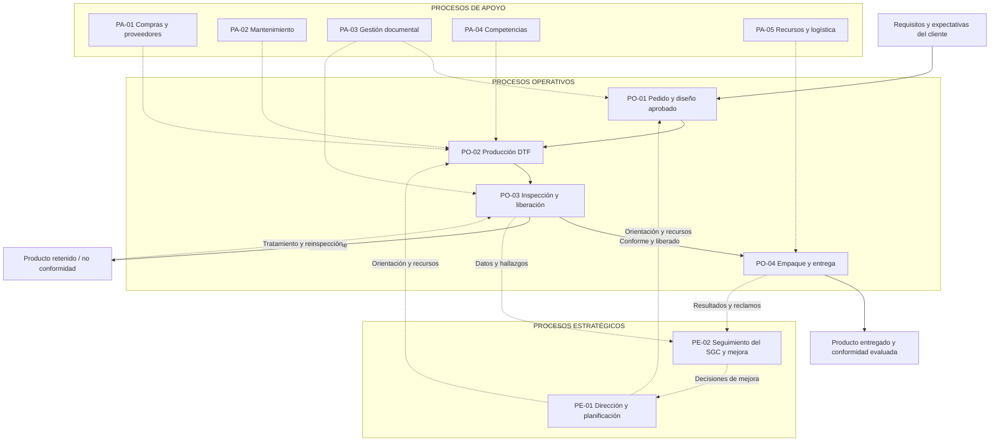

# DOC-QP-006 — Procesos de la empresa y mapa de procesos

| Campo | Información |
|---|---|
| Proyecto | QualityPrint — Sistema de Gestión de Calidad |
| Código documental | DOC-QP-006 |
| Etapa | 2. Documentación de la empresa y del SGC |
| Apartado | 2.4. Procesos de la empresa |
| Versión | 0.1 |
| Fecha | 10 de noviembre de 2026 |
| Estado | **Borrador para revisión y aprobación** |
| Organización | **QualityPrint, empresa ficticia** |
| Responsable propuesto | Gerencia general, con apoyo de Control de calidad |

> **Nota:** este documento describe un modelo propuesto para una empresa simulada con cinco trabajadores y una impresora DTF. Sus procesos, responsables y registros no son evidencia de operación real ni de certificación de un SGC.

## 1. Objetivo y alcance del documento

Identificar y organizar los procesos estratégicos, operativos y de apoyo de QualityPrint; representar sus interacciones mediante un mapa; definir entradas, salidas y responsables; y dejar bases para los procedimientos, indicadores y módulos de software futuros.

**Documentos de referencia internos:**
- [DOC-QP-003 — Información general](DOC-QP-003_informacion_general_empresa.md).
- [DOC-QP-004 — Direccionamiento estratégico](DOC-QP-004_direccionamiento_estrategico.md).
- [DOC-QP-005 — Contexto y alcance del SGC](DOC-QP-005_contexto_de_la_organizacion.md).
- [ROADMAP general](../../ROADMAP_QUALITYPRINT.md).

### 1.1. Criterios de diseño
- Producción **bajo pedido** y método DTF como único proceso de estampado inicial.
- Cinco funciones principales: gerencia, comercial/diseño, operación DTF, calidad y administración/logística.
- Los **procesos** no equivalen a personas ni a módulos de software.
- Toda orden debe poder rastrearse desde los requisitos aprobados hasta la decisión de inspección y la entrega.
- Los controles físicos y operativos no se automatizan solo por registrar datos en el software.

---

## 2.4.1. Identificar procesos estratégicos

Los procesos estratégicos establecen la dirección, recursos y criterios para controlar y mejorar la calidad.

| Código | Proceso | Finalidad | Actividades principales | Resultado esperado |
|---|---|---|---|---|
| PE-01 | Dirección y planificación | Determinar prioridades y compromisos | Revisar necesidades, aprobar política, objetivos y recursos | Objetivos y decisiones documentadas |
| PE-02 | Seguimiento del SGC y mejora | Evaluar desempeño y promover correcciones | Analizar indicadores, reclamaciones, no conformidades y eficacia de acciones | Decisiones de mejora y seguimiento |

### 2.4.1.1. Interacción con otros procesos
PE-01 proporciona recursos y lineamientos a operación y apoyo. PE-02 recibe datos de inspecciones, entregas y problemas; sus decisiones pueden modificar procedimientos, capacitación, mantenimiento o planificación.

### 2.4.1.2. Evidencias previstas
Política aprobada, objetivos de calidad, revisión de indicadores, decisiones de recursos y registro de acciones de mejora.

---

## 2.4.2. Identificar procesos operativos

Estos procesos transforman los requisitos del cliente en productos personalizados entregados.

| Código | Proceso | Actividades comprendidas | Salida principal | Control de calidad |
|---|---|---|---|---|
| PO-01 | Gestión del pedido y del diseño | Recibir requisitos, confirmar prendas, cantidades y fecha; preparar/revisar diseño; registrar aprobación | Pedido y diseño aprobados | No producir sin especificaciones y aceptación documentadas |
| PO-02 | Preparación y producción DTF | Comprobar insumos y equipo; imprimir film; aplicar adhesivo; curar; transferir y realizar acabado | Lote de prendas estampadas identificado | Registrar materiales, lote, parámetros validados e incidencias |
| PO-03 | Inspección y liberación | Inspeccionar, identificar defectos, decidir aprobación/retención/rechazo y registrar resultado | Lote liberado o retenido con evidencia | No entregar sin decisión de liberación documentada |
| PO-04 | Empaque y entrega | Confirmar cantidades, empacar y despachar pedidos liberados | Pedido entregado con registro | Verificar correspondencia entre pedido, prendas y cantidad |

### 2.4.2.1. Secuencia general
**Solicitud → Pedido y diseño aprobados → Producción DTF → Inspección y decisión → Empaque y entrega.**

### 2.4.2.2. Flujo ante un producto no conforme
Si la inspección detecta una no conformidad, la unidad o lote se identifica y **se retiene** mientras Calidad define el tratamiento según el procedimiento correspondiente. Solo después de corrección, reinspección y liberación autorizada puede volver al flujo de entrega. La decisión de desechar o rechazar también queda registrada.

### 2.4.2.3. Trazabilidad mínima
Para el prototipo se propone relacionar los registros con las claves conceptuales **ID de pedido**, **versión/aprobación del diseño**, **ID de lote**, **ID de inspección**, **ID de no conformidad** cuando corresponda y **registro de entrega**. El modelo formal de datos se diseñará en la etapa 4.

---

## 2.4.3. Identificar procesos de apoyo

Los procesos de apoyo aportan recursos y controles necesarios para sostener la operación.

| Código | Proceso | Propósito | Evidencias previstas |
|---|---|---|---|
| PA-01 | Compras y control de proveedores | Asegurar la obtención y recepción de prendas, tintas, film y polvo adecuados | Pedido a proveedor, ficha técnica y registro de recepción |
| PA-02 | Mantenimiento de equipos | Mantener disponible la impresora DTF y sus equipos auxiliares | Plan preventivo y registros de intervención |
| PA-03 | Gestión documental y registros | Controlar versiones, aprobaciones, conservación y disponibilidad de documentos | Lista maestra y documentos vigentes |
| PA-04 | Competencia y capacitación | Definir habilidades requeridas y evidenciar preparación del personal | Matriz de competencias y capacitaciones |
| PA-05 | Gestión de recursos y logística interna | Coordinar materiales, equipos de apoyo y condiciones para trabajar | Registros de insumos, necesidades y despacho interno |

### 2.4.3.1. Consideración para una empresa pequeña
Los procesos de apoyo **no requieren departamentos separados**. Las responsabilidades pueden acumularse en cargos existentes si se define quién registra, quién revisa y quién autoriza.

### 2.4.3.2. Relación con las no conformidades
El tratamiento de no conformidades y acciones correctivas se gestiona de forma **transversal** entre PO-03 y PE-02, con apoyo de otros procesos según la causa. No se excluye por no tener un departamento independiente.

---

## 2.4.4. Elaborar el mapa de procesos

### 2.4.4.1. Mapa general propuesto

Diagrama Mermaid compatible con la visualización de GitHub:



**Interpretación:** las líneas continuas representan la secuencia operativa y las discontinuas los apoyos y la retroalimentación. La inspección controla la liberación; una unidad retenida no debe avanzar directamente a entrega.

### 2.4.4.2. Mapa simplificado de valor

```text
Cliente solicita
      ↓
PO-01 Pedido y aprobación de diseño
      ↓
PO-02 Producción DTF
      ↓
PO-03 Inspección y liberación ─── NO CONFORME → Retención / tratamiento
      ↓ CONFORME
PO-04 Empaque y entrega
      ↓
Cliente recibe el pedido

PE-01 y PE-02: dirección, seguimiento y mejora (transversales)
PA-01 a PA-05: recursos y soporte (transversales)
```

### 2.4.4.3. Alcance del mapa
Se representa una sola operación ficticia de estampado DTF. No se añaden serigrafía, bordado, sublimación, fábricas textiles ni otros procesos no comprendidos en el alcance aprobado.

---

## 2.4.5. Describir las entradas y salidas de cada proceso

### 2.4.5.1. Matriz de interacción (caracterización resumida)

| Código | Entradas principales | Actividades clave | Salidas principales | Destinatario / proceso siguiente |
|---|---|---|---|---|
| PE-01 | Contexto, requisitos, indicadores | Definir objetivos, prioridades y recursos | Política, objetivos, asignaciones | Todos los procesos |
| PE-02 | Resultados de calidad, reclamos, indicadores | Evaluar desempeño y acciones | Revisiones y mejoras definidas | PE-01, procesos afectados |
| PO-01 | Solicitud, diseño, cantidad, tallas y fecha | Revisar y aprobar pedido/diseño | Pedido aprobado y versión de diseño | PO-02 |
| PO-02 | Pedido, arte aprobado, equipo e insumos | Preparación, impresión DTF y transferencia | Lote estampado con registro | PO-03 |
| PO-03 | Lote, criterios de inspección, orden aprobada | Inspeccionar, clasificar, retener o liberar | Resultado, liberación o no conformidad | PO-04, PE-02 |
| PO-04 | Lote liberado, pedido y datos de entrega | Verificar cantidades, empacar, entregar | Pedido despachado y evidencia | Cliente, PE-02 |
| PA-01 | Necesidad de insumos, especificaciones | Seleccionar, comprar y recibir | Insumos verificados | PO-02 |
| PA-02 | Plan y necesidades del equipo | Verificar, mantener y registrar | Equipo mantenido y registro | PO-02 |
| PA-03 | Documentos y cambios propuestos | Codificar, revisar, aprobar y conservar | Información documentada vigente | Todos los procesos |
| PA-04 | Necesidades de competencia | Capacitar y verificar aprendizaje | Competencias y registros | Todos los procesos |
| PA-05 | Necesidades operativas y de materiales | Coordinar insumos y logística interna | Recursos disponibles y registros | PO-02, PO-04 |

### 2.4.5.2. Puntos de control e información documentada

| Punto | Criterio de control propuesto | Evidencia a conservar |
|---|---|---|
| Antes de producir | Pedido completo y arte aprobado | Orden, diseño y aceptación |
| Antes y durante impresión | Insumos adecuados y parámetros validados | Ficha de materiales, lote y registro de producción |
| Antes de entregar | Inspección final y liberación | Registro de inspección y decisión |
| Frente a defectos | Identificación, retención, disposición y reinspección cuando aplique | Registro de no conformidad y acción |
| Después de entrega | Registro y atención de observaciones | Entrega y reclamaciones si existen |

No se proponen temperaturas, presiones o tiempos universales para DTF. Se documentarán y validarán con materiales y equipos concretos en el apartado 2.5 y en los procedimientos.

### 2.4.5.3. Ejemplo ficticio de trazabilidad

```text
Pedido QP-0001
  └─ Diseño aprobado V1
     └─ Lote L-DTF-0001
        └─ Inspección INS-0001
           ├─ Unidades conformes: liberadas
           └─ Unidades no conformes → NC-0001
              └─ Tratamiento / reinspección → decisión final
```

Los identificadores son **ejemplos**, no registros reales y no definen todavía el esquema definitivo de base de datos.

---

## 2.4.6. Definir responsables de los procesos

### 2.4.6.1. Matriz de responsables

| Proceso | Responsable principal | Apoyo o consulta | Autoridad o decisión relevante |
|---|---|---|---|
| PE-01 Dirección y planificación | Gerencia | Calidad y demás roles | Aprobar objetivos y recursos |
| PE-02 Seguimiento y mejora | Gerencia | Calidad | Priorizar decisiones y evaluar acciones |
| PO-01 Pedidos y diseño | Comercial y diseño | Gerencia, operación DTF | Confirmar requisitos y conservar aprobación del cliente |
| PO-02 Producción DTF | Operación DTF | Calidad, administración | Ejecutar la producción según instrucciones validadas |
| PO-03 Inspección y liberación | Control de calidad | Operador y gerencia en excepciones | Decidir liberación/retención según criterios aprobados |
| PO-04 Empaque y entrega | Administración y logística | Comercial y calidad | Despachar únicamente pedidos liberados |
| PA-01 Compras y proveedores | Administración y logística | Operación y gerencia | Compras dentro de límites autorizados |
| PA-02 Mantenimiento | Operación DTF | Gerencia y proveedor de servicio | Solicitar intervención y documentar ejecución |
| PA-03 Gestión documental | Control de calidad | Gerencia | Controlar documentos; gerencia aprueba documentos clave |
| PA-04 Competencia y capacitación | Gerencia | Todos los cargos | Definir y autorizar formación |
| PA-05 Recursos y logística interna | Administración y logística | Operación DTF y gerencia | Coordinar disponibilidad y suministros |

### 2.4.6.2. Autoridad para detener y liberar
- **Detener/identificar:** el operador o cualquier trabajador que observe un defecto debe informarlo; Calidad define la retención documentada.
- **Liberar para empaque:** el responsable de Calidad valida los criterios de inspección y autoriza la liberación según reglas definidas.
- **Gestionar excepciones:** Gerencia revisa condiciones contractuales o decisiones que excedan la autoridad de Calidad, sin anular requisitos del cliente ni obligaciones aplicables.

### 2.4.6.3. Suplencias
En una empresa de cinco personas puede haber ausencia de titulares. Antes de operar se deberán asignar suplencias competentes y documentar quién ejecutó, revisó y autorizó una actividad. Una persona que realizó un trabajo no debería ser su única revisora final cuando sea viable separar funciones.

---

## 3. Relación con la aplicación QualityPrint-SGC

La información de procesos se traducirá a requisitos del software en etapas posteriores:

| Proceso | Función prevista de la aplicación |
|---|---|
| PO-01 | Clientes, pedidos, requisitos y diseños aprobados |
| PO-02 | Registro de lotes, materiales, responsables e incidencias |
| PO-03 | Inspecciones, decisiones de calidad y no conformidades |
| PO-04 | Consulta de pedidos liberados y estado de entrega (alcance a precisar en requisitos) |
| PE-02 | Dashboard con indicadores y seguimiento de acciones |
| PA-03 | Control documental avanzado (fase posterior al MVP) |

La aplicación no sustituye máquinas, inspecciones físicas ni obligaciones de la empresa. El **MVP** cubrirá inicialmente pedidos, lotes, inspecciones, no conformidades e indicadores; algunas funciones de apoyo quedarán para versiones posteriores.

## 4. Verificación antes de aprobar

- [ ] **2.4.1.** Identificar procesos estratégicos.
- [ ] **2.4.2.** Identificar procesos operativos.
- [ ] **2.4.3.** Identificar procesos de apoyo.
- [ ] **2.4.4.** Elaborar el mapa de procesos.
- [ ] **2.4.5.** Describir entradas y salidas de cada proceso.
- [ ] **2.4.6.** Definir responsables de los procesos.

**Criterios para aprobación:**
1. Los procesos son coherentes con cinco trabajadores y una impresora DTF.
2. El mapa diferencia dirección, operación y apoyo.
3. La secuencia incluye aprobación del diseño, inspección y decisión de liberación.
4. Las entradas y salidas son útiles para construir la trazabilidad del software.
5. Los responsables corresponden al organigrama aprobado (DOC-QP-003).
6. Las tareas no documentadas todavía se identifican como propuestas, no como hechos.

## 5. Control de cambios

| Versión | Fecha | Modificación | Estado |
|---|---|---|---|
| 0.1 | 10/11/2026 | Redacción de apartados 2.4.1 a 2.4.6 y mapa de procesos | Borrador |

**Siguiente actividad, después de la aprobación:** **2.5. Proceso de producción DTF**, en un documento independiente.
