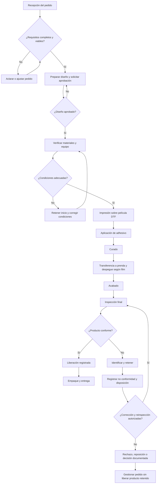

# DOC-QP-007 — Descripción del proceso de producción DTF

| Campo | Información |
|---|---|
| Proyecto | QualityPrint — Sistema de Gestión de Calidad (SGC) |
| Código documental | DOC-QP-007 |
| Etapa | 2. Documentación de la empresa y del SGC |
| Apartado | 2.5. Proceso de producción DTF |
| Versión | 1.0 |
| Fecha de elaboración | 10 de noviembre de 2026 |
| Estado | **Aprobado para el caso de estudio** |
| Empresa | **QualityPrint, empresa ficticia** |
| Responsables propuestos | Comercial y diseño, operador DTF, control de calidad y logística |
| Equipo productivo previsto | Una impresora DTF y equipos auxiliares |

> **Carácter académico:** este documento modela un proceso para fines de aprendizaje y portafolio, no representa operaciones reales ni una certificación. Es una **descripción de proceso**, no una instrucción técnica validada para una máquina determinada. Los procedimientos específicos y formatos controlados se desarrollarán en el apartado **2.8**.

## 1. Objetivo

Describir la secuencia de trabajo para convertir un pedido de estampado en un producto textil personalizado mediante impresión DTF (*Direct to Film*), definiendo responsabilidades, entradas, salidas, controles, puntos de decisión y registros que posteriormente podrá gestionar la aplicación QualityPrint-SGC.

## 2. Alcance

Comienza con la recepción y revisión del pedido, sigue con la aprobación del diseño, la preparación de materiales, la impresión del film, la aplicación y curado del adhesivo, la transferencia a la prenda, el acabado y la inspección, y finaliza con el empaque y la entrega autorizada. Comprende pedidos de camisetas, sudaderas y uniformes compatibles con los insumos seleccionados.

Quedan fuera de este proceso los servicios no definidos en el alcance inicial, como bordado, serigrafía y sublimación.

**Documentos vinculados:** [DOC-QP-003 — Información general](DOC-QP-003_informacion_general_empresa.md), [DOC-QP-004 — Direccionamiento estratégico](DOC-QP-004_direccionamiento_estrategico.md), [DOC-QP-005 — Contexto y alcance](DOC-QP-005_contexto_de_la_organizacion.md), [DOC-QP-006 — Mapa de procesos](DOC-QP-006_procesos_y_mapa_de_procesos.md) y [ROADMAP](../../ROADMAP_QUALITYPRINT.md).

## 3. Reglas generales de calidad, seguridad y trazabilidad

1. **No comenzar la producción sin la aprobación del diseño y del pedido.** Registrar quién aprobó, qué versión de diseño y en qué fecha.
2. **Identificar el lote de producción.** Relacionarlo con pedido, cantidades, prendas, equipo, materiales e inspector.
3. **Verificar compatibilidad.** Las instrucciones para tinta, película PET, adhesivo, textil y equipos deben ser consistentes entre sí; consultar al proveedor ante dudas.
4. **No improvisar parámetros universales.** La resolución y modo de impresión, cantidad de polvo, curado, temperatura, tiempo, presión, reposo/despegue y posible prensado final deberán documentarse por combinación de insumos, equipo y prenda, usando instrucciones del fabricante/proveedor y pruebas propias.
5. **Controlar la exposición a polvo, vapores y calor.** Consultar las fichas de datos de seguridad (SDS) de los insumos concretos, utilizar ventilación/extracción apropiada, EPP definido a partir del riesgo y medidas para evitar quemaduras o contacto con partes móviles; el personal no interviene equipos en movimiento o calientes sin un procedimiento seguro.
6. **Mantener el polvo fuera de la impresora.** Destinar un área de aplicación alejada de la impresora de acuerdo con el manual del equipo y gestionar adecuadamente los residuos.
7. **No liberar productos retenidos.** Cualquier defecto detectado debe registrarse, aislarse y tratarse antes de la decisión final de calidad.
8. **Registros de simulación.** No incluir en GitHub datos personales reales, números de lote reales inventados como evidencia empresarial, ni afirmar que se alcanzaron metas de producción.

## 4. Responsables

| Rol | Función en el proceso |
|---|---|
| Comercial y diseño | Recibir requisitos, preparar/revisar arte y conservar aprobación del cliente |
| Operador DTF | Revisar materiales y equipo, ejecutar la producción y registrar controles en proceso |
| Control de calidad | Verificar criterios, registrar inspección y autorizar liberación/retención |
| Administración y logística | Preparar empaque y despachar solamente lo liberado |
| Gerencia general | Aprobar recursos, resolver excepciones y revisar incidencias o desviaciones relevantes |

Se separará la inspección final de la operación DTF cuando sea viable con el equipo de cinco personas.

---

## 2.5.1. Recepción del pedido

### 2.5.1.1. Entrada
Solicitud del cliente con tipo de prenda, tejido conocido, tallas, colores, cantidades, ubicación/tamaño de estampado, archivo de arte o idea de diseño, fecha solicitada y datos de contacto **ficticios**.

### 2.5.1.2. Actividades
1. Crear un identificador de pedido.
2. Registrar detalles y aclarar información faltante.
3. Evaluar la factibilidad inicial del diseño y la compatibilidad del soporte textil con el proceso DTF.
4. Verificar disponibilidad de materiales, capacidad y fecha ofrecida.
5. Confirmar las condiciones acordadas y el estado del pedido antes de aprobarlo.

### 2.5.1.3. Control y salida
**Control:** pedido completo, sin ambigüedad de cantidad, talla o diseño.  
**Salida:** pedido documentado y listo para revisión del arte.  
**Responsable:** Comercial y diseño.  
**Registro previsto:** F-QP-001 (pedido); el formato se elaborará en 2.8.

---

## 2.5.2. Preparación y aprobación del diseño

### 2.5.2.1. Entrada
Pedido registrado, arte proporcionado por el cliente o indicaciones de diseño.

### 2.5.2.2. Actividades
1. Preparar el archivo gráfico con el formato, tamaño, resolución y perfil requeridos por el flujo de impresión y el RIP elegidos.
2. Confirmar ortografía, dimensiones, orientación, colores de referencia y ubicación del diseño en la prenda.
3. Previsualizar o producir una muestra digital del diseño y dejar identificada su **versión**.
4. Enviar la propuesta al cliente para aprobación.
5. Guardar fecha, versión y evidencia de aprobación o solicitud de cambios.
6. Transferir a producción únicamente la versión aprobada; documentar las modificaciones posteriores.

### 2.5.2.3. Control y salida
**Control:** arte aprobado y vinculado al pedido. La conversión o inversión necesaria para imprimir sobre película se realizará conforme a las instrucciones del RIP y la impresora seleccionados; no invertir de nuevo un archivo ya preparado.  
**Salida:** arte liberado para impresión con versión identificable.  
**Responsable:** Comercial y diseño.  
**Registro previsto:** pedido, versión de archivo, aprobación.

---

## 2.5.3. Verificación de materiales

### 2.5.3.1. Entrada
Pedido y arte aprobados, especificaciones técnicas de los insumos, prendas y equipo de trabajo.

### 2.5.3.2. Materiales y equipos a comprobar

| Elemento | Verificación propuesta | Evidencia |
|---|---|---|
| Prendas | Tejido, talla, color, cantidad, limpieza y compatibilidad | Lista de verificación de materiales |
| Film PET DTF | Tipo, cara de impresión, integridad y recomendación de despegue | Referencia/identificación de insumo |
| Tintas DTF | Compatibilidad, condición, identificación y manejo según fabricante | Referencia de tinta / verificación |
| Polvo adhesivo | Tipo compatible, estado de conservación, SDS y controles de exposición | Referencia de insumo / SDS |
| Impresora | Estado operativo y controles previos según manual | Lista de inspección del equipo |
| Equipo de curado y prensa | Disponibilidad y condiciones de operación segura | Lista de verificación |
| Software RIP y archivo | Trabajo correcto, modo y configuración aprobados | Referencia de trabajo |

### 2.5.3.3. Actividades
1. Comprobar coincidencia entre pedido, diseño y prendas disponibles.
2. Verificar estado, trazabilidad y compatibilidad de insumos.
3. Revisar instrucciones de seguridad y condiciones de ventilación/extracción.
4. Comprobar condiciones básicas del equipo según sus manuales.
5. Registrar desviaciones y no iniciar la producción si un material o condición crítica es inadecuada.

### 2.5.3.4. Control y salida
**Control:** materiales y equipos aptos para trabajar con seguridad.  
**Salida:** lote preparado y liberado para impresión.  
**Responsable:** Operador DTF, con apoyo de Administración y logística.  
**Registro previsto:** F-QP-002 (verificación de materiales).

---

## 2.5.4. Impresión DTF

### 2.5.4.1. Entrada
Archivo aprobado y preparado para el equipo seleccionado, película DTF, tintas y orden de producción.

### 2.5.4.2. Actividades
1. Abrir el archivo aprobado en el flujo RIP de la impresora.
2. Confirmar dimensiones, disposición de imagen, orientación, cobertura de blanco y ajustes aplicables.
3. Preparar/cargar la película conforme al manual del equipo.
4. Realizar las comprobaciones de impresión requeridas por el fabricante, sin introducir intervenciones inseguras.
5. Iniciar la impresión sobre película y observar la continuidad del proceso.
6. Identificar el trabajo impreso y registrar parámetros realmente utilizados e incidencias.

### 2.5.4.3. Control y salida
**Control:** correspondencia con diseño aprobado, imagen completa, ausencia de bandas evidentes, manchas y fallos visibles. Los criterios cuantitativos se definirán en el procedimiento técnico.  
**Salida:** film impreso identificado.  
**Responsable:** Operador DTF.  
**Registro previsto:** F-QP-003 (registro de producción).

---

## 2.5.5. Aplicación del polvo adhesivo

### 2.5.5.1. Entrada
Film recién impreso, polvo compatible y estación de aplicación preparada.

### 2.5.5.2. Actividades
1. Llevar el film al área destinada a aplicar adhesivo, siguiendo las medidas de seguridad del equipo.
2. Aplicar el polvo de forma que cubra las áreas impresas que deben recibir adhesivo, según las instrucciones de los materiales.
3. Retirar el exceso de adhesivo con el método seguro previsto.
4. Verificar que no queden acumulaciones, zonas sin cobertura o polvo no deseado fuera del diseño.
5. Registrar la referencia del polvo y cualquier desviación.

### 2.5.5.3. Control y seguridad
**Control:** cobertura y distribución consistentes, sin contaminación del área de impresión.  
**Seguridad:** mantener el polvo alejado de la impresora; aplicar la ventilación/extracción y el EPP indicados por la SDS y la evaluación del puesto. Evitar dispersar el polvo mediante técnicas no aprobadas.  
**Salida:** película con adhesivo lista para curado.  
**Responsable:** Operador DTF.  
**Registro previsto:** registro de producción y control de insumos.

---

## 2.5.6. Curado del adhesivo

### 2.5.6.1. Entrada
Film con adhesivo aplicado y equipo de curado disponible.

### 2.5.6.2. Actividades
1. Consultar el procedimiento específico de la película, tinta, adhesivo y equipo de curado seleccionados.
2. Verificar el estado del sistema de curado, controles térmicos y extracción requerida.
3. Aplicar **temperatura y tiempo validados** para la combinación de materiales y equipo; registrar valores reales o indicaciones del control.
4. Comprobar visualmente el resultado según las instrucciones del proveedor.
5. Identificar y separar los films con signos de curado insuficiente, daño o contaminación.

### 2.5.6.3. Control y salida
**Control:** adhesivo curado según criterios de aceptación definidos para el sistema concreto.  
**Salida:** transferencia preparada para aplicar a la prenda.  
**Responsable:** Operador DTF.  
**Registro previsto:** parámetros de curado, equipo, fecha e incidencias.

**Precaución técnica:** no se fija en este documento una temperatura o duración universal; incluso las referencias de fabricantes pueden variar por film, polvo, tinta y equipo.

---

## 2.5.7. Transferencia mediante prensa térmica

### 2.5.7.1. Entrada
Transferencia curada, prendas verificadas, prensa térmica y especificaciones de ubicación.

### 2.5.7.2. Actividades
1. Revisar que la prenda sea compatible y no presente defectos previos.
2. Preparar la superficie de estampado según el tejido y las instrucciones técnicas (por ejemplo, retirar pelusa o humedad cuando corresponda).
3. Ubicar el diseño según la aprobación del cliente.
4. Configurar y verificar los valores de **temperatura, tiempo y presión específicos** para la combinación de película, adhesivo, textil y prensa.
5. Realizar la transferencia de acuerdo con el procedimiento aprobado.
6. Retirar la película según las instrucciones del proveedor: **hot peel, warm peel o cold peel**, según el film. No elegir el método de despegue arbitrariamente.
7. Realizar un prensado adicional **solo si la ficha técnica aplicable lo exige o una prueba validada lo justifica**.
8. Registrar parámetros, lote, cantidad producida e incidencias.

### 2.5.7.3. Control y seguridad
**Control:** alineación, integridad, adherencia inicial y ausencia de quemaduras o daños en la tela.  
**Seguridad:** identificar zonas calientes, evitar contactos con placas y usar elementos de protección compatibles con la tarea.  
**Salida:** prendas estampadas, pendientes de acabado e inspección.  
**Responsable:** Operador DTF.  
**Registro previsto:** parámetros de transferencia y resultado del lote.

---

## 2.5.8. Acabado final

### 2.5.8.1. Entrada
Prendas estampadas tras la transferencia y despegue del film.

### 2.5.8.2. Actividades
1. Dejar enfriar o estabilizar las prendas cuando lo indique el material utilizado.
2. Revisar presencia de residuos, arrugas, hilos sueltos y marcas.
3. Realizar tareas sencillas de presentación o limpieza que no dañen la impresión.
4. Separar unidades sospechosas de defecto para su inspección.
5. Identificar la cantidad preparada y mantener la correspondencia con el pedido/lote.

### 2.5.8.3. Control y salida
**Control:** presentación limpia y estampado sin deterioro evidente durante el acabado.  
**Salida:** prendas listas para inspección final.  
**Responsable:** Operador DTF y apoyo de logística cuando corresponda.  
**Registro previsto:** cantidad preparada e incidencias.

---

## 2.5.9. Inspección del producto

### 2.5.9.1. Entrada
Prendas acabadas, requisitos del pedido, diseño aprobado y criterios de inspección.

### 2.5.9.2. Actividades
1. Verificar identificación del pedido y del lote.
2. Comparar el estampado con el arte aprobado: contenido, tamaño, posición, orientación y presentación.
3. Revisar defectos visibles: impresión incompleta, manchas, mala alineación, bordes levantados, adhesión deficiente evidente, daño de tela y otras fallas definidas en el procedimiento.
4. Registrar cantidad inspeccionada y **unidades distintas defectuosas** para evitar dobles conteos en el indicador IND-01.
5. Clasificar cada unidad como conforme, retenida o rechazada; registrar defectos y acciones necesarias.
6. Cuando haya no conformidades, identificar/retener las unidades afectadas y gestionar la disposición.
7. Reinspeccionar cuando se realice una corrección aplicable.
8. Registrar la **decisión de liberación** y al responsable que la autoriza.

### 2.5.9.3. Control y salida
**Control:** inspección final documentada sobre los pedidos finalizados, con criterios definidos y trazabilidad de decisiones.  
**Salida:** producto liberado para entrega o producto retenido para tratamiento.  
**Responsable:** Control de calidad, preferentemente distinto del operador.  
**Registro previsto:** F-QP-004 (inspección final), F-QP-005 (no conformidad), formatos por crear en 2.8.

**Nota:** no se incluyen pruebas destructivas o de lavado por defecto en cada unidad. Los métodos, frecuencia y criterios de pruebas adicionales se decidirán al diseñar el procedimiento de inspección.

---

## 2.5.10. Empaque y entrega

### 2.5.10.1. Entrada
Únicamente prendas **liberadas por Control de calidad**, pedido y datos de entrega.

### 2.5.10.2. Actividades
1. Verificar la liberación del pedido, cantidades, tallas y referencias.
2. Empacar con materiales apropiados para evitar manchas, humedad o daño durante el transporte.
3. Etiquetar el paquete con la identificación de pedido correspondiente y datos de entrega ficticios.
4. Registrar fecha de despacho, responsable y cantidad enviada.
5. Confirmar la entrega según el canal acordado y registrar observaciones del cliente.

### 2.5.10.3. Control y salida
**Control:** ninguna unidad retenida se incluye en el despacho. La cantidad entregada coincide con la orden o con una entrega parcial expresamente autorizada y registrada.  
**Salida:** pedido entregado y trazabilidad del despacho.  
**Responsable:** Administración y logística, con consulta a Comercial y diseño.  
**Registro previsto:** entrega/despacho y actualización del estado del pedido.

---

## 5. Diagrama de flujo operativo y decisiones

### 5.1. Puntos de detención obligatorios
- **Antes de imprimir:** pedido y arte aprobados y materiales compatibles.
- **Antes de transferir:** film y adhesivo preparados mediante un proceso conforme.
- **Antes de entregar:** inspección y decisión de liberación documentadas.
- **Ante una no conformidad:** retener, registrar, resolver y verificar antes de liberar.

---

## 6. Matriz de control de calidad por etapa

| Paso | Posible defecto/falla | Control mínimo propuesto | Responsable | Evidencia |
|---|---|---|---|---|
| 2.5.1 Pedido | Información incompleta | Verificación de requisitos y cantidades | Comercial/diseño | Pedido |
| 2.5.2 Diseño | Arte incorrecto o no aprobado | Registro de aprobación y versión | Comercial/diseño | Archivo y aceptación |
| 2.5.3 Materiales | Prenda/film/tinta/polvo incompatibles | Lista de materiales y fichas técnicas | Operador | Verificación |
| 2.5.4 Impresión | Bandas, errores de imagen, manchas | Revisión de película y parámetros | Operador | Producción |
| 2.5.5 Adhesivo | Cobertura irregular o exceso | Inspección de distribución y retiro seguro de exceso | Operador | Producción |
| 2.5.6 Curado | Adhesivo insuficientemente curado | Verificación frente a instrucciones validadas | Operador | Parámetros |
| 2.5.7 Transferencia | Mala posición, daño del tejido, bordes levantados | Posicionamiento, parámetros y despegue correctos | Operador | Producción |
| 2.5.8 Acabado | Residuos o daño de presentación | Revisión visual y separación de sospechas | Operador | Incidencias |
| 2.5.9 Inspección | Producto no conforme liberado | Criterios, decisión y retención documentada | Calidad | Inspección/NC |
| 2.5.10 Entrega | Pedido incorrecto o incompleto | Lista de empaque y evidencia de liberación | Logística | Despacho |

---

## 7. Registro mínimo que necesitará el software

**Esta sección es una orientación de negocio**; las entidades, tipos de datos, pantallas y reglas se definirán formalmente en etapas 3 y 4.

| Registro | Campos conceptuales mínimos |
|---|---|
| Pedido | ID, cliente ficticio, fecha, producto, tallas, cantidad, fecha acordada, estado |
| Aprobación del diseño | ID de pedido, versión de archivo, fecha, responsable y evidencia de aprobación |
| Lote de producción | ID de lote, pedido, fecha, operador, cantidad planificada y producida |
| Materiales | Referencia de prenda, film, tinta y polvo; lotes de insumos cuando proceda |
| Impresión y curado | Referencia del equipo, instrucciones validadas, parámetros utilizados y observaciones |
| Transferencia | Prenda/tejido, film, presión, temperatura, tiempo, método de despegue y, si procede, prensado final |
| Inspección | ID, pedido/lote, fecha, inspector, unidades revisadas, resultado, cantidades y liberación |
| No conformidad | ID, referencia de unidad/lote, defecto, cantidad afectada, estado, decisión, seguimiento |
| Entrega | ID de pedido, cantidad, fecha de despacho/entrega, responsable y estado |

### 7.1. Estados conceptuales del flujo
Un pedido puede pasar por **registrado → pendiente de aprobación → aprobado → en producción → en inspección → liberado → entregado**, con estados de **retenido/no conforme** y **cancelado** cuando apliquen. Las reglas exactas de transición y permisos se revisarán en la etapa 3.

---

## 8. Ficha técnica pendiente de validación (plantilla, no parámetros reales)

**No utilizar esta tabla para operar una prensa o una impresora.** Primero deben existir equipos, insumos y manuales concretos con condiciones verificadas.

| Campo de control | Dato a definir antes de operar |
|---|---|
| Referencia de impresora y RIP | Por especificar |
| Modelo de sistema de curado | Por especificar |
| Modelo de prensa térmica | Por especificar |
| Marca/referencia de tinta DTF | Por especificar |
| Film PET y tipo de despegue | Por especificar |
| Polvo adhesivo y SDS | Por especificar |
| Composición y comportamiento del tejido | Por especificar |
| Ajustes de impresión y capa blanca | Según RIP, impresora y validación |
| Método, temperatura y tiempo de curado | Según combinación equipo/materiales validada |
| Temperatura, tiempo y presión de transferencia | Según combinación prensa/tejido/materiales validada |
| Momento de despegue y prensado adicional | Según instrucciones del film y pruebas validadas |
| Límites de aceptación, pruebas y registro | A definir en procedimiento de producción e inspección |
| Requisitos de ventilación y EPP | Según SDS, fabricante y evaluación de riesgos del puesto |

---

## 9. Fuentes técnicas para consultar al definir el procedimiento real

Estas referencias **orientan el diseño del caso académico**. No reemplazan manuales y SDS de los materiales/equipos que se seleccionen:

1. [Epson — Flujo general de diseño, impresión, polvo y aplicación de DTFilm](https://epson.com/dtg-dtf-printers-for-makers).
2. [Epson — Precauciones al imprimir sobre película](https://files.support.epson.com/docid/cpd6/cpd63670/source/pro_graphics/source/usage_notes/reference/film_safety.html).
3. [Epson — Equipo requerido para impresión sobre película](https://files.support.epson.com/docid/cpd6/cpd64429/source/pro_graphics/source/printing_computer/reference/scf1070/preparing_equipment_film_scf1070.html).
4. [Roland DG — Información de seguridad del polvo adhesivo DTF y consulta de SDS](https://dgastore.rolanddga.com/printing/direct-transfer-system-powder-1-kg-s--powder).
5. [DTF Direct — Ejemplo de recomendaciones de despegue según el tipo de película](https://dtfdirect.zendesk.com/hc/en-us/articles/12531024388367-Hot-peel-or-cold-peel).

**Importante:** al elegir una combinación distinta de producto o equipo, consultar y registrar las instrucciones técnicas de sus proveedores. No copiar valores de temperatura, presión o tiempo de un proveedor a otro sin validación.

---

## 10. Lista de validación del apartado 2.5

- [x] **2.5.1.** Recepción del pedido.
- [x] **2.5.2.** Preparación y aprobación del diseño.
- [x] **2.5.3.** Verificación de materiales.
- [x] **2.5.4.** Impresión DTF.
- [x] **2.5.5.** Aplicación del polvo adhesivo.
- [x] **2.5.6.** Curado del adhesivo.
- [x] **2.5.7.** Transferencia mediante prensa térmica.
- [x] **2.5.8.** Acabado final.
- [x] **2.5.9.** Inspección del producto.
- [x] **2.5.10.** Empaque y entrega.

### Criterios de aprobación
- Mantiene el mismo alcance del SGC: una operación DTF y cinco funciones.
- Documenta aprobación del diseño, identificación de lotes y separación de productos defectuosos.
- Distingue descripción general del proceso de instrucción técnica validada.
- Reconoce riesgos por polvo, calor y equipos y exige consultar SDS/manuales aplicables.
- Define responsables, puntos de decisión, salidas y registros.
- No atribuye datos, productividad, ensayos o parámetros a una operación real.

## 11. Control de cambios

| Versión | Fecha | Descripción | Estado |
|---|---|---|---|
| 0.1 | 10/11/2026 | Elaboración de los diez subpuntos de producción DTF, controles y registros | Borrador |
| 1.0 | 10/11/2026 | Aprobación de los diez subpuntos de 2.5 | Aprobado |

**Siguiente documento:** [DOC-QP-008 — Gestión de riesgos y oportunidades](DOC-QP-008_gestion_de_riesgos_y_oportunidades.md), borrador en revisión.
