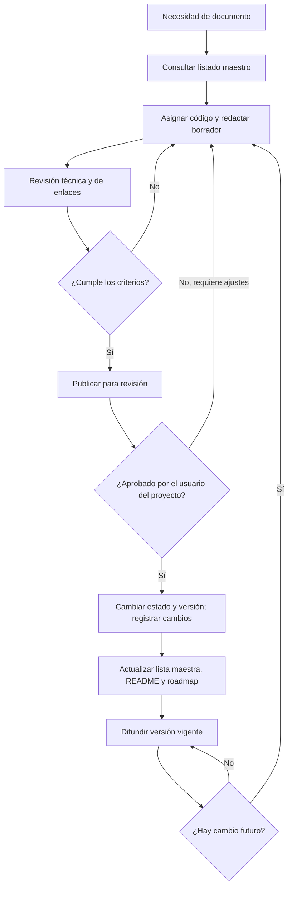

# DOC-QP-009 — Gestión documental de QualityPrint

| Campo | Información |
|---|---|
| Proyecto | QualityPrint — Sistema de Gestión de Calidad (SGC) |
| Código documental | DOC-QP-009 |
| Apartado | 2.7. Gestión documental |
| Versión | 0.1 |
| Fecha de elaboración | 10 de noviembre de 2026 |
| Estado | **Borrador para revisión y aprobación** |
| Empresa | QualityPrint (**empresa ficticia**) |
| Elaboración propuesta | Responsable de calidad |
| Revisión propuesta | Gerencia general |
| Aplicación | Documentos y registros del proyecto y del SGC simulado |

> **Nota:** esta es una propuesta de control documental para un caso académico. Las aprobaciones del proyecto reflejan validación de contenido para el portafolio, no firmas o auditorías de una empresa real. Un repositorio público no debe contener datos personales reales, contraseñas, bases de datos de clientes ni documentos internos sensibles.

## 1. Propósito, alcance y términos

Establecer cómo se **identifican, redactan, revisan, aprueban, publican, modifican, consultan y conservan** los documentos de QualityPrint. Este documento aplica a los archivos de definición del proyecto, documentación del SGC, procedimientos, formatos, registros de prueba y futuras especificaciones del software.

**Referencias internas:** [DOC-QP-003 — Organización](DOC-QP-003_informacion_general_empresa.md), [DOC-QP-005 — Alcance](DOC-QP-005_contexto_de_la_organizacion.md), [DOC-QP-006 — Mapa de procesos](DOC-QP-006_procesos_y_mapa_de_procesos.md), [DOC-QP-008 — Riesgos](DOC-QP-008_gestion_de_riesgos_y_oportunidades.md) y [ROADMAP](../../ROADMAP_QUALITYPRINT.md).

| Término | Significado dentro de este proyecto |
|---|---|
| **Documento** | Información que define una actividad, decisión o regla; puede actualizarse |
| **Registro** | Evidencia de que una actividad ocurrió dentro del escenario o prueba descrita |
| **Formato** | Plantilla aún sin diligenciar; al completarse puede producir un registro |
| **Versión vigente** | Última versión aprobada y señalada como tal en el listado maestro |
| **Borrador** | Contenido elaborado, pero pendiente de revisión/aprobación |
| **Obsoleto** | Versión sustituida que no debe utilizarse como referencia vigente |
| **Lista maestra** | Índice que relaciona código, título, versión, estado, responsable y ubicación |

**Distinción esencial:** un formato de inspección sin completar **no demuestra** que se haya inspeccionado una prenda; una matriz de riesgos simulada **no acredita** controles ejecutados.

---

## 2.7.1. Definir el sistema de codificación documental

### 2.7.1.1. Convención de códigos

Se usará el patrón **TIPO-QP-NNN** en mayúsculas, donde `QP` corresponde a QualityPrint y `NNN` es un consecutivo de tres dígitos por tipo documental.

| Tipo | Código de ejemplo | Uso previsto | Estado actual |
|---|---|---|---|
| Documento general o técnico | `DOC-QP-009` | Definición, organización, caracterizaciones, estudios y capítulos del SGC | **En uso** |
| Procedimiento formal | `PR-QP-001` | Describir responsabilidades, pasos, controles y registros de una actividad | Reservado para la etapa 2.8 |
| Formato / plantilla | `F-QP-001` | Recoger información de pedidos, inspecciones, producción o NC | Reservado para la etapa 2.8 |
| Instructivo de trabajo | `IT-QP-001` | Instrucciones técnicas detalladas para un método/equipo específico | Propuesto; no existe |
| Registro consolidado / listado controlado | `LM-QP-001` | Listado maestro de documentos | Primer listado propuesto |

**Importante:** la numeración histórica **DOC-QP-001 a DOC-QP-008** se conserva. No se renumeran archivos aprobados. Las referencias `F-QP-001`, `F-QP-002` y otras mencionadas en DOC-QP-007 son **identificadores previstos**, no formatos existentes hasta que se publiquen por separado.

### 2.7.1.2. Regla de nombres de archivos
- Nombre sugerido: `CODIGO_descripcion_en_minusculas.md`.
- Se evitarán espacios, tildes y caracteres especiales en el nombre físico; el título interior sí puede llevarlos.
- Ejemplos reales: `DOC-QP-009_gestion_documental.md` y `LM-QP-001_listado_maestro_de_documentos.md`.
- El **código documental es estable**: las nuevas versiones se guardan preferentemente en la misma ruta; Git conserva el historial.
- No reutilizar códigos anulados; los códigos nuevos se asignan consultando el listado maestro.

### 2.7.1.3. Ubicación por etapa

```text
QualityPrint/
├── README.md
├── ROADMAP_QUALITYPRINT.md
├── ETAPA_1_CHECKLIST.md
├── .gitignore
└── docs/
    ├── README.md
    ├── 01_proyecto/
    │   ├── DOC-QP-001_ficha_del_proyecto.md
    │   └── DOC-QP-002_organizacion_inicial_del_proyecto.md
    ├── 02_sgc/
    │   ├── DOC-QP-003_informacion_general_empresa.md
    │   ├── ...
    │   ├── DOC-QP-009_gestion_documental.md
    │   └── LM-QP-001_listado_maestro_de_documentos.md
    ├── 03_requisitos/
    └── 04_diseno/
```

Las carpetas de etapas futuras se organizarán cuando se produzcan documentos; no se declararán completadas por tener un archivo `README.md`.

### 2.7.1.4. Cabecera mínima de documentos controlados

Cada documento controlado llevará: **título, código, versión, fecha, estado, apartado de referencia, responsable de elaboración, responsable de revisión/aprobación y notas de alcance**. Al final incluirá una tabla de control de cambios. Si algún dato no se conoce, se escribirá **«Por definir»**, nunca una firma, fecha o validación ficticia presentada como real.

---

## 2.7.2. Definir versiones y control de cambios

### 2.7.2.1. Regla de versiones

Se empleará `M.m` (por ejemplo, `0.1`, `1.0`, `1.1`, `2.0`) como convención interna, **sin confundirla con la versión del software**.

| Versión / estado | Interpretación |
|---|---|
| `0.1`, `0.2` — Borrador | Redacción o corrección en curso; no aprobada |
| `1.0` — Aprobado | Primera versión del documento aceptada para el proyecto |
| `1.1` — Revisión menor aprobada | Cambio aclaratorio o de forma que mantiene propósito y alcance |
| `2.0` — Revisión mayor aprobada | Cambio sustancial de alcance, proceso, responsabilidad o criterio |
| **Obsoleto** | Versión anterior que no se considera vigente |

**Situación previa:** DOC-QP-001 y DOC-QP-002 ya tienen **versión 1.2**; se conservará su numeración histórica sin forzar su renombrado a `1.0`.

### 2.7.2.2. Registro de modificaciones
Cada cambio sustancial deberá actualizar:
1. Fecha, motivo y descripción del cambio.
2. Número de versión y estado actual.
3. Responsable de elaboración y de revisión.
4. Enlaces o referencias a documentos afectados.
5. Lista maestra y `ROADMAP_QUALITYPRINT.md`, cuando corresponda.
6. Un commit de GitHub con un mensaje descriptivo.

Ejemplos de commits:
- `docs(sgc): aprobar DOC-QP-009`
- `docs: corregir referencias del mapa de procesos`
- `docs: actualizar listado maestro tras publicar formato de inspección`

### 2.7.2.3. Regla de vigencia
La **versión vigente** será la última versión marcada como aprobada en la lista maestra y en la cabecera del archivo. Un borrador publicado para comentarios **no se convierte en aprobado por estar visible** en GitHub.

Si hay contradicción entre cabecera, listado maestro y roadmap se registrará una incidencia documental y se corregirán los archivos de manera coordinada.

### 2.7.2.4. Historial y obsolescencia
Git guarda versiones anteriores por commit. No será necesario duplicar archivos con sufijos como `FINAL`, `FINAL2` o `NUEVO`. Si se sustituye un documento, su entrada del listado maestro debe indicar **Obsoleto** y remitir a la nueva versión. No eliminar historial necesario para justificar decisiones del proyecto.

---

## 2.7.3. Definir responsables de elaboración y aprobación

### 2.7.3.1. Roles

| Función documental | Responsable propuesto | Actividad |
|---|---|---|
| Elaboración | Responsable del proceso o autor del proyecto | Redactar contenido y adjuntar referencias |
| Revisión técnica | Control de calidad y dueño del proceso | Comprobar consistencia, controles y requisitos |
| Aprobación del contenido | Gerencia general en la empresa simulada; **usuario del proyecto para documentación de portafolio** | Confirmar aceptación de la versión |
| Publicación / custodia | Administrador del repositorio | Publicar en GitHub, actualizar índice y lista maestra |
| Consulta y aplicación | Roles de cada proceso | Acceder únicamente a la versión vigente |
| Conservación de registros | Responsable del proceso y custodio designado | Guardar evidencia y aplicar protección de datos |

Para el caso académico, la confirmación de aprobación por el usuario **habilita marcar el documento como aprobado para el portafolio**. No equivale a una aprobación firmada por una gerencia existente.

### 2.7.3.2. Reglas de segregación
- Quien elabora puede proponer, pero no declarar sin evidencia la aprobación de otra persona.
- El administrador del repositorio puede publicar un borrador para revisión sin cambiar su estado a aprobado.
- Un documento crítico de seguridad o que incluya parámetros de DTF requiere revisión competente de los manuales, fichas y condiciones reales **antes de usarse operativamente**.
- Un registro ya cerrado no se sobrescribe silenciosamente: las correcciones deben conservar trazabilidad del valor anterior y del motivo.

### 2.7.3.3. Evidencia de aprobación
En el repositorio se conservarán **versión, estado y commit**; la confirmación del usuario en la conversación sirve como antecedente del proyecto. Si en el futuro se aplica un flujo de revisión con GitHub Pull Requests, se podrán usar sus revisiones como evidencia adicional. **No se inventan nombres de firmantes, sellos o actas reales.**

---

## 2.7.4. Crear el procedimiento de gestión documental

### 2.7.4.1. Identificación del procedimiento

**Procedimiento propuesto dentro de DOC-QP-009:** `PDOC-QP-01` como identificador interno de esta sección, **sin crear todavía un procedimiento independiente `PR-QP-###`**. Si en 2.8 o después se decide separar este procedimiento en un archivo propio, se asignará el siguiente código `PR-QP-###` libre en la lista maestra y se mantendrá un enlace desde este documento.

### 2.7.4.2. Secuencia de trabajo

| Paso | Acción | Responsable | Evidencia / criterio de salida |
|---|---|---|---|
| 1 | Detectar necesidad documental | Responsable de proceso | Solicitud o actividad del roadmap |
| 2 | Revisar lista maestra para evitar duplicados | Custodio documental | Código y propósito verificados |
| 3 | Asignar código y ubicación | Custodio documental | Código no reutilizado |
| 4 | Redactar archivo con cabecera y referencias | Elaborador | Borrador `0.x` |
| 5 | Comprobar coherencia técnica y enlaces | Revisor | Observaciones resueltas o documentadas |
| 6 | Publicar borrador para revisión | Administrador del repositorio | Archivo accesible y estado «En revisión» |
| 7 | Solicitar aprobación | Responsable del proyecto | Confirmación explícita o solicitud de ajustes |
| 8 | Registrar aprobación y versión `1.0` o posterior | Administrador/custodio | Cabecera, checklist y control de cambios actualizados |
| 9 | Actualizar lista maestra, índices y roadmap | Custodio documental | Estados y enlaces coincidentes |
| 10 | Comunicar la versión vigente | Responsable de proceso | Enlace estable, sin copias divergentes |
| 11 | Revisar y modificar cuando exista un cambio | Responsable de proceso | Nueva versión y justificación |
| 12 | Identificar versiones obsoletas y preservar historial | Custodio documental | Referencia al reemplazo e historial Git |

### 2.7.4.3. Flujograma



### 2.7.4.4. Reglas para almacenamiento, seguridad y conservación

**Documentación pública:** el repositorio alojará archivos Markdown, diagramas, ejemplos sin datos sensibles y documentos aprobados o claramente identificados como borrador. La rama `main` puede contener un borrador, pero su cabecera y la lista maestra deben expresar que aún no está vigente.

**Registros de pruebas:** se crearán con personas, pedidos y lotes enteramente **ficticios**. No publicar contraseñas, tokens, documentos de identidad reales, datos bancarios, archivos de clientes reales ni bases de datos locales. Mantener `.gitignore` y revisar el contenido antes de publicar commits.

**Conservación:** el tiempo para conservar documentos y registros del proyecto se definirá por tipo documental cuando existan obligaciones y necesidades concretas. Como **propuesta académica**, conservar versiones documentales en el historial de Git durante el proyecto y guardar evidencias de prueba solo el tiempo necesario para la demostración. **No se fija un plazo legal universal**.

**Copias de seguridad y restauración:** GitHub no reemplaza una estrategia de respaldo para datos de operación. El repositorio se podrá clonar/descargar como copia de la documentación; cuando exista una base de datos, se diseñará un respaldo separado, protegido y verificable.

**Acceso:** el repositorio es público. La edición requiere autorización de la cuenta del repositorio; las responsabilidades de acceso de la aplicación web se definirán durante las etapas de requisitos y desarrollo.

### 2.7.4.5. Tratamiento de documentos externos
Manual de la impresora, instrucciones de película, tinta, adhesivo, SDS y recomendaciones del fabricante deberán identificarse por **proveedor, nombre, edición/fecha y enlace o ubicación**, verificando vigencia antes de usarlos. No copiar íntegramente manuales protegidos ni presentar documentos genéricos como instrucciones validadas.

---

## 2.7.5. Crear el listado maestro de documentos

### 2.7.5.1. Archivo independiente para mantener el orden

El listado maestro se llevará por separado en:

**[LM-QP-001 — Listado maestro de documentos](LM-QP-001_listado_maestro_de_documentos.md)**.

Este archivo es un **registro de control documental**, no el sustituto de cada documento. Se actualizará cada vez que se cree, apruebe, revise u obsoletice un documento.

### 2.7.5.2. Campos obligatorios del listado
- Código e identificación del archivo.
- Título.
- Versión vigente o versión del borrador.
- Estado (**Aprobado**, **En revisión**, **Obsoleto** o **Previsto**).
- Responsable del contenido y del control.
- Fecha de actualización.
- Ruta o vínculo relativo a GitHub.
- Observaciones, si hay cambios de alcance o archivos externos.

### 2.7.5.3. Situación inicial verificable

| Grupo | Documento | Estado al redactar DOC-QP-009 |
|---|---|---|
| Inicio del proyecto | DOC-QP-001 y DOC-QP-002 | Aprobados; versión histórica 1.2 |
| Empresa y SGC | DOC-QP-003 a DOC-QP-008 | Aprobados; versión 1.0 |
| Gestión documental | DOC-QP-009 | Borrador; versión 0.1 |
| Listado maestro | LM-QP-001 | Borrador inicial para revisión |
| Procedimientos y formatos futuros | `PR-QP-###` y `F-QP-###` | Previsto; **no existen todavía** |

La relación completa y sus enlaces se encuentran en **LM-QP-001**. Los archivos `README.md`, `ROADMAP_QUALITYPRINT.md` y `ETAPA_1_CHECKLIST.md` se relacionan en una sección separada como **archivos operativos del repositorio**, sin asignarles códigos retrospectivos.

### 2.7.5.4. Reglas de actualización
1. Añadir un renglón al crear un documento nuevo.
2. Cambiar estado y versión **solo después de su aprobación**.
3. Enlazar la ruta que exista de verdad en el repositorio.
4. No registrar como «publicado» un formato, procedimiento o registro que todavía no exista.
5. Revisar coincidencia entre cabeceras, enlaces, índice `docs/README.md`, roadmap y listado maestro.

---

## 3. Ejemplo de control de cambio (simulado)

| Campo | Ejemplo |
|---|---|
| Documento | DOC-QP-009 |
| Versión anterior | 0.1 — borrador |
| Versión propuesta | 1.0 — aprobada |
| Motivo | Validación de la política de codificación y control de cambios |
| Responsable de revisión | Usuario del proyecto |
| Evidencia de publicación | Commit de GitHub correspondiente |
| Condición | **No se ejecuta hasta recibir aprobación** |

---

## 4. Lista de verificación del apartado 2.7

- [ ] **2.7.1.** Definir el sistema de codificación documental.
- [ ] **2.7.2.** Definir versiones y control de cambios.
- [ ] **2.7.3.** Definir responsables de elaboración y aprobación.
- [ ] **2.7.4.** Crear el procedimiento de gestión documental.
- [ ] **2.7.5.** Crear el listado maestro de documentos.

**Estado:** los cinco subpuntos están redactados y el archivo LM-QP-001 está creado, pero ambos documentos siguen pendientes de tu aprobación. El roadmap conservará `[ ]` hasta validar esta sección.

### Criterios de aceptación
- Los códigos son únicos y compatibles con los documentos ya publicados.
- La regla de vigencia distingue borradores de documentos aprobados.
- Los roles y el flujo de aprobación son claros.
- Se conserva el historial y las decisiones se pueden rastrear.
- La lista maestra contiene **documentos existentes**, con versiones, estados y enlaces comprobables.
- No se confunden formatos vacíos con registros de operaciones realizadas.

## 5. Control de cambios

| Versión | Fecha | Modificación | Estado |
|---|---|---|---|
| 0.1 | 10/11/2026 | Desarrollo de 2.7.1–2.7.5, procedimiento y enlace al listado maestro | Borrador |

**Siguiente apartado tras aprobación:** **2.8 — Procedimientos y formatos del SGC**, cuyos entregables se crearán individualmente y tendrán su propio código documental.
