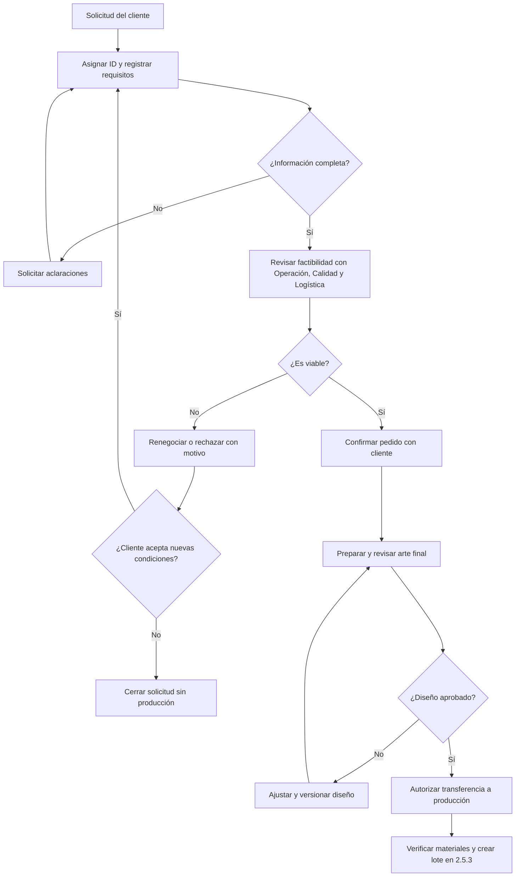

# PR-QP-001 — Procedimiento de recepción y revisión de pedidos

| Campo | Información |
|---|---|
| Proyecto | QualityPrint — Sistema de Gestión de Calidad |
| Código | PR-QP-001 |
| Etapa y actividad | 2.8.1 — Procedimiento de recepción de pedidos |
| Versión | 0.1 |
| Fecha de elaboración | 10 de noviembre de 2026 |
| Estado | **Borrador publicado para revisión; no aprobado** |
| Empresa | QualityPrint (**empresa ficticia**) |
| Proceso relacionado | PO-01 — Gestión de pedidos y del diseño |
| Responsable del proceso | Comercial y diseño |
| Revisión propuesta | Control de calidad |
| Aprobación del contenido del portafolio | Pendiente de revisión del usuario |

> **Alcance académico:** describe un procedimiento propuesto para una pequeña empresa ficticia de personalización textil DTF (hasta cinco trabajadores y una impresora). No es un registro de pedidos ejecutados ni demuestra implantación real de un Sistema de Gestión de Calidad.

## 1. Objetivo

Asegurar que cada pedido de personalización textil DTF sea recibido, identificado, revisado, aclarado y confirmado **antes de aceptar el compromiso de entrega o iniciar la producción**, conservando evidencia de los requisitos del cliente y de sus cambios.

El procedimiento pretende prevenir errores de cantidad, talla, tejido, estampado, diseño, plazos y destino, y proporcionar información consistente a las etapas de producción, inspección, entrega y al futuro software.

## 2. Alcance

**Inicia** cuando QualityPrint recibe una solicitud de cliente particular u organización; **termina** cuando el pedido queda documentado y confirmado para pasar a preparación/aprobación de diseño, o queda pendiente, rechazado o cancelado con un motivo registrado.

Este procedimiento **no reemplaza** la aprobación final del arte prevista en 2.5.2, la validación técnica de equipos y materiales ni la inspección del producto. Tampoco incluye facturación o pagos del MVP.

## 3. Documentos de referencia internos

- [DOC-QP-003 — Información general](../DOC-QP-003_informacion_general_empresa.md): clientes, productos y funciones.
- [DOC-QP-005 — Alcance del SGC](../DOC-QP-005_contexto_de_la_organizacion.md): límites y requisitos relevantes.
- [DOC-QP-006 — Mapa de procesos](../DOC-QP-006_procesos_y_mapa_de_procesos.md): proceso PO-01.
- [DOC-QP-007 — Flujo DTF](../DOC-QP-007_proceso_de_produccion_DTF.md): apartado 2.5.1 y relación con 2.5.2.
- [DOC-QP-008 — Gestión de riesgos](../DOC-QP-008_gestion_de_riesgos_y_oportunidades.md): riesgos R-01 (pedido incompleto), R-02 (diseño equivocado) y R-10 (entrega errónea).
- [DOC-QP-009 — Gestión documental](../DOC-QP-009_gestion_documental.md): códigos, versiones, responsabilidades y aprobación.
- [LM-QP-001 — Listado maestro](../LM-QP-001_listado_maestro_de_documentos.md): estado vigente del procedimiento.

**Formato asociado previsto:** `F-QP-001 — Formato de recepción de pedidos` (actividad 2.8.5). **Todavía no está creado ni aprobado**. Hasta entonces, este procedimiento define los campos a capturar, pero no afirma el uso de un formulario implementado.

## 4. Definiciones y criterios

| Término | Significado |
|---|---|
| Solicitud | Petición inicial, posiblemente incompleta, que aún no genera obligación de producción |
| Pedido documentado | Solicitud identificada cuyos datos esenciales se registraron |
| Pedido confirmado | Solicitud cuyos requisitos, factibilidad y condiciones se revisaron y aceptaron |
| Diseño aprobado | Versión exacta del arte que recibió conformidad explícita del cliente |
| Cambio de pedido | Modificación de requisitos, cantidades, entrega o diseño posterior a un acuerdo |
| Factibilidad | Posibilidad de cumplir requisitos con materiales, equipo, personal y plazo disponibles |

**Regla principal:** «pedido confirmado» y «diseño aprobado» son **estados distintos**. La confirmación comercial no autoriza producir si el diseño final aún no fue aprobado.

## 5. Responsabilidades

| Rol | Responsabilidad |
|---|---|
| **Comercial y diseño** | Recibir solicitud, aclarar requisitos, registrar pedido y cambios, confirmar con el cliente y custodiar aprobación del arte |
| **Operador DTF** | Consultar viabilidad técnica, compatibilidad de prenda/materiales y capacidad estimada |
| **Control de calidad** | Revisar requisitos críticos y criterios de aceptación cuando haya dudas o condiciones especiales |
| **Administración y logística** | Comprobar disponibilidad, cantidades, fecha y condiciones de entrega |
| **Gerencia** | Resolver compromisos o excepciones que excedan la capacidad ordinaria, sin ignorar requisitos aplicables |

La autoridad para aceptar condiciones de pedido debe estar definida por gerencia. **Ningún rol debe comprometer resultados o plazos imposibles sin validación de la capacidad.**

## 6. Entradas, salidas y registros

| Elemento | Descripción |
|---|---|
| **Entrada** | Solicitud, datos de contacto ficticios, prendas, cantidades, tallas, colores, arte/referencias, ubicación del estampado, plazo |
| **Recursos** | Canal de contacto, catálogo de prendas, información técnica de materiales DTF y capacidad de equipo |
| **Salida conforme** | Pedido identificado y confirmado; requisitos completos; fecha acordada; vínculo al diseño por aprobar/aprobado |
| **Salida pendiente** | Solicitud retenida por falta de información, aprobación o confirmación de factibilidad |
| **Salida no aceptada** | Pedido rechazado/cancelado con motivo y comunicación registrados |
| **Registro mínimo** | ID de pedido, versión de requisitos, fecha, responsable, detalles del producto, cantidad, plazo, estado, aceptación/cambios |

Los registros reales se definirán en el formato F-QP-001 y, posteriormente, en el módulo de pedidos de la aplicación. El uso público será exclusivamente con **datos ficticios**.

---

## 7. Desarrollo del procedimiento

### 7.1. Recibir la solicitud
**Responsable:** Comercial y diseño.

1. Registrar fecha y canal de recepción.
2. Asignar un identificador provisional o definitivo según la herramienta disponible.
3. Identificar cliente, medio de contacto, tipo de pedido y necesidad principal.
4. Consultar si el cliente aporta arte aprobado, arte para adaptar o una idea para desarrollar.

**Control:** no aceptar una solicitud anónima o sin información suficiente como pedido listo para producir; usar datos ficticios en las pruebas públicas.

### 7.2. Capturar los requisitos del pedido
**Responsable:** Comercial y diseño.

| Campo requerido | Ejemplo ilustrativo, no real | Regla de revisión |
|---|---|---|
| ID de pedido | QP-0001 | Único en el sistema |
| Cliente | Cliente Demo 001 | Identificable sin datos reales |
| Fecha de solicitud | 10/11/2026 | No debe omitirse |
| Producto | Camiseta | Debe estar dentro del alcance DTF |
| Tipo de tejido | Algodón (pendiente de validar compatibilidad) | Confirmar compatibilidad técnica |
| Tallas y distribución | 4 M, 6 L | Suma igual a cantidad solicitada |
| Color de prenda | Negro | Confirmar su correspondencia con el arte |
| Cantidad total | 10 unidades | Entero positivo; coherente con tallas |
| Diseño / versión | Arte V1 | Referencia identificable |
| Posición y dimensiones del arte | Pecho frontal, medida por confirmar | No producir sin definir |
| Fecha solicitada | Por acordar | No confundir con fecha aceptada |
| Fecha acordada | Por confirmar tras factibilidad | Registrar aceptación del cliente |
| Destino / modalidad de entrega | Recolección o envío | Definir según lo acordado |
| Condiciones especiales | Por ejemplo, embalaje específico | Aclarar antes de confirmar |

**Control de coherencia:** cantidades y tallas coincidentes, diseño legible y ubicación conocida. No suponer características técnicas que el cliente no confirmó.

### 7.3. Revisar la factibilidad
**Responsables:** Comercial y diseño coordina; Operación DTF, Logística y Calidad son consultados cuando aplique.

1. Verificar que la prenda, su composición y la técnica de estampado sean compatibles con los insumos seleccionados.
2. Consultar disponibilidad de prendas, película, tintas y adhesivo.
3. Revisar capacidad de una sola impresora, otros pedidos comprometidos y tiempo para inspección.
4. Identificar requisitos especiales que requieran muestra, validación o revisión técnica.
5. Definir una propuesta de fecha, sin inventar tiempos de producción estandarizados.
6. Escalar casos no viables o extraordinarios a gerencia; no sustituir requisitos del cliente sin autorización.

**Decisión:** si no se puede asegurar la factibilidad, el pedido permanece **pendiente de aclaración**, se renegocian condiciones o se rechaza; en ningún caso pasa directamente a impresión.

### 7.4. Confirmar requisitos y condiciones con el cliente
**Responsable:** Comercial y diseño.

1. Enviar un resumen de producto, cantidades por talla, diseño solicitado, dimensiones, ubicación, condiciones y fecha comprometida.
2. Solicitar aceptación expresa o registrar las observaciones.
3. Resolver discrepancias y actualizar la versión de requisitos.
4. Registrar quién y cuándo confirmó las condiciones, por un canal identificable en la simulación.
5. Diferenciar esta confirmación de la **aprobación específica del diseño final**.

**Salida:** pedido comercial confirmado o solicitud todavía pendiente.

### 7.5. Preparar y aprobar el diseño (interfaz con 2.5.2)
**Responsable:** Comercial y diseño.

La etapa de diseño puede iniciarse cuando el pedido es viable. Antes de pasar a producción, debe existir una **versión exacta del arte aprobada por el cliente**, incluyendo dimensiones, posición, orientación y contenido. Las modificaciones deben generar una nueva versión y, si afectan el acuerdo, requerir confirmación.

**Punto de bloqueo:** sin evidencia de aprobación del diseño no se autoriza crear un lote para imprimir.

### 7.6. Registrar el estado y transferir el pedido
**Responsable:** Comercial y diseño.

1. Completar la revisión de requisitos y factibilidad.
2. Confirmar existencia de arte aprobado o marcarlo como pendiente.
3. Comunicar a producción solo pedidos autorizados, con identificador y versión vigente.
4. Conservar la relación de pedido, aprobación de arte y decisión de aceptación.
5. Dejar disponible información de cantidades, tejido y fecha para logística y calidad.

**Criterio de aceptación de la transferencia:** requisitos sin ambigüedades y diseño aprobado; no se omite verificación física de materiales en 2.5.3.

### 7.7. Gestionar cambios y cancelaciones
**Responsable:** Comercial y diseño, con aprobación de las funciones afectadas.

1. Identificar requisito que cambió, motivo, solicitud y fecha.
2. Evaluar efecto sobre materiales, diseño, estado del lote, costo y fecha comprometida.
3. Solicitar nueva aprobación si cambia diseño, ubicación, cantidad o fecha acordada.
4. Actualizar versión de requisitos conservando historial.
5. Notificar a producción, calidad y logística; bloquear el uso de versiones sustituidas.
6. Si el cambio ocurre después de iniciar producción, gestionar el material afectado como incidencia y decidir su tratamiento.

**No se elimina silenciosamente** un pedido ni se sobrescribe una fecha acordada si afectará un indicador de puntualidad (IND-02).

### 7.8. Finalizar la etapa de recepción
**Responsable:** Comercial y diseño.

Registrar estado final de la recepción, responsable, fecha y vínculo a evidencias. El pedido solo pasa a producción cuando se cumplan **requisitos revisados + factibilidad + diseño final aprobado + disponibilidad confirmada para el lote**.

---

## 8. Flujograma de decisiones

**Interpretación:** no se enlaza directamente la recepción con la impresión sin completar los puntos de control y la aprobación del arte.

---

## 9. Matriz de controles y riesgos

| Punto de control | Riesgo relacionado | Medida propuesta | Evidencia prevista |
|---|---|---|---|
| Campos completos y distribución por tallas | R-01 | Validación y revisión antes de confirmar | Pedido revisado |
| Arte y versión correctos | R-02 | Aprobación explícita vinculada a versión | Confirmación del diseño |
| Fecha y capacidad compatibles | R-01 / R-09 | Consulta a Operación y Logística | Fecha acordada y aprobación |
| Direcciones/cantidades confirmadas | R-10 | Resumen de pedido y revisión previa a despacho | Datos de entrega |
| Cambios posteriores controlados | R-02 / R-11 | Nueva versión y notificación | Historial y confirmación |
| Bloqueo de producción no autorizada | R-02 | Regla para no crear lote sin arte aprobado | Estado y referencia de aprobación |

**Importante:** los controles están **propuestos** y deberán implementarse y probarse. Este procedimiento aún es un borrador, no una afirmación de ejecución empresarial.

## 10. Registros, conservación y protección de datos

Los registros previstos incluyen pedidos, versiones de requisitos, conformidad del cliente, evidencias de aprobación del diseño, decisiones de factibilidad, cambios y cancelaciones.

- El formato `F-QP-001` se elaborará y aprobará en **2.8.5**; no se presume existente.
- En la aplicación se prevén claves únicas y relaciones entre pedido, arte aprobado y lotes; las reglas concretas se definirán en las etapas **3 y 4**.
- No publicar nombres de personas reales, teléfonos, domicilios o archivos reales de clientes en GitHub.
- Para retención de registros, seguir el documento de gestión documental y determinar plazos según necesidades y obligaciones aplicables; no se inventa un plazo legal universal.

## 11. Criterios de aceptación y verificación del procedimiento

- [ ] El pedido tiene identificador y datos esenciales completos.
- [ ] Las cantidades por talla coinciden con el total.
- [ ] La compatibilidad y capacidad se revisaron o justificaron.
- [ ] El cliente confirmó condiciones y fecha comprometida.
- [ ] La versión final del arte está aprobada antes de producir.
- [ ] Los cambios posteriores mantienen historial y aceptación.
- [ ] Se asignaron responsables y evidencias a los puntos de control.
- [ ] El formato asociado se identifica como **pendiente de creación** y no como ejecutado.

**Estado de esta lista:** son **criterios de verificación futuros**, no registros realizados. La aprobación de la **redacción documental** no significa que ya se procesaron pedidos ni que el sistema web esté funcionando.

### Revisión del apartado del roadmap
- [ ] **2.8.1.** Procedimiento de recepción de pedidos: **redactado y publicado; pendiente de aprobación**.

## 12. Control de versiones

| Versión | Fecha | Cambio | Estado |
|---|---|---|---|
| 0.1 | 10/11/2026 | Redacción inicial del procedimiento de recepción de pedidos y controles | En revisión |

**Siguiente entregable, después de aprobar PR-QP-001:** **PR-QP-002 — Procedimiento de producción DTF**, correspondiente a **2.8.2**.
