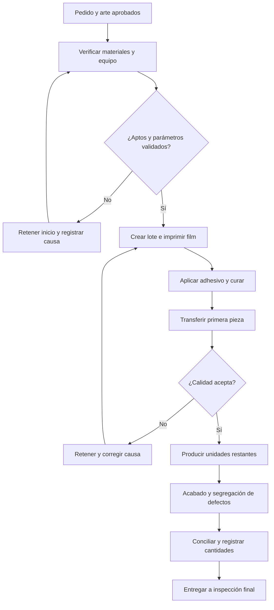

# PR-QP-002 — Procedimiento de producción DTF

| Campo | Información |
|---|---|
| Código | PR-QP-002 |
| Actividad | 2.8.2 — Procedimiento de producción DTF |
| Versión | 1.0 |
| Fecha | 18 de noviembre de 2026 |
| Estado | **Aprobado para el proyecto académico** |
| Empresa | QualityPrint (ficticia) |
| Proceso | PO-02 — Producción DTF |
| Responsable | Operador DTF |
| Revisión | Control de calidad |
| Aprobación del portafolio | Aprobado por el usuario del proyecto |

> Procedimiento propuesto para el proyecto académico de una empresa con una impresora DTF y hasta cinco trabajadores. No acredita producción ejecutada ni parámetros técnicos validados.

## 1. Objetivo

Estampar las prendas del pedido aprobado mediante DTF, controlando material, diseño, impresión, adhesivo, curado y transferencia, y entregar a Calidad un lote identificado y registrado para su inspección final.

## 2. Alcance

Inicia con un pedido confirmado y su diseño aprobado (PR-QP-001). Finaliza cuando las prendas estampadas, sus cantidades y el registro de producción se entregan a Control de calidad. No incluye la liberación para despacho.

## 3. Referencias y registros

- [PR-QP-001 — Recepción de pedidos](PR-QP-001_recepcion_de_pedidos.md).
- [DOC-QP-007 — Proceso de producción DTF](../DOC-QP-007_proceso_de_produccion_DTF.md): actividades 2.5.3 a 2.5.8.
- [DOC-QP-008 — Riesgos y oportunidades](../DOC-QP-008_gestion_de_riesgos_y_oportunidades.md).
- [DOC-QP-009 — Gestión documental](../DOC-QP-009_gestion_documental.md).

| Código previsto | Función |
|---|---|
| F-QP-002 | Resultado de la inspección de materiales |
| F-QP-003 | Datos, parámetros, cantidades e incidencias de cada lote |
| F-QP-004 | Resultado de la inspección final por Calidad |
| F-QP-005 | Identificación y tratamiento de no conformidades |
| PR-QP-003 | Inspección de calidad |
| PR-QP-004 | Tratamiento de no conformidades |

Los formatos y procedimientos indicados como previstos se crearán en 2.8.3–2.8.9; no se consideran implementados.

## 4. Definiciones

| Término | Definición |
|---|---|
| DTF (Direct to Film) | Técnica que imprime el diseño en una película y lo transfiere al tejido mediante calor y presión. |
| Film DTF | Película que recibe la impresión y transporta el diseño durante la transferencia. |
| RIP | Software que prepara el archivo para la impresión, incluida su configuración de imagen y tinta. |
| Polvo adhesivo | Insumo aplicado sobre la impresión que permite fijar el diseño al tejido tras el curado y la transferencia. |
| Curado | Tratamiento del adhesivo del film mediante el ciclo térmico definido para los insumos y el equipo. |
| Transferencia | Aplicación del diseño curado a la prenda mediante una prensa térmica. |
| Despegue | Retiro del film de la prenda en la condición indicada por el proveedor. |
| Lote de producción | Conjunto de unidades de un pedido procesadas con el mismo diseño aprobado, tejido y configuración técnica, bajo un ID único. |
| Primera pieza | Primera prenda estampada del lote que se revisa antes de autorizar la producción de las demás. |
| Parámetro validado | Valor o rango de operación documentado y aceptado para una combinación específica de equipo, insumos y tejido. |
| Unidad retenida | Prenda o film identificado y separado por incumplimiento o sospecha de incumplimiento, sin autorización de uso o despacho. |

## 5. Responsabilidades

| Rol | Acción y decisión |
|---|---|
| Comercial y diseño | Entregar pedido confirmado, arte aprobado y especificación de posición y dimensiones. |
| Administración y logística | Suministrar prendas e insumos identificados y verificar cantidad disponible. |
| Operador DTF | Verificar materiales y equipo, producir, registrar parámetros, separar defectos y entregar el lote. |
| Control de calidad | Autorizar la primera pieza, verificar las desviaciones y recibir el lote para inspección final. |
| Gerencia | Resolver falta de recursos, reparaciones o condiciones que impidan una operación segura. |

## 6. Condiciones de inicio

El operador debe comprobar y registrar:

- ID del pedido y versión exacta del arte aprobado.
- Producto, tejido, color, talla, cantidad, dimensiones y posición del diseño.
- Disponibilidad y aptitud de prendas, film, tinta y adhesivo para la combinación seleccionada.
- Identificación de la impresora, sistema de curado y prensa disponibles.
- Instrucciones técnicas documentadas, parámetros validados y criterios de aceptación de la combinación.
- Condiciones de seguridad (manuales, ficha de datos de seguridad, ventilación/extracción y protección definida para el puesto).

**Bloqueo:** si falta un requisito crítico, un parámetro validado o una condición segura, no se inicia el lote. Registrar la causa y notificar al responsable correspondiente.

## 7. Desarrollo del procedimiento

| Paso | Actividad del operador | Aceptación / acción si falla |
|---|---|---|
| 1. Verificar materiales | Comparar prendas con el pedido; revisar integridad, referencias y compatibilidad de film, tinta y adhesivo. Registrar en F-QP-002. | Cantidades, características y referencias coinciden; si no, separar el material y solicitar sustitución. |
| 2. Preparar el lote | Asignar ID único, vincular pedido, arte, cantidad e insumos. Revisar equipo según manual. Abrir archivo aprobado en RIP. | Archivo, dimensiones, orientación y configuración corresponden al arte preparado; si no, detener y corregir. |
| 3. Imprimir film | Cargar film según manual, hacer comprobación de impresión requerida e imprimir la primera transferencia. | Imagen completa, sin bandas, manchas ni faltantes visibles; si falla, retener film y corregir la causa antes de reimprimir. |
| 4. Aplicar adhesivo | Aplicar polvo compatible y retirar el exceso según instrucciones técnicas. | Cobertura de las áreas impresas, sin acumulaciones ni zonas sin adhesivo; si falla, separar film. |
| 5. Curar adhesivo | Ejecutar el ciclo registrado de temperatura y tiempo autorizado. | Valores dentro del rango validado y acabado según ficha técnica; si falla, retener y evaluar. |
| 6. Transferir primera pieza | Preparar la prenda, alinear diseño, aplicar parámetros de prensa y retirar film según su ficha técnica. | Calidad verifica diseño, posición, dimensiones, integridad y adherencia inicial conforme a especificaciones. No continuar hasta registrar aceptación. |
| 7. Estampar lote | Repetir impresión, adhesivo, curado y transferencia para las unidades restantes con la configuración de la primera pieza aceptada; controlar cada film y prenda. | Separar cada unidad defectuosa. Detener si cambia la configuración o aparece una desviación repetitiva. |
| 8. Acabado | Completar enfriamiento o estabilización y acabado según instrucciones. Si la combinación exige prensado final, realizarlo y registrarlo. | Sin daño visible ocasionado por el acabado; prendas identificadas y separadas de las retenidas. |
| 9. Cierre del lote | Conciliar cantidades y registrar resultado, tiempo, incidencias y unidades retenidas en F-QP-003. Entregar a Calidad. | El total procesado concuerda con unidades aptas para inspección, retenidas y descartadas; las pendientes quedan registradas. No despachar. |

**Nueva primera pieza:** repetir y obtener aceptación de Calidad si cambia diseño, tejido, insumo, equipo o parámetro validado, o después de corregir un defecto que requiera modificar la configuración. Si se modifica el diseño, exigir antes una nueva aprobación del cliente.

## 8. Parámetros que deben registrarse

No se indican temperaturas, segundos ni presiones universales: la combinación de equipos y materiales de la empresa ficticia aún no se ha especificado.

| Operación | Dato obligatorio |
|---|---|
| Impresión | Impresora, RIP, referencia del trabajo, configuración de impresión y tinta/film utilizados |
| Aplicación | Referencia del adhesivo y método definido |
| Curado | Equipo, temperatura (°C), tiempo (s) y referencia de instrucción validada |
| Transferencia | Prensa, temperatura (°C), tiempo (s), ajuste de presión con unidad o escala del equipo |
| Despegue | Condición indicada por el proveedor y tiempo de espera si se exige |
| Prensado final | Si aplica, temperatura, tiempo y ajuste de presión |
| Primera pieza | ID de lote, resultado, fecha y responsable de aceptación |

Para cada parámetro aplicable, conservar valor objetivo o rango autorizado y valor configurado/observado, según el método de control del equipo. Si se sale del rango autorizado, detener y retener lo afectado desde la última verificación conforme.

## 9. Flujo de producción

## 10. Control de desviaciones y seguridad

| Situación | Acción |
|---|---|
| Material incompatible o dañado (R-03) | Separar, identificar y notificar a Logística. |
| Impresión defectuosa (R-04) | Retener film; revisar configuración y equipo. |
| Adhesivo o curado no conforme (R-05) | Retener film afectado; revisar material y ciclo. |
| Daño, mala posición o transferencia incompleta (R-06) | Retener prenda; consultar a Calidad antes de retrabajar. |
| Falla del equipo o condición insegura (R-09/R-14) | Suspender la operación y aplicar el procedimiento seguro definido por fabricante y responsable del puesto. |
| Pérdida de identificación (R-11) | Retener unidades hasta restablecer su trazabilidad mediante evidencias. |

Registrar la desviación en producción y remitir a Calidad según PR-QP-004/F-QP-005 cuando estén aprobados. No dar por conforme un retrabajo sin verificar su resultado. No mezclar unidades retenidas con las aptas para inspección.

## 11. Registros y cierre

Datos mínimos del lote (F-QP-003 previsto):

- ID de lote y pedido; versión del diseño; identificación de prendas e insumos.
- Operador, fecha y horas de inicio/cierre.
- Equipos, referencia de las instrucciones validadas y parámetros utilizados.
- Resultado y responsable de la aceptación de primera pieza.
- Cantidades asignadas, procesadas, aptas para inspección, retenidas, descartadas y pendientes; registrar aparte los retrabajos y sustituciones para evitar doble conteo.
- Incidencias, unidad afectada, decisión de Calidad y vínculo con el registro de no conformidad cuando aplique.

Regla de conciliación: **unidades procesadas = unidades aptas para inspección + unidades retenidas + unidades descartadas** (cada unidad se cuenta una sola vez según su estado al cierre). Una unidad descartada requiere decisión documentada y no vuelve al lote apto. Las unidades pendientes no se registran como procesadas. La aceptación inicial no sustituye la liberación definitiva de PR-QP-003.

## 12. Criterios de verificación futura

- [ ] Pedido y diseño aprobados vinculados al lote.
- [ ] Materiales y equipo verificados.
- [ ] Parámetros técnicos documentados y validados.
- [ ] Primera pieza aceptada antes del resto del lote.
- [ ] Desviaciones identificadas y unidades retenidas.
- [ ] Cantidades conciliadas y registro completo.
- [ ] Lote transferido a Calidad sin autorización de despacho anticipada.

Estos criterios se comprobarán en la simulación del proceso; no representan registros ejecutados.

### Estado del roadmap

- [x] **2.8.2.** Procedimiento de producción DTF aprobado para el proyecto académico.

## 13. Control de versiones

| Versión | Fecha | Cambio | Estado |
|---|---|---|---|
| 0.1 | 18/11/2026 | Procedimiento inicial, definiciones concretas, controles y registros de producción | En revisión |
| 1.0 | 18/11/2026 | Aprobación del usuario | Aprobado |

**Siguiente entregable:** [PR-QP-003 — Procedimiento de inspección de calidad](PR-QP-003_inspeccion_de_calidad.md) (2.8.3).
