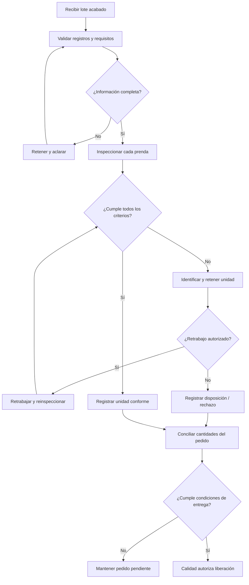

# PR-QP-003 — Procedimiento de inspección de calidad

| Campo | Información |
|---|---|
| Código | PR-QP-003 |
| Actividad | 2.8.3 — Procedimiento de inspección de calidad |
| Versión | 0.1 |
| Fecha | 18 de noviembre de 2026 |
| Estado | **Borrador para revisión** |
| Empresa | QualityPrint (ficticia) |
| Proceso | PO-03 — Control de calidad |
| Responsable | Control de calidad |
| Aprobación del portafolio | Pendiente de revisión del usuario |

> Procedimiento propuesto para el SGC académico de QualityPrint. Los controles se documentan para su posterior simulación; no representan inspecciones reales ejecutadas.

## 1. Objetivo

Verificar cada prenda estampada contra el pedido y el diseño aprobados, identificar defectos, registrar resultados y autorizar únicamente la entrega de unidades conformes.

## 2. Alcance

Desde la recepción del lote acabado, identificado y registrado por Producción hasta la decisión documentada de liberación o retención de las prendas. La inspección final no reemplaza los controles de materiales ni la aprobación de primera pieza de PR-QP-002.

## 3. Referencias

- [PR-QP-001 — Recepción de pedidos](PR-QP-001_recepcion_de_pedidos.md).
- [PR-QP-002 — Producción DTF](PR-QP-002_produccion_dtf.md).
- [DOC-QP-004 — Direccionamiento estratégico e indicadores](../DOC-QP-004_direccionamiento_estrategico.md).
- [DOC-QP-007 — Proceso DTF](../DOC-QP-007_proceso_de_produccion_DTF.md), apartado 2.5.9.
- [DOC-QP-008 — Gestión de riesgos](../DOC-QP-008_gestion_de_riesgos_y_oportunidades.md), riesgos R-07, R-08 y R-11.

**Registros previstos:** F-QP-003 (producción), F-QP-004 (inspección final) y F-QP-005 (no conformidades). PR-QP-004 definirá el tratamiento de no conformidades. Todos están pendientes de creación y aprobación.

## 4. Definiciones

| Término | Definición |
|---|---|
| Inspección final | Comparación de cada prenda acabada con los requisitos aprobados antes del despacho. |
| Criterio de aceptación | Condición verificable que la prenda debe cumplir para ser conforme. |
| Tolerancia | Desviación máxima permitida respecto a una medida especificada, expresada en la misma unidad de medida. |
| Defecto | Incumplimiento observable o medible en una prenda. |
| Unidad conforme | Prenda que cumple todos los criterios de aceptación aplicables. |
| Unidad retenida | Prenda separada e identificada por incumplimiento o falta de evidencia, pendiente de decisión. |
| Unidad rechazada | Prenda cuya decisión registrada impide su entrega como producto conforme. |
| Reinspección | Nueva verificación de una unidad después de un retrabajo autorizado. |
| Liberación | Autorización registrada de Calidad para pasar unidades conformes a despacho. |

## 5. Responsabilidades

| Rol | Responsabilidad |
|---|---|
| Control de calidad | Inspeccionar, registrar defectos, decidir el estado de cada unidad y autorizar la liberación. |
| Operador DTF | Entregar el lote y sus registros; realizar únicamente retrabajos autorizados. |
| Comercial y diseño | Facilitar el arte y las especificaciones aceptadas por el cliente. |
| Administración y logística | Recibir las unidades liberadas y conciliar cantidades antes del empaque y despacho. |
| Gerencia | Asegurar recursos y resolver excepciones sin autorizar entregas que incumplan requisitos. |

Calidad será preferentemente una persona distinta del operador; toda autorización debe identificar a quien la emite.

## 6. Condiciones de inspección

- Identificación de pedido, lote y unidades; registro de producción y primera pieza aceptada.
- Arte aprobado, tallas, tejido, color, cantidad, posición y dimensiones especificadas.
- Criterios de medición, tolerancias y referencia visual definidos antes de evaluar.
- Área de trabajo limpia, iluminación que permita detectar defectos y medios de medición adecuados.

Si falta identificación, especificación, tolerancia necesaria o registro crítico, retener las unidades afectadas. No inventar tolerancias al momento de inspeccionar.

## 7. Criterios de aceptación

QualityPrint propone inspección del **100 % de las prendas acabadas** por tratarse de lotes pequeños. Registrar el resultado individual.

| Código de defecto | Elemento | Verificación | Criterio de aceptación |
|---|---|---|---|
| DEF-01 | Prenda incorrecta | Etiqueta y comparación con pedido | Talla, color y tejido coinciden con lo aprobado. |
| DEF-02 | Diseño incorrecto | Comparación con arte aprobado | Contenido, texto y orientación coinciden. |
| DEF-03 | Dimensión fuera de especificación | Medir ancho y alto del estampado en cm | Ambas medidas cumplen los límites aprobados. |
| DEF-04 | Posición incorrecta | Medir desde las referencias de la prenda definidas en el pedido | Ubicación y alineación dentro de límites aprobados. |
| DEF-05 | Impresión incompleta | Revisar toda el área estampada | Ninguna parte prevista del diseño está ausente. |
| DEF-06 | Manchas o bandas | Inspección visual del estampado | Sin manchas, bandas ni alteraciones visibles no previstas en el arte. |
| DEF-07 | Adhesión deficiente visible | Revisar superficie y bordes | Sin bordes levantados, desprendimientos ni áreas visiblemente desadheridas. |
| DEF-08 | Daño textil | Revisar prenda y zona estampada | Sin perforaciones, quemaduras, cortes o marcas no previstas. |
| DEF-09 | Acabado no conforme | Revisar área estampada y presentación | Sin residuos o deformaciones que contradigan la especificación aprobada. |
| DEF-10 | Color del estampado incorrecto | Comparar con referencia visual aprobada bajo condiciones definidas | Coincide con el criterio de color acordado; si no puede evaluarse, retener. |

**Reglas:** cada criterio aplicable debe registrarse como cumple/no cumple; si no aplica, justificarlo. Una prenda con uno o más criterios incumplidos no es conforme. La inspección visual de adhesión no demuestra resistencia a lavados.

Las pruebas adicionales de adherencia o lavado solo son obligatorias cuando el pedido o la validación técnica las exige. Antes de realizarlas se definirá y documentará método, muestra, condiciones y criterio de aceptación. Sin resultado exigido, no se libera el lote correspondiente.

## 8. Procedimiento

| Paso | Acción | Resultado |
|---|---|---|
| 1 | Recibir lote, verificar identificación y conciliar cantidades con F-QP-003. | Registro de recepción o retención por discrepancia. |
| 2 | Asignar ID de inspección y vincular pedido, lote, versión del arte y responsable. | Inspección identificada. |
| 3 | Identificar cada unidad mediante código único dentro del lote. | Trazabilidad individual de resultados. |
| 4 | Verificar todos los criterios aplicables de la sección 7 en cada unidad. | Resultado por criterio y medida cuando aplique. |
| 5 | Registrar los códigos de defecto detectados y separar físicamente las unidades no conformes. | Prendas conformes y retenidas identificadas. |
| 6 | Registrar cantidad inspeccionada, conforme, retenida y rechazada; vincular las no conformidades. | F-QP-004 y referencia de F-QP-005. |
| 7 | Tras retrabajo autorizado, reinspeccionar todos los criterios aplicables y conservar el resultado inicial. | Nueva decisión vinculada a la misma unidad. |
| 8 | Autorizar la liberación de unidades conformes y entregar cantidades identificadas a Logística. | Decisión, fecha y responsable registrados. |

**Regla de despacho:** el pedido completo se libera únicamente si la cantidad conforme por producto y talla coincide con la cantidad acordada y no existen requisitos pendientes. Una entrega parcial requiere modificación o autorización expresa del cliente registrada en el pedido; jamás incluir una unidad retenida o rechazada.

## 9. Flujo de decisión

## 10. Registros y control de cantidades

F-QP-004 deberá contener como mínimo:

- ID de inspección, pedido, lote, fecha, responsable y versión del diseño.
- ID de cada unidad y resultado de cada criterio aplicable.
- Medida observada, especificación y tolerancia cuando corresponda.
- Códigos de defectos, observaciones y referencias de evidencias.
- Cantidades distintas inspeccionadas, conformes, retenidas y rechazadas.
- Resultados de reinspección vinculados a la unidad original.
- Decisión de liberación, cantidad autorizada, fecha y responsable.

Al cierre: **unidades distintas inspeccionadas = unidades conformes + unidades retenidas + unidades rechazadas**, según el último estado de cada unidad. Las no presentadas a inspección y los descartes de producción no inspeccionados se controlan por separado en F-QP-003. Cada unidad se cuenta una sola vez; no eliminar el historial.

### Indicadores relacionados

| Indicador | Regla de cálculo |
|---|---|
| IND-01 — Unidades defectuosas | (Unidades distintas con al menos un defecto detectado en inspección final / unidades distintas inspeccionadas en el período) × 100. Una reinspección favorable no borra el defecto inicial. |
| IND-03 — Cobertura de inspección | (Pedidos finalizados con inspección final registrada / pedidos finalizados) × 100. |
| IND-04 — Registro de no conformidades | (Eventos detectados con no conformidad registrada / eventos de no conformidad detectados) × 100. |

Si el denominador es cero, informar N/D; no declarar cumplimiento del indicador sin datos.

## 11. Criterios de verificación futura

- [ ] Identificación de unidad, lote y pedido verificable.
- [ ] Inspección individual de todas las prendas acabadas.
- [ ] Criterios aplicables y resultados registrados.
- [ ] Defectos identificados sin doble conteo.
- [ ] Unidades retenidas separadas y reinspecciones trazables.
- [ ] Cantidades conciliadas y liberación firmada/identificada por Calidad.

Los criterios son actividades futuras de comprobación; no representan inspecciones realizadas.

### Estado del roadmap

- [ ] **2.8.3.** Procedimiento de inspección de calidad redactado y publicado; pendiente de aprobación.

## 12. Control de versiones

| Versión | Fecha | Cambio | Estado |
|---|---|---|---|
| 0.1 | 18/11/2026 | Procedimiento inicial con criterios de aceptación, defectos, inspección individual y liberación | En revisión |

**Siguiente entregable:** PR-QP-004 — Procedimiento de gestión de no conformidades (2.8.4).
