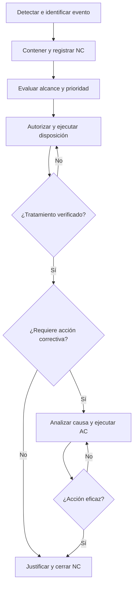

# PR-QP-004 — Procedimiento de gestión de no conformidades

| Campo | Información |
|---|---|
| Código | PR-QP-004 |
| Actividad | 2.8.4 — Procedimiento de gestión de no conformidades |
| Versión | 1.0 |
| Fecha | 18 de noviembre de 2026 |
| Estado | **Aprobado para el proyecto académico** |
| Empresa | QualityPrint (ficticia) |
| Proceso | PO-03 — Control de calidad |
| Responsable | Control de calidad |
| Aprobación del portafolio | Aprobado por el usuario del proyecto |

> Procedimiento académico propuesto; no constituye evidencia de incidencias reales ni acciones ejecutadas.

## 1. Objetivo

Identificar, contener, registrar y tratar los incumplimientos de los requisitos de QualityPrint, impedir la entrega de productos no conformes y evitar la repetición de fallas mediante acciones correctivas cuando corresponda.

## 2. Alcance

Aplica a incumplimientos detectados en pedidos, materiales, producción DTF, inspección final, despacho y reportes posteriores a la entrega. Comienza con la detección y termina con el cierre documentado de la no conformidad y, si se exige, con la verificación de eficacia de la acción correctiva asociada.

## 3. Referencias

- [PR-QP-001 — Recepción de pedidos](PR-QP-001_recepcion_de_pedidos.md).
- [PR-QP-002 — Producción DTF](PR-QP-002_produccion_dtf.md).
- [PR-QP-003 — Inspección de calidad](PR-QP-003_inspeccion_de_calidad.md).
- [DOC-QP-008 — Gestión de riesgos](../DOC-QP-008_gestion_de_riesgos_y_oportunidades.md).
- [DOC-QP-004 — Indicadores](../DOC-QP-004_direccionamiento_estrategico.md): IND-04.

**Formatos previstos:** F-QP-005 (registro de no conformidades) y F-QP-006 (registro de acciones correctivas), pendientes de creación en 2.8.9 y 2.8.10.

## 4. Definiciones

| Término | Definición |
|---|---|
| No conformidad (NC) | Incumplimiento comprobado de un requisito especificado del producto, proceso o SGC. |
| Contención | Medida inmediata que impide usar, procesar o despachar elementos afectados. |
| Corrección | Acción aplicada para eliminar un incumplimiento ya detectado. |
| Retrabajo | Reprocesamiento autorizado de una unidad para que cumpla el requisito original. |
| Disposición | Decisión registrada sobre el destino de un elemento no conforme. |
| Causa raíz | Factor identificado mediante evidencias cuya eliminación evita la repetición de la falla. |
| Acción correctiva (AC) | Acción dirigida a eliminar la causa de una no conformidad y prevenir su repetición. |
| Eficacia | Cumplimiento del criterio de evaluación definido para comprobar que la acción correctiva controla la causa. |
| Cierre | Confirmación de Calidad de que el tratamiento requerido está ejecutado, verificado y registrado. |

Una corrección resuelve el incumplimiento detectado; una acción correctiva actúa sobre su causa. No son equivalentes.

## 5. Responsabilidades

| Rol | Responsabilidad |
|---|---|
| Persona que detecta | Reportar el incumplimiento, identificar lo afectado y detener su uso si corresponde. |
| Control de calidad | Registrar la NC, determinar alcance y prioridad, autorizar disposición y verificar el cierre. |
| Operador DTF | Detener la operación afectada, separar unidades y ejecutar retrabajos autorizados. |
| Comercial y diseño | Aclarar requisitos y gestionar comunicación con el cliente cuando la NC afecta el pedido o la entrega. |
| Administración y logística | Bloquear despacho de unidades retenidas y tramitar devoluciones o reposición de insumos. |
| Gerencia | Asignar recursos y responsables de acciones correctivas; escalar incumplimientos críticos. |

## 6. Clasificación y prioridad

| Prioridad | Criterio | Respuesta |
|---|---|---|
| Crítica | Riesgo para personas, operación insegura o entrega de producto sin liberación. | Detener la actividad afectada, contener y notificar de inmediato a Gerencia y Calidad. |
| Mayor | Incumplimiento que afecta un requisito del cliente, varias unidades, la trazabilidad, o falla repetida del mismo tipo. | Bloquear lo afectado, informar a Calidad antes de continuar y evaluar causa. |
| Menor | Incumplimiento aislado sin afectación a seguridad, trazabilidad o requisitos del cliente. | Registrar, contener cuando aplique y corregir antes de cerrar. |

Si concurren varios criterios, aplicar la prioridad más alta. Esta clasificación es una regla interna propuesta; no sustituye la evaluación de seguridad ni autoriza liberar productos defectuosos.

## 7. Desarrollo del procedimiento

| Paso | Acción | Salida verificable |
|---|---|---|
| 1. Detectar | Registrar el hecho, fecha, requisito incumplido y evidencia. Identificar el reporte de origen. | Evento de detección identificable. |
| 2. Contener | Detener la actividad afectada si procede, identificar unidades o materiales, separarlos y bloquear uso o despacho. | Alcance inicial y elementos retenidos. |
| 3. Registrar | Asignar ID único de NC, vincular evento de origen, pedido, lote o unidad cuando apliquen, y clasificar prioridad. | F-QP-005 abierto. |
| 4. Evaluar alcance | Determinar qué unidades, lotes, materiales y pedidos pueden verse afectados; ampliar contención si se encuentra evidencia. | Alcance y cantidades confirmados. |
| 5. Decidir disposición | Calidad autoriza corrección, retrabajo, reposición, devolución o descarte según sección 8. | Disposición, responsable y plazo registrados. |
| 6. Ejecutar y verificar | Ejecutar la disposición; reinspeccionar una unidad retrabajada antes de liberarla. | Evidencia de ejecución y resultado de verificación. |
| 7. Evaluar causa y recurrencia | Determinar si requiere AC según sección 9; analizar causa si se exige y asignar responsable y plazo. | Decisión justificada y F-QP-006 vinculado cuando aplique. |
| 8. Cerrar | Verificar tratamiento, cantidades, registros y eficacia de AC exigida; registrar decisión y fecha. | NC cerrada por Calidad o pendiente con motivo. |

Si se detecta el defecto después de la entrega, identificar el pedido y unidades afectadas, informar a Comercial y Gerencia, acordar el tratamiento con el cliente y conservar evidencia. No sustituir ni eliminar el registro de entrega original.

## 8. Disposición del producto o material

| Decisión | Condición | Verificación |
|---|---|---|
| Retrabajo | Existe un método autorizado capaz de cumplir el requisito original sin introducir nuevos defectos. | Reinspección según PR-QP-003 y registro del resultado. |
| Reposición | Se sustituye la unidad afectada por una nueva unidad fabricada o suministrada conforme. | Identificar unidad nueva y verificar requisitos; registrar destino de la original. |
| Devolución | Material o producto no aceptado retorna al proveedor según decisión registrada. | Cantidad, destino y evidencia de devolución. |
| Descarte | No es viable recuperar o devolver el elemento; Calidad autoriza su disposición definitiva. | Cantidad y destino registrados; nunca pasa a despacho. |
| Corrección documental | El incumplimiento afecta un registro o requisito documentado y es posible corregirlo con evidencia. | Conservar valor anterior, cambio, fecha y responsable. |

No se autoriza liberar una unidad que siga incumpliendo un requisito. Una modificación del pedido requiere aceptación expresa y trazable del cliente, conforme a PR-QP-001; no puede eliminar requisitos de seguridad ni ocultar la NC original.

## 9. Acción correctiva

Se exige F-QP-006 para toda NC crítica, repetitiva, o que evidencie una falla sistemática. En otros casos, Calidad documenta si basta la corrección y por qué.

1. **Analizar:** describir el problema y revisar registros, materiales, equipo, método y condiciones; usar los cinco porqués u otro método adecuado, sustentando conclusiones con evidencias.
2. **Determinar causa:** identificar la causa demostrable; si no hay evidencia suficiente, mantener la investigación abierta.
3. **Planificar:** definir acción, responsable, plazo, evidencia prevista y criterio verificable de eficacia antes de ejecutarla.
4. **Ejecutar:** realizar la acción y conservar evidencia.
5. **Verificar eficacia:** evaluar el criterio en el plazo o número de lotes definido en el plan. Si falla, reabrir el análisis y ajustar la acción; no cerrar como eficaz.

**Ejemplo ilustrativo (no ejecutado):** si se detecta repetidamente arte de versión incorrecta, revisar el origen del error. Si se confirma que la causa es el acceso a archivos sustituidos, implantar el bloqueo de versiones obsoletas y comprobar, en los tres lotes siguientes, que todos usan la versión aprobada. El criterio del ejemplo es cero usos de versiones incorrectas en esos lotes; no es una prueba universal de eficacia.

## 10. Estados del registro

| Estado | Condición |
|---|---|
| Abierta | Evento aceptado como NC y registrado, pendiente de tratamiento. |
| En tratamiento | Disposición asignada y ejecución pendiente o en curso. |
| Pendiente de verificación | Disposición ejecutada; falta verificar resultado o eficacia de una AC obligatoria. |
| Cerrada | Tratamiento verificado, registros completos y AC obligatoria eficaz. |

La reapertura conserva el historial y la fecha de cierre anterior. El estado de la NC no equivale al estado de la unidad: solo Calidad puede liberar una unidad tras verificación conforme.

## 11. Flujo de decisión

## 12. Registros e indicadores

| Registro previsto | Datos mínimos |
|---|---|
| F-QP-005 | ID de NC, evento de origen, fecha, requisito, descripción, evidencia, proceso, pedido/lote/unidades afectadas si aplican, prioridad, contención, disposición, responsable, plazo, verificación, estado, vínculo a AC y cierre. |
| F-QP-006 | ID de AC, NC vinculadas, análisis de causa, acción, responsable, plazo, evidencia de ejecución, criterio y fecha de evaluación de eficacia, resultado y decisión. |

**Trazabilidad:** el reporte de detección (inspección, registro de producción, reporte de materiales o incidencia) existe independientemente del F-QP-005. Cada evento confirmado tiene ID único; varios defectos o unidades en un evento se detallan sin duplicar ese evento. Si varios eventos comparten una causa, pueden vincularse a una AC común conservando los IDs originales.

**IND-04:** (eventos de NC detectados con registro / total de eventos de NC detectados) × 100. Meta propuesta: 100 %. Si no existen eventos, informar N/D. El cierre de NC no modifica las unidades defectuosas registradas en IND-01.

## 13. Criterios de verificación futura

- [ ] Evento e incumplimiento identificados con evidencia.
- [ ] Contención y alcance registrados.
- [ ] Prioridad y disposición asignadas.
- [ ] Unidades retenidas bloqueadas hasta decisión.
- [ ] Corrección verificada o destino final registrado.
- [ ] Necesidad de acción correctiva evaluada y justificada.
- [ ] Eficacia verificada cuando corresponde y cierre autorizado.

Son criterios para pruebas posteriores del SGC simulado; no se declaran ejecutados.

### Estado del roadmap

- [x] **2.8.4.** Procedimiento de gestión de no conformidades aprobado para el proyecto académico.

## 14. Control de versiones

| Versión | Fecha | Cambio | Estado |
|---|---|---|---|
| 0.1 | 18/11/2026 | Procedimiento inicial: contención, disposición, acción correctiva y cierre | En revisión |
| 1.0 | 18/11/2026 | Aprobación del usuario | Aprobado |

**Siguiente entregable:** [F-QP-001 — Formato de recepción de pedidos](../formatos/F-QP-001_recepcion_de_pedidos.md) (2.8.5).
