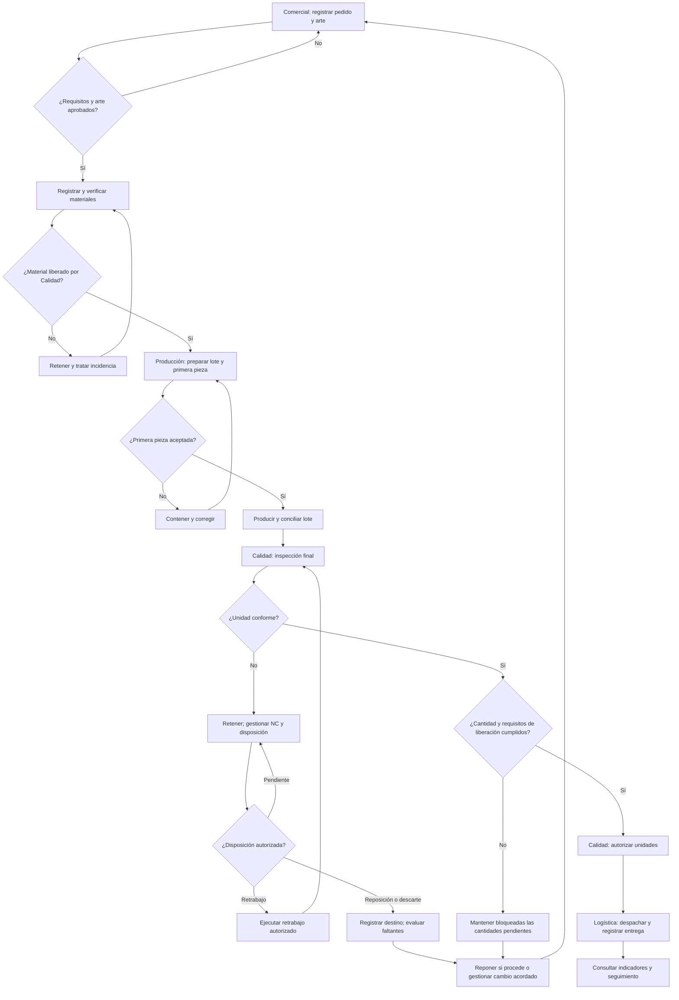
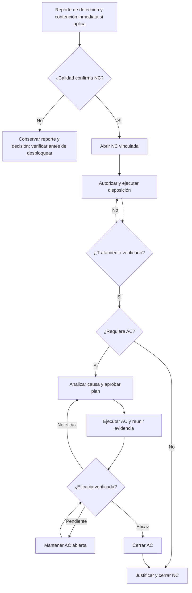
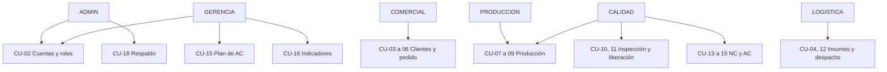

# DOC-QP-013 — Análisis del funcionamiento del software

| Campo documental | Información |
|---|---|
| Código | DOC-QP-013 |
| Apartado | 3.4 — Análisis del funcionamiento |
| Versión | 1.0 |
| Fecha | 19/11/2026 |
| Estado | **Aprobado para el proyecto académico** |
| Proyecto | QualityPrint-SGC (empresa ficticia) |
| Elaboración | Responsable del proyecto |
| Revisión propuesta | Gerencia y Control de calidad |
| Aprobación del portafolio | Aprobado por el usuario del proyecto |

## 1. Objetivo

Definir la secuencia de trabajo de la aplicación, las interacciones de sus usuarios, los escenarios de operación y las reglas que deberá aplicar antes de construir la arquitectura y el modelo de datos.

**Base:** [DOC-QP-010 — Usuarios y permisos](DOC-QP-010_usuarios_roles_y_permisos.md), [DOC-QP-011 — Requisitos funcionales](DOC-QP-011_requisitos_funcionales.md), [DOC-QP-012 — Requisitos no funcionales](DOC-QP-012_requisitos_no_funcionales.md) y [SGC aprobado](../02_sgc/README.md).

**Definiciones:** un caso de uso (CU) describe una interacción del actor con el sistema para obtener un resultado; un escenario es una trayectoria concreta de ese caso o de varios casos; una regla de negocio (RN) establece una condición obligatoria del proceso. Las reglas de autorización también se rigen por PER-01 a PER-08. Los datos de ejemplo son ficticios; ninguna prueba ha sido ejecutada.

## 3.4.1. Flujo general del sistema

### Flujo principal: del pedido al despacho

- Las credenciales y permisos se comprueban antes de cada operación registrada.
- La autorización de transferencia comercial, la liberación de materiales, la aceptación de primera pieza y la liberación final son decisiones diferentes.
- Un lote cerrado no equivale a un pedido entregado. Se identifica cada prenda y se conserva su historial; una reposición genera un ID físico nuevo.
- Los bloqueos pueden afectar unidades o grupos concretos. Las demás unidades solo siguen su flujo si las reglas de liberación parcial se satisfacen.
- El bucle de reposición en el diagrama representa gestionar el faltante y volver a la etapa que corresponda: producción con especificaciones vigentes o actualización comercial si cambian requisitos. No se crea automáticamente otro pedido.

### Flujo de NC y acciones correctivas

La NC y la AC tienen estados independientes. La evaluación de necesidad de AC y su análisis pueden iniciarse durante el tratamiento de una NC, especialmente si es crítica; el diagrama muestra las condiciones que deben verificarse antes de cerrar. Si una AC es obligatoria, la NC no se cierra hasta verificar su propio tratamiento y la eficacia de la AC asociada. La liberación individual exige conformidad y autorización; no se deduce del mero estado de la NC.

## 3.4.2. Casos de uso

### Actores

ADMIN administra cuentas y autorizaciones aprobadas; GERENCIA supervisa, aprueba recursos y cambios de roles; COMERCIAL registra clientes, pedidos y arte; PRODUCCION registra lotes y controles; CALIDAD verifica y autoriza; LOGISTICA registra recepción y despacho. El cliente no inicia sesión: su aceptación se documenta por Comercial.

### Catálogo de casos de uso

Las columnas indican actor principal y participantes cuando corresponda, precondición, flujo principal y alternativa verificable. Los RF se refieren a DOC-QP-011; las restricciones PER y RNF se aplican a todos los casos pertinentes.

| CU | Caso de uso y actor | Precondición | Flujo principal / resultado | Alternativa o excepción | RF relacionados |
|---|---|---|---|---|---|
| CU-01 | Iniciar/cerrar sesión — Todos | Cuenta creada y habilitada para acceso | Validar credenciales, abrir sesión, mostrar menú autorizado; al salir invalidar sesión. | Credenciales inválidas, cuenta inactiva o bloqueo: denegar. | RF-02,05,46 |
| CU-02 | Administrar usuarios — ADMIN; GERENCIA | ADMIN autenticado; autorización válida para asignar roles | Crear/editar cuenta, aplicar roles autorizados, restablecer credencial o desactivar; guardar historial. | Duplicado, autoelevación o falta de autorización: rechazar. | RF-01,03–05 |
| CU-03 | Gestionar clientes — COMERCIAL | Sesión y permiso | Registrar, consultar, actualizar y desactivar cliente; conservar pedidos asociados. | Dato obligatorio ausente o ID repetido: rechazar. | RF-06–07 |
| CU-04 | Gestionar catálogo y recepción — COMERCIAL / LOGISTICA | Permiso para la operación específica | Crear variante; registrar recepción con cantidades, referencia y lote; consultar trazabilidad. | Variante duplicada o cantidad inválida: rechazar; recepción no autoriza uso. | RF-15–17 |
| CU-05 | Registrar y confirmar pedido — COMERCIAL | Cliente activo y variantes disponibles | Crear líneas; calcular total, revisar factibilidad y obtener aceptación; guardar fecha y estado confirmado. | Requisitos incompletos: mantener pendiente o rechazar; cancelación registrada. | RF-08,10,13 |
| CU-06 | Aprobar diseño y transferir pedido — COMERCIAL | Pedido y diseño identificados | Registrar versión, especificaciones y evidencia; revisar los cuatro controles de transferencia; autorizar si cumplen. | Arte pendiente, insumos no confirmados o cambio: bloquear; exigir nueva aceptación cuando proceda. | RF-09,11–12 |
| CU-07 | Inspeccionar materiales — PRODUCCION / CALIDAD | Pedido identificado e insumos recibidos | Registrar criterios y cantidades; CALIDAD autoriza los materiales conformes. | NC/P: retener lo afectado; registrar evento y tratamiento. | RF-18,30 |
| CU-08 | Preparar lote y primera pieza — PRODUCCION; CALIDAD | Pedido transferido, materiales liberados e instrucción validada | Crear lote, registrar configuración y primera pieza; CALIDAD acepta antes de continuar. | Primera pieza no conforme o cambio invalidante: detener y repetir verificación. | RF-19–21 |
| CU-09 | Registrar y cerrar producción — PRODUCCION | Lote iniciado con primera pieza aceptada | Identificar prendas, registrar parámetros, autocontroles, desviaciones y cantidades; conciliar y entregar a Calidad. | Desviación o cantidad inconsistente: detener/retener o impedir cierre. | RF-20,22–23 |
| CU-10 | Inspeccionar y reinspeccionar — CALIDAD | Unidades identificadas entregadas a inspección o retrabajo autorizado | Evaluar criterios y pruebas, registrar hallazgos y estado por unidad; conservar cada revisión y conciliar. | NC/P: retener; pruebas pendientes: no declarar conformidad. | RF-24–27,29 |
| CU-11 | Liberar unidades — CALIDAD | Conformidad y verificaciones completas; inspector autorizado para liberar | Verificar cantidades por línea y requisitos, seleccionar IDs y registrar autorización de entrega. | Unidad retenida/rechazada, propia producción, duplicado o parcial no autorizado: bloquear. | RF-27–28 |
| CU-12 | Despachar y registrar entrega — LOGISTICA | Unidades liberadas vigentes, autorización parcial si aplica | Conciliar IDs y cantidades; registrar despacho, recepción y evidencia; calcular entrega completa. | Intento de despacho no liberado o duplicado: rechazar. | RF-14 |
| CU-13 | Detectar y consultar defectos — CALIDAD; roles reportantes autorizados | Hallazgo identificable en una fuente | Crear reporte independiente y evidencias; Calidad confirma o descarta incumplimiento; consultar códigos e historial. | Detección no confirmada se conserva, pero no entra en IND-04; no duplicar evento. | RF-29–31 |
| CU-14 | Gestionar NC — CALIDAD; responsables asignados | Evento confirmado | Crear NC; clasificar, contener, autorizar disposición, registrar ejecución y verificar; evaluar AC y cerrar si corresponde. | Tratamiento pendiente, AC obligatoria no eficaz o reincidencia: no cerrar o reabrir conservando historial. | RF-32–35 |
| CU-15 | Gestionar AC — CALIDAD; GERENCIA y responsables asignados | NC vinculada y necesidad justificada | Analizar causa; aprobar plan y criterios; ejecutar; evaluar eficacia independientemente; cerrar y comunicar. | Causa no demostrada o evaluación pendiente/no eficaz: conservar estado abierto y repetir análisis si corresponde. | RF-36–39 |
| CU-16 | Consultar indicadores y dashboard — roles autorizados | Sesión activa y registros del período | Calcular indicadores, mostrar estado y filtros según alcance; navegar a fuente. | Denominador cero: N/D; acceso fuera de alcance: denegar. | RF-40–43,45–48 |
| CU-17 | Registrar mantenimiento preventivo básico — GERENCIA / PRODUCCION | Equipo y responsable identificados | Autorizar programación; registrar ejecución y evidencia; conservar fecha original para IND-05. | Sin evidencia: no contar como ejecutada a tiempo; reprogramación no borra plazo original. | RF-44 |
| CU-18 | Gestionar respaldo y recuperación — ADMIN; GERENCIA | ADMIN autorizado y respaldo identificado para restauración | Crear copia consistente, registrar inventario y resultado; ensayar restauración aislada; restaurar base operativa solo con autorización y respaldo previo. | Copia fallida no reemplaza copia válida; restauración no autorizada se rechaza. | RNF-26–29; PER-01,02 |

El CU-18 desarrolla el permiso de copias de seguridad aprobado en DOC-QP-010 y los RNF, no agrega un nuevo módulo de negocio. El método de ejecución (comando/servicio administrado) se decide en el diseño técnico; no implica una ruta web de restauración.

### Relación entre actores y casos principales

El catálogo, y no el dibujo resumido, define todos los actores autorizados. Los permisos complementarios de mantenimiento (RF-44) y los filtros de alcance se mantienen.

## 3.4.3. Escenarios principales

Los siguientes son datos sintéticos para diseñar pruebas de extremo a extremo, no actividades reales. Cada resultado supone que los demás requisitos aplicables se cumplen.

| Escenario | Datos de entrada / recorrido | Resultado esperado |
|---|---|---|
| ESC-01 — Pedido completo | Cliente activo; pedido de 10 prendas de una variante; arte aprobado, materiales liberados y primera pieza aceptada; lote conciliado de 10 aptas; Calidad inspecciona 10 conformes y autoriza 10; Logística registra entrega. | Pedido entregado completamente, 10 IDs entregados una vez, trazabilidad CU-03 a CU-12; IND-01 del conjunto = 0 %, IND-03 = 100 %. |
| ESC-02 — Defecto y retrabajo | Pedido de 10; en inspección, 9 conformes y una retenida con DEF-03 y DEF-06 en un mismo evento confirmado; NC registrada; Calidad autoriza retrabajo y operador lo ejecuta; reinspección conforme. | Dos hallazgos, una prenda defectuosa histórica, un evento y una NC; misma unidad tras retrabajo. IND-01 = 10 % en su cohorte, no 0 % ni 20 %. Liberación solo tras nueva verificación. |
| ESC-03 — Entrega parcial | Pedido de 10: 8 conformes y 2 retenidas; cliente autoriza entrega de las 8, con evidencia registrada. | Calidad libera 8 IDs y Logística entrega solo esos 8; pedido no finalizado hasta entrega de las 2 restantes o modificación expresa vigente. Sin autorización parcial se bloquea. |
| ESC-04 — AC obligatoria | Tres eventos independientes de falla repetida; se confirma causa común; una AC vincula las tres NC. Se exige verificar tres lotes consecutivos, sin recurrencia del mismo problema. | Con dos lotes sin recurrencia la AC sigue pendiente. Si un criterio falla, estado En revisión de causa; tras nuevo ciclo eficaz, Calidad cierra AC y evalúa cada NC por separado. |
| ESC-05 — Cambio de diseño | Pedido confirmado con arte v1; Comercial registra v2 con cambio aceptado del cliente. Existía lote preparado con v1. | v1 permanece en historial; lote afectado bloqueado hasta reevaluación de nueva versión y nueva primera pieza cuando aplica. No se produce con diseño obsoleto. |
| ESC-06 — Acceso no autorizado | Operador que produjo un lote intenta liberar la prenda, incluso si tiene CALIDAD adicional. | Se rechaza por PER-03; no cambia el estado ni la cantidad liberada; queda evento de autorización denegada. |
| ESC-07 — Detección pendiente de registro | Cinco eventos confirmados del mes, cuatro NC vinculadas al corte; uno aún sin registro F-QP-005. | IND-04 = 80 % (4/5); el evento faltante es consultable, sin deducir denominador desde tabla NC. |
| ESC-08 — Recuperación de respaldo | Copia válida con pedidos, unidades, NC y evidencias; se simula pérdida de la base en entorno aislado. | Recuperación con relaciones verificadas; registrar conteos, tiempo y resultado conforme RNF-28; sin alterar la base operativa. |

Cada escenario se desglosará en pruebas con precondiciones y resultado esperado en etapa 7. ESC-02 no presupone que la NC sea menor o que no requiera AC: Calidad evalúa su prioridad y necesidad conforme a RN-15 y RN-17.

## 3.4.4. Reglas de negocio

| ID | Regla obligatoria | Resultado si no cumple | Trazabilidad |
|---|---|---|---|
| RN-01 | Toda operación requiere cuenta activa, permiso y alcance autorizado. | Denegar sin cambiar el registro. | RF-01–05, PER-01,02,08 |
| RN-02 | No autoelevar privilegios ni eliminar cuentas con historial. | Rechazar; desactivar cuenta cuando corresponda. | RF-03–04, PER-07,08 |
| RN-03 | Pedido nuevo requiere cliente activo y líneas con cantidades enteras positivas; total = suma de líneas. | Impedir registro inválido. | RF-06–08 |
| RN-04 | Confirmar pedido solo con requisitos, factibilidad viable, fecha acordada y aceptación del cliente. | Mantener pendiente o registrar rechazo. | RF-10, F-QP-001 |
| RN-05 | Toda versión de diseño debe estar identificada; solo Comercial registra aprobación con evidencia del cliente. | Nueva versión sin evidencia no se aprueba. | RF-09,12, PER-04 |
| RN-06 | Transferir a producción solo con cuatro controles de F-QP-001 cumplidos. | Bloquear transferencia. | RF-11 |
| RN-07 | Material NC o pendiente no se utiliza hasta disposición y liberación conforme por Calidad. | Retener y bloquear uso. | RF-16,18–19 |
| RN-08 | Lote se vincula a pedido y versiones aprobadas vigentes, materiales liberados, instrucción validada y equipos. | No iniciar lote. | RF-19–20, F-QP-003 |
| RN-09 | Calidad acepta primera pieza antes de las restantes; cambios invalidantes exigen repetirla. | No continuar hasta aceptación nueva. | RF-21 |
| RN-10 | Cada prenda tiene ID físico único; retrabajo conserva ID y reposición crea otro, con vínculo a original. | Impedir duplicación y preservar historial. | RF-22,26,33 |
| RN-11 | Procesadas = aptas para inspección + retenidas + descartadas; pendientes se registran aparte. | Impedir cierre inconciliado. | RF-23 |
| RN-12 | Inspeccionar cada unidad presentada; todo NC/P o prueba exigida pendiente impide conformidad. NA requiere justificación. | Unidad afectada permanece no liberada; rechazo exige decisión. | RF-24–27, F-QP-004 |
| RN-13 | Solo Calidad independiente de la producción autoriza liberación individual conforme; validar cantidades por línea y no duplicar IDs. | Bloquear liberación. | RF-28, PER-03 |
| RN-14 | Solo Logística despacha unidades liberadas; parcial requiere aceptación expresa del cliente. La entrega completa requiere cantidades y requisitos vigentes satisfechos, con evidencia. | Bloquear despacho o mantener pedido no finalizado. | RF-14,28, PER-05 |
| RN-15 | Evento independiente confirmado recibe una única NC con prioridad más alta aplicable: crítica, mayor o menor. | Rechazar duplicado; conservar reporte; registrar contención y avisos. | RF-30,32–33 |
| RN-16 | Calidad autoriza disposición y verifica su ejecución por cantidad y elemento; no autorizar uso/despacho de retenidos. | Mantener bloqueo y tratamiento pendiente. | RF-33–34 |
| RN-17 | AC obligatoria para NC crítica, repetitiva o sistemática; en otros casos decisión justificada. | No cerrar sin AC exigida vinculada y eficaz. | RF-34–35 |
| RN-18 | AC requiere causa confirmada con evidencia, plan aprobado, responsables, plazo y criterio medible previo a ejecución. | Mantener análisis/plan pendiente. | RF-36–37 |
| RN-19 | Eficacia requiere todos los criterios cumplidos, cantidad/período de evaluación suficiente y verificador independiente del ejecutor. | Mantener pendiente o retornar a revisión de causa. | RF-38–39, PER-06 |
| RN-20 | Cierre de NC requiere tratamiento verificado y eficacia de AC obligatoria; cierre de AC no cierra automáticamente la NC. | Mantener registro abierto o pendiente. | RF-35,39 |
| RN-21 | Conservar decisiones, versiones, defectos, fechas iniciales, evidencias y reaperturas; cambios históricos solo mediante registro auditado. | Rechazar sobrescritura o borrado sin trazabilidad. | RF-12,17,26,35,38,39, RNF-19 |
| RN-22 | IND-01 a IND-05 se calculan con reglas de corte y fechas aprobadas en DOC-QP-011, sin conteo duplicado; denominador cero = N/D. | No presentar cifra fija ni cumplimiento inventado. | RF-40–45 |
| RN-23 | No permitir despachar una unidad cuya autorización vigente haya quedado invalidada por un nuevo hallazgo o cambio de requisitos. | Bloquear el despacho hasta nueva decisión de Calidad. Conservar liberación anterior y su invalidación. | RF-12,25,28,33; PR-QP-003/004 |

**Estados controlados:** se conservan los del documento de requisitos funcionales (pedido comercial, lote, unidad, NC y AC). El avance operativo del pedido se deriva de registros vinculados; no se utiliza un estado comercial para representar el despacho.

La RN-23 precisa la diferencia entre liberar y despachar: la retención posterior a la liberación bloquea la unidad antes del envío sin borrar la autorización histórica. Si ya fue entregada, se activa el procedimiento posterior a la entrega, no se borra el despacho.

## 3.4.5. Prioridades de funcionalidades

Todos los 48 RF aprobados permanecen en el alcance de la primera versión. Se establece una secuencia de construcción por dependencia, no una eliminación de requisitos. La seguridad, integridad y trazabilidad son transversales y deben implementarse desde el inicio.

| Incremento | Funciones / objetivo | RF | Criterio de salida |
|---|---|---|---|
| I-1 — Base segura | Cuentas, sesión, permisos y navegación inicial. | RF-01–05,46 | Los seis roles tienen acceso controlado; solicitudes directas no autorizadas se rechazan. |
| I-2 — Pedidos e insumos | Clientes, catálogo, recepción y pedidos, versiones y transferencia. | RF-06–13,15–17 | Un pedido con diseño aprobado puede transferirse, uno incompleto no; conserva cambios. |
| I-3 — Producción | Materiales, lotes, primera pieza y conciliación. | RF-18–23 | Lote verificable, bloqueos por primera pieza/insumos y cantidades conciliadas. |
| I-4 — Calidad y entrega | Inspección, defectos, eventos, liberación y despacho. | RF-14,24–31 | Flujo de inspección y entrega trazable; no se liberan ni entregan unidades bloqueadas. |
| I-5 — Mejora | NC, disposición y acciones correctivas. | RF-32–39 | NC crítica/repetitiva no se cierra sin tratamiento y AC eficaz; se conserva historial. |
| I-6 — Indicadores y gestión | Mantenimiento básico, cálculo, filtros y panel completo. | RF-40–45,47–48 | Cinco indicadores desde datos; panel y detalle filtrados por rol, N/D cuando corresponda. |

Los bloqueos de seguridad y de calidad aplicables a cada incremento no se posponen. Antes de que I-5 esté completo, los escenarios con incumplimiento permanecen bloqueados y no se simula un cierre. Las pruebas de integración se realizan durante el desarrollo; la etapa 7 documenta la validación completa. Los RNF-01 a RNF-33 son criterios de aceptación transversales antes de publicar el MVP, con pruebas específicas según cada incremento. El mantenimiento básico soporta IND-05, no implica gestión avanzada de equipos.

## 4. Validación documental y siguiente etapa

- [x] 3.4.1. Definir el flujo general del sistema.
- [x] 3.4.2. Elaborar casos de uso.
- [x] 3.4.3. Describir los escenarios principales.
- [x] 3.4.4. Definir reglas de negocio.
- [x] 3.4.5. Establecer prioridades de funcionalidades.

**Resumen:** 18 casos de uso, 8 escenarios principales, 23 reglas de negocio y 6 incrementos de construcción. Los 48 RF quedan vinculados a casos de uso y a un incremento; los 33 RNF mantienen sus criterios de aceptación.

Con la aprobación de DOC-QP-013 se cierra la etapa 3 (28/28 actividades). La etapa 4 definirá la arquitectura (4.1), el modelo de datos (4.2) y la interfaz (4.3). Este documento no define aún tablas físicas, código ni pantallas implementadas.

## 5. Control de cambios

| Versión | Fecha | Descripción | Estado |
|---|---|---|---|
| 0.1 | 19/11/2026 | Flujos, casos de uso, escenarios, reglas y prioridades trazables a requisitos | En revisión |
| 1.0 | 19/11/2026 | Aprobación del usuario | Aprobado |

**Siguiente etapa:** [DOC-QP-014 — Diseño de arquitectura](../04_diseno/DOC-QP-014_diseno_de_arquitectura.md) (4.1).
