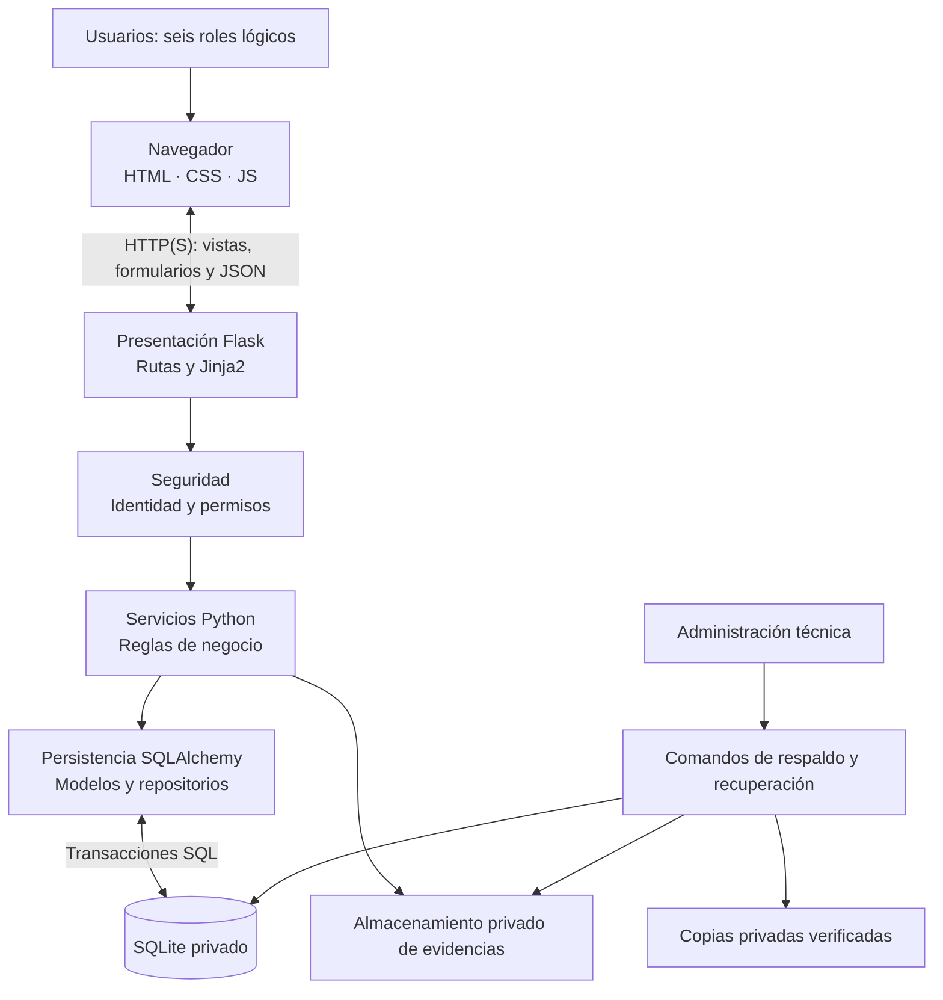

# DOC-QP-014 — Diseño de arquitectura del software

| Campo documental | Información |
|---|---|
| Código | DOC-QP-014 |
| Apartado | 4.1 — Diseño de arquitectura |
| Versión | 0.1 |
| Fecha | 19/11/2026 |
| Estado | **En revisión** |
| Proyecto | QualityPrint-SGC (empresa ficticia) |
| Elaboración | Responsable del proyecto |
| Revisión propuesta | Responsable del proyecto / Control de calidad |
| Aprobación del portafolio | Pendiente de confirmación del usuario |

## 1. Objetivo y alcance

Definir la estructura técnica de la aplicación, la distribución de responsabilidades, la comunicación entre interfaz y servidor y la conexión con la base de datos. El diseño soportará los 48 RF, los 33 RNF y las reglas de negocio aprobadas de la etapa 3.

**Referencias:** [DOC-QP-002 — Organización y tecnologías](../01_proyecto/DOC-QP-002_organizacion_inicial_del_proyecto.md), [DOC-QP-010 — Roles y permisos](../03_requisitos/DOC-QP-010_usuarios_roles_y_permisos.md), [DOC-QP-011 — Requisitos funcionales](../03_requisitos/DOC-QP-011_requisitos_funcionales.md), [DOC-QP-012 — Requisitos no funcionales](../03_requisitos/DOC-QP-012_requisitos_no_funcionales.md), [DOC-QP-013 — Análisis del funcionamiento](../03_requisitos/DOC-QP-013_analisis_del_funcionamiento.md).

## 4.1.1. Arquitectura general

### 4.1.1.1. Decisión arquitectónica

**Arquitectura monolítica modular, en tres capas lógicas:** presentación, aplicación/negocio y persistencia. Se desarrollará una sola aplicación web Flask, con módulos internos y plantillas HTML renderizadas en el servidor.

| Alternativa | Decisión | Motivo |
|---|---|---|
| Monolito modular Flask | Seleccionada | Una aplicación desplegable, responsabilidades separadas y complejidad adecuada para cinco trabajadores. |
| Frontend independiente y API separada | No seleccionada para el MVP | Añadiría otro proyecto, configuración de comunicación y despliegue sin necesidad actual. |
| Microservicios | No seleccionada | Aumentaría infraestructura y coordinación de transacciones para un sistema pequeño. |

Las capas son separaciones de código, no tres servidores físicos. En el entorno inicial, Flask y SQLite se ejecutarán en el mismo equipo; el navegador es el cliente de la aplicación. No se requiere un servidor de base de datos independiente ni una API pública en esta versión.

### 4.1.1.2. Componentes y responsabilidades

| Componente | Tecnología / mecanismo previsto | Responsabilidad | No debe realizar |
|---|---|---|---|
| Navegador | HTML, CSS, JavaScript | Mostrar formularios, listados y dashboard; interacción del usuario. | Consultar SQLite directamente ni decidir permisos o liberaciones. |
| Presentación en servidor | Flask, rutas y Jinja2 | Recibir HTTP, interpretar formularios, invocar casos de uso y construir vistas. | Contener reglas de negocio duplicadas en cada ruta. |
| Seguridad transversal | Autenticación, autorización y sesiones | Comprobar identidad, rol, alcance y separación de funciones antes de cada operación. | Confiar en un rol, usuario o ID recibido del navegador sin comprobación. |
| Servicios de negocio | Python | Ejecutar casos de uso; validar estados, cantidades, versiones y evidencias; coordinar transacciones. | Depender del HTML o recibir decisiones críticas como valores aceptados automáticamente. |
| Persistencia | Modelos y acceso a datos SQLAlchemy | Consultar y guardar registros, administrar sesión de base y restricciones. | Decidir unilateralmente la liberación de una unidad o el cierre de una NC. |
| Almacenamiento | SQLite y directorio privado de evidencias | Conservar información relacional, historial y archivos de referencia. | Exponer la base o archivos privados mediante rutas estáticas. |
| Operaciones técnicas | Comandos de administración y pytest | Inicialización, migraciones, respaldos, restauraciones y pruebas. | Ejecutar cambios administrativos sin autorización o sobre datos de ensayo ajenos. |

### 4.1.1.3. Módulos y dependencias

La organización sigue los seis incrementos de DOC-QP-013. Los módulos comparten infraestructura y reglas de autorización, pero tendrán rutas y servicios identificables.

| Módulo | Casos de uso | Dependencias directas |
|---|---|---|
| Usuarios y acceso | CU-01, CU-02 | Seguridad, usuarios, roles y auditoría |
| Clientes / catálogo | CU-03, CU-04 | Usuarios y acceso |
| Pedidos y diseños | CU-05, CU-06 | Clientes, catálogo, permisos |
| Materiales / producción | CU-07–09 | Pedidos, recepciones, autorización de Calidad |
| Calidad y defectos | CU-10, CU-11, CU-13 | Producción, versiones vigentes, unidades y permisos |
| Despachos | CU-12 | Pedidos, unidades liberadas vigentes y Logística |
| No conformidades | CU-14 | Evento de detección independiente, registros afectados |
| Acciones correctivas | CU-15 | NC vinculadas, Gerencia y responsables |
| Indicadores / panel | CU-16, CU-17 | Consultas de módulos, mantenimiento y permisos |
| Respaldo técnico | CU-18 | Base de datos, archivos de evidencia y registro de respaldos |

Los servicios de liberación y despacho consultan las condiciones de retención vigentes antes de confirmar. Los vínculos entre NC y AC no fusionan registros de origen; cerrar la AC no llama automáticamente al cierre de NC. Evitar dependencias circulares entre módulos mediante servicios compartidos de consulta de estados y transacciones coordinadas.

### 4.1.1.4. Organización propuesta del código

```text
QualityPrint/
  app/
    __init__.py          # creación y configuración de la aplicación
    config.py            # perfiles y lectura de configuración
    extensions.py        # inicialización de extensiones compartidas
    routes/
      auth.py            # inicio y cierre de sesión
      usuarios.py
      clientes.py
      catalogo.py
      pedidos.py
      produccion.py
      calidad.py
      despachos.py
      no_conformidades.py
      acciones_correctivas.py
      indicadores.py
    services/            # casos de uso y reglas de negocio
    models/              # modelos relacionales
    repositories/        # consultas y acceso a datos
    security/            # sesiones, permisos y auditoría de seguridad
    templates/           # vistas HTML y componentes Jinja2
    static/              # CSS, JS, imágenes públicas
    commands/            # inicialización, respaldos y tareas técnicas
  migrations/            # cambios versionados de estructura
  instance/              # datos privados locales, excluidos de Git
  tests/                 # pruebas de rutas, servicios e integración
  docs/
  requirements.txt
  .gitignore
  .env.example           # únicamente nombres de variables, sin secretos
  run.py                 # punto de entrada local propuesto
```

La carpeta `instance/` deberá ser privada. La ubicación real de datos y copias se configurará por entorno. Los archivos listados son un diseño propuesto; su existencia y ejecución se verificarán en etapas 5 y 6. Los módulos pueden dividirse en archivos más pequeños conforme crezca el código, sin cambiar sus responsabilidades.

## 4.1.2. Comunicación frontend/backend

### 4.1.2.1. Modelo de comunicación

El navegador realizará solicitudes HTTP al servidor Flask. Las consultas GET devolverán vistas HTML, y los formularios POST efectuarán operaciones de escritura tras validación. El frontend podrá hacer consultas JSON del mismo origen cuando se necesite actualizar un panel o selector, sin crear un servicio separado. El servidor sigue siendo la fuente de validación y datos.

| Operación | Método | Ruta propuesta | Resultado |
|---|---|---|---|
| Mostrar formulario de acceso | GET | /login | HTML |
| Autenticar | POST | /login | Sesión válida y redirección o error genérico |
| Cerrar sesión | POST | /logout | Sesión revocada y redirección |
| Consultar pedidos | GET | /pedidos | Listado HTML paginado y filtrado |
| Registrar pedido | POST | /pedidos | Registro o errores de validación |
| Consultar un pedido | GET | /pedidos/{id} | Detalle autorizado y vínculos |
| Aprobar transferencia | POST | /pedidos/{id}/transferir | Decisión auditada o motivo de bloqueo |
| Registrar lote | POST | /produccion/lotes | Lote identificado o rechazo |
| Aceptar primera pieza | POST | /produccion/lotes/{id}/primera-pieza/aceptar | Autorización de Calidad o bloqueo |
| Registrar inspección | POST | /calidad/inspecciones | Inspección y resultados vinculados |
| Autorizar liberación | POST | /calidad/liberaciones | Autorización de unidades válidas o rechazo |
| Registrar despacho | POST | /despachos | Despacho/entrega autorizados |
| Cerrar NC | POST | /no-conformidades/{id}/cerrar | Cierre verificado o bloqueo |
| Evaluar AC | POST | /acciones-correctivas/{id}/evaluar | Resultado de eficacia auditado |
| Consultar panel | GET | /dashboard?mes=2026-11 | Indicadores y datos autorizados |

Las rutas son un contrato orientativo de diseño; el catálogo completo se definirá en el desarrollo. `{id}` representa el identificador de un registro. Una solicitud GET no producirá cambios de negocio; las decisiones de escritura se realizan mediante POST con protección CSRF. No se ofrecen rutas públicas de restauración de SQLite.

### 4.1.2.2. Secuencia de una escritura

1. El usuario diligencia un formulario; el navegador envía POST con token CSRF y datos permitidos.
2. Flask valida sesión, token, permiso base y formato de entrada; no confía en el rol ni en el identificador de usuario aportado por el cliente.
3. El servicio carga la información vigente y verifica alcance, separación de funciones, versión del registro y reglas aplicables.
4. Dentro de una transacción, persiste el cambio y su auditoría; si alguna validación falla, realiza rollback.
5. Flask devuelve errores específicos de validación sin datos sensibles o redirige al detalle por GET (patrón POST/Redirect/GET).
6. El navegador muestra el resultado e identificador. Una operación repetida se controla en el servidor; la redirección por sí sola no garantiza que no haya duplicados.

### 4.1.2.3. Contrato de respuestas

| Condición | Resultado HTTP orientativo | Comportamiento de la interfaz |
|---|---|---|
| Consulta válida | 200 | Mostrar vista o JSON autorizado |
| Escritura válida desde formulario | 303 a un GET | Confirmación del resultado |
| Sin sesión | Redirección al acceso en HTML; 401 en JSON | Solicitar autenticación |
| Operación prohibida | 403; 404 cuando ocultar existencia fuera de alcance sea necesario | Informar acceso denegado sin revelar datos |
| Registro inexistente | 404 | Página de no encontrado |
| Datos inválidos | 422; 400 para solicitud malformada o CSRF inválido | Mostrar campos/motivos y conservar entradas válidas |
| Versión desactualizada o conflicto de estado | 409 | Solicitar recarga y mostrar motivo |
| Error inesperado | 500 | Mensaje genérico; rollback y referencia interna de incidencia |

### 4.1.2.4. Seguridad

- Sesión con identificador aleatorio opaco, cookie HttpOnly/SameSite y Secure bajo HTTPS; registro de sesión revocable en servidor, con vencimientos y revocación de DOC-QP-012. Se guarda el hash del identificador de sesión, no el token reutilizable.
- Hash de contraseñas con sal y costo mediante biblioteca confiable; aplicar requisitos de longitud, bloqueo, límites e intentos de RNF-02–04. Los secretos se leen desde configuración no versionada.
- En cada ruta protegida, autorización por rol y operación, luego verificación de alcance y conflictos de funciones en el servicio. Ocultar botones no sustituye estas comprobaciones.
- Escapar contenido en vistas; usar consultas parametrizadas; validar CSRF tanto en formularios como en escrituras JSON autorizadas del mismo origen.
- En desarrollo, servidor solo en bucle invertido. Acceso desde otra máquina o demostración compartida exige servidor de aplicación adecuado, HTTPS, depuración deshabilitada y configuración segura.
- Evidencias se vinculan a su registro. Si se almacenan archivos, aceptar únicamente los tipos y tamaños que se definan en el diseño detallado, generar nombres internos no controlados por el usuario, comprobar permisos de lectura y no servirlos directamente desde `static/`. No ejecutar archivos adjuntos.

## 4.1.3. Conexión con la base de datos

### 4.1.3.1. Persistencia y configuración

| Elemento | Decisión propuesta |
|---|---|
| Motor | SQLite local |
| Acceso | SQLAlchemy como capa ORM y consultas parametrizadas |
| Configuración | URL de conexión según entorno por variable/configuración externa |
| Base de desarrollo | Archivo privado en `instance/`, nunca en Git |
| Base de pruebas | Archivo temporal aislado por ejecución, con datos ficticios |
| Migraciones | Alembic o integración equivalente compatible con SQLAlchemy; registrar cada cambio de estructura |
| Integridad | Claves primarias, foráneas activas por conexión, UNIQUE, NOT NULL y CHECK donde proceda |
| Evidencias | Referencias identificadas en la base y archivos privados, si se requieren |
| Fechas | Instantes persistidos con referencia UTC y fechas de negocio en America/Bogota |
| Acceso del cliente | Exclusivamente a través de servicios Flask; sin acceso directo a SQLite |

No se fijan todavía los nombres de tablas, columnas ni claves concretas. Esto se resolverá mediante modelo entidad-relación y diccionario de datos en 4.2.

### 4.1.3.2. Gestión de transacciones y concurrencia

- Utilizar una sesión de SQLAlchemy por unidad de trabajo; cerrarla al finalizar y revertir cualquier error. La sesión de base de datos no es la sesión de autenticación.
- Los servicios serán responsables de los límites transaccionales. Los repositorios no harán commits independientes de la operación principal.
- Guardar cabecera y líneas de pedido, inspecciones y sus resultados, liberaciones y detalles, despachos y detalles, y sus cambios de auditoría en transacciones indivisibles.
- Para ediciones concurrentes aplicar control de versión: actualización condicionada a la versión leída y a las precondiciones vigentes; si ya cambió, devolver conflicto.
- Las decisiones de liberación, despacho y cierre se verifican dentro de la transacción de escritura, con bloqueo/serialización de escrituras cuando corresponda. Aplicar restricciones únicas a vinculaciones que no deben duplicarse y claves de idempotencia para solicitudes repetidas.
- Mantener transacciones de escritura cortas, configurar espera acotada ante bloqueo SQLite y manejar conflicto o reintento seguro. No mantener transacciones abiertas durante la interacción humana.
- Evaluar mediante pruebas RNF-20 y RNF-24 que cinco usuarios concurrentes operan sin pérdidas. Si SQLite se vuelve un límite demostrado, documentar el resultado y evaluar PostgreSQL en una versión posterior; no declarar una migración ya hecha.

### 4.1.3.3. Consultas, indicadores y respaldo

- Filtrar en el servidor por rol, alcance y parámetros permitidos; paginar 25 filas por defecto y máximo 100 según RNF-25.
- Crear índices sobre campos de búsqueda y relaciones definidos en 4.2, verificando con las pruebas de rendimiento; no duplicar indicadores como valores editables.
- Implementar cálculos IND-01–05 en servicios de consulta usando las reglas de corte, deduplicación y fuentes aprobadas del DOC-QP-011. Mostrar N/D con denominador cero.
- Realizar respaldo consistente de SQLite y evidencias vinculadas, con un procedimiento coordinado que obtenga un conjunto íntegro (pausar escrituras durante el respaldo si se necesita); conservar manifiesto, versión, fecha, ubicación y resultado. No sustituir copias válidas si falla el proceso.
- Las restauraciones se prueban en entorno aislado; la restauración operativa requiere autorización de Gerencia, respaldo previo y ventana de mantenimiento. El ADMIN usa un comando local controlado, sin endpoint público.
- Mantener resguardo fuera del disco principal según RNF-27; verificar RPO/RTO y periodicidad conforme RNF-26–29.

## 4.1.4. Diagramas de arquitectura

### 4.1.4.1. Diagrama lógico



Las respuestas retornan desde los servicios a Flask y al navegador. El control de alcance y las reglas de negocio se aplican también en los servicios; no dependen solo de un control inicial en la ruta.

### 4.1.4.2. Diagrama de secuencia: autorizar liberación

```mermaid
sequenceDiagram
 actor Q as Calidad
 participant B as Navegador
 participant F as Flask/seguridad
 participant S as Servicio de calidad
 participant D as SQLite/SQLAlchemy
 Q->>B: Confirmar autorización
 B->>F: POST liberación + CSRF + versión
 F->>F: Validar sesión y rol
 alt Identidad o permiso inválidos
   F-->>B: Rechazo sin escritura
 else Autorización base válida
   F->>S: Solicitar liberación
   S->>D: Iniciar transacción y consultar estado vigente
   D-->>S: Unidades, requisitos, historial
   S->>S: Validar alcance, independencia, conformidad y cantidades
   alt Validación o versión incorrecta
     S->>D: Rollback
     S-->>F: Conflicto o bloqueo
     F-->>B: Mostrar motivo
   else Decisión válida
     S->>D: Insertar autorización y auditoría; commit
     D-->>S: Identificador
     S-->>F: Resultado válido
     F-->>B: 303 al detalle
     B->>F: GET detalle
     F-->>B: Vista autorizada
   end
 end
```

### 4.1.4.3. Entornos

| Entorno | Configuración de ejecución | Datos |
|---|---|---|
| Desarrollo | Navegador y Flask en equipo local, HTTP solo loopback, depuración local | Base de desarrollo con datos ficticios |
| Pruebas | Aplicación y base temporales independientes; configuración reproducible | Datos de prueba y escenarios ESC-01–08 |
| Demostración compartida (etapa 8, si procede) | Servidor de aplicación y HTTPS; depuración desactivada; configuración segura | Datos ficticios separados, copia y restauración controladas |

Los perfiles no comparten credenciales ni base de datos. El despliegue público no se ejecutará durante esta etapa.

## 5. Trazabilidad y condiciones de revisión

| Decisión | Requisitos principales | Evidencia futura |
|---|---|---|
| Módulos, rutas y servicios separados | RF-01–48 / RNF-30–33 | Estructura de código, pruebas de servicio e instalación |
| Sesión y autorizaciones centrales | PER-01–08 / RNF-01–07 | Pruebas de accesos, expiración y separación |
| Formularios y respuestas de servidor | RNF-08–15 | Pruebas de flujos y pantallas en 4.3 y etapa 7 |
| Transacciones, restricciones y auditoría | RNF-16–21 | Pruebas de rollback, concurrencia e historial |
| Consultas filtradas/paginadas | RNF-22–25 | Medición del escenario de referencia |
| Respaldo aislado, inventario y restauración | RNF-26–29 | Ensayo de restauración y cronometraje |

Las decisiones técnicas se comprobarán contra los documentos aprobados. Los límites de rendimiento y recuperación siguen siendo objetivos de prueba, no resultados. Las versiones exactas de dependencias y comandos de instalación se fijarán en la etapa 5.

## 6. Estado del roadmap y control de cambios

- [ ] 4.1.1. Definir arquitectura general.
- [ ] 4.1.2. Diseñar la comunicación frontend/backend.
- [ ] 4.1.3. Definir la conexión con la base de datos.
- [ ] 4.1.4. Elaborar el diagrama de arquitectura.

| Versión | Fecha | Descripción | Estado |
|---|---|---|---|
| 0.1 | 19/11/2026 | Arquitectura modular, comunicación HTTP, persistencia, seguridad y diagramas | En revisión |

**Siguiente apartado:** 4.2 — Diseño de base de datos (entidades, atributos, claves, relaciones y modelo entidad-relación).
