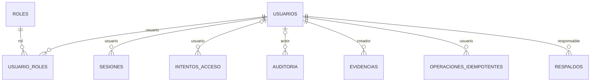
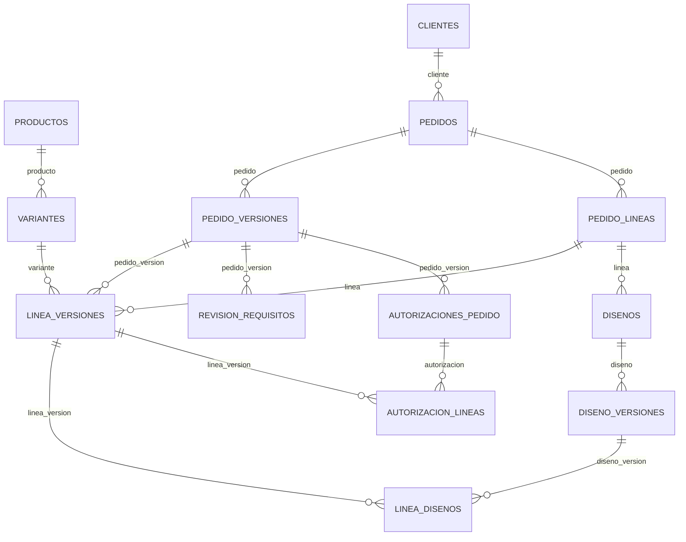
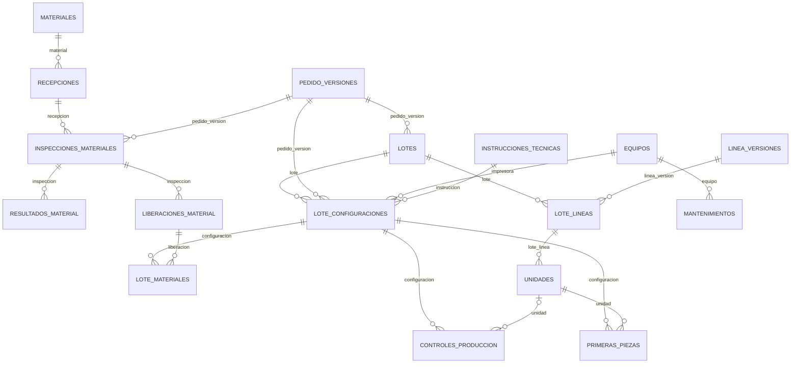
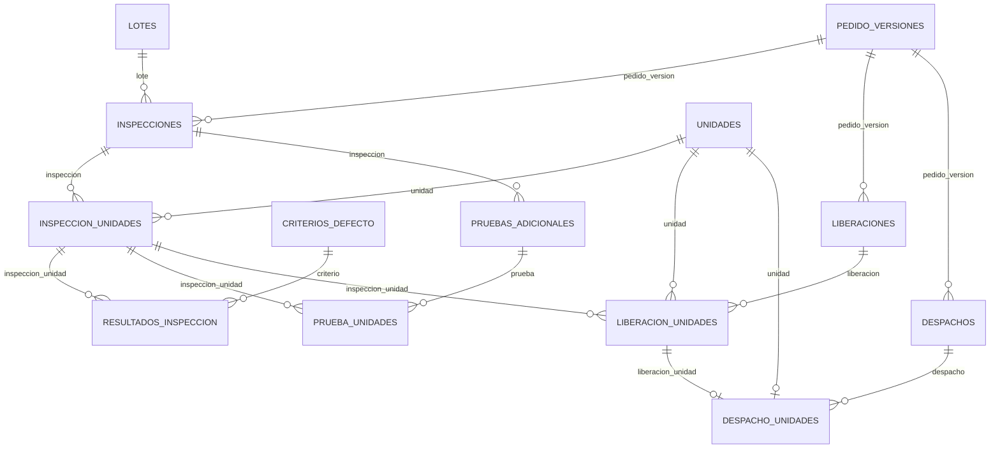
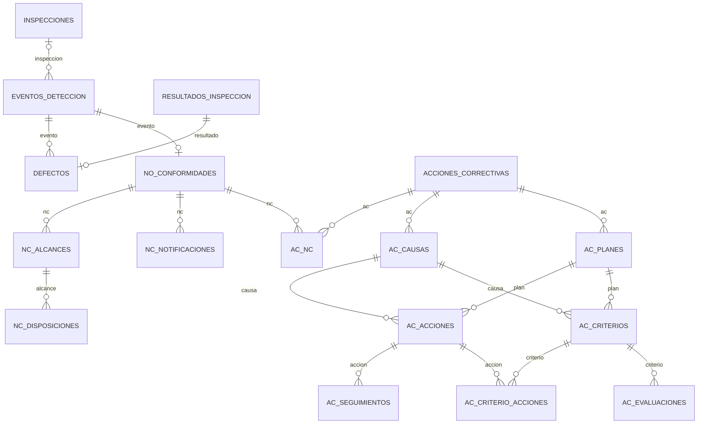
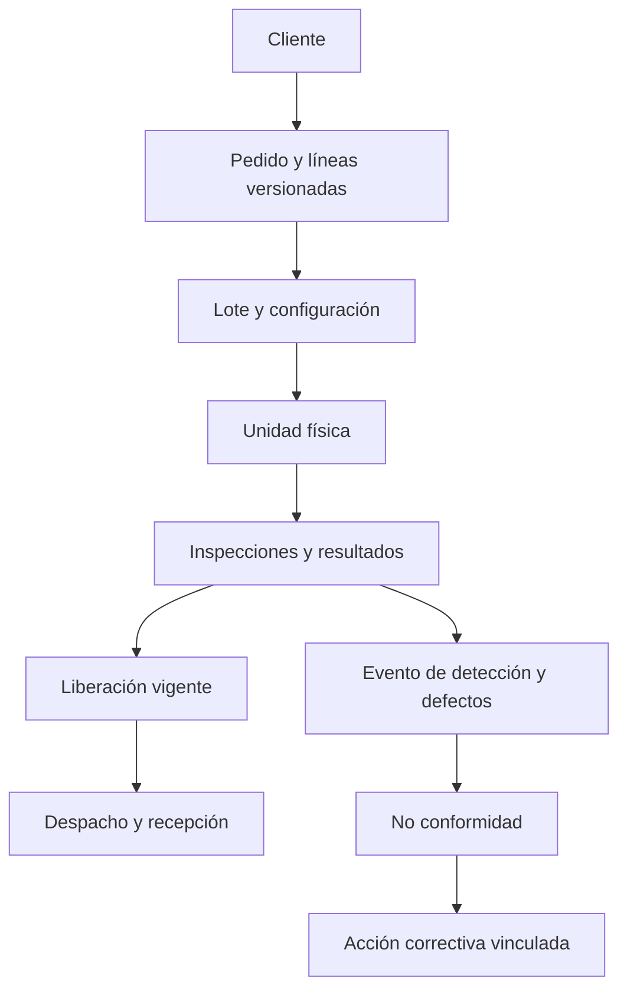

# DOC-QP-015 — Diseño de base de datos

| Campo documental | Información |
|---|---|
| Código | DOC-QP-015 |
| Apartado | 4.2 — Diseño de base de datos |
| Versión | 0.1 |
| Fecha | 19/11/2026 |
| Estado | **En revisión** |
| Proyecto | QualityPrint-SGC (empresa ficticia) |
| Elaboración | Responsable del proyecto |
| Revisión propuesta | Responsable del proyecto / Control de calidad |
| Aprobación del portafolio | Pendiente de confirmación del usuario |

## 1. Objetivo y alcance

Definir la estructura relacional de QualityPrint en SQLite: entidades, atributos, claves primarias y foráneas, cardinalidades y restricciones para implementar los 48 requisitos funcionales y rastrear pedidos, prendas, inspecciones, no conformidades y acciones correctivas.

**Referencias:** [DOC-QP-014 — Arquitectura](DOC-QP-014_diseno_de_arquitectura.md), [DOC-QP-011 — Requisitos funcionales](../03_requisitos/DOC-QP-011_requisitos_funcionales.md), [DOC-QP-012 — RNF](../03_requisitos/DOC-QP-012_requisitos_no_funcionales.md), [DOC-QP-013 — Casos de uso y reglas](../03_requisitos/DOC-QP-013_analisis_del_funcionamiento.md) y [formatos aprobados del SGC](../02_sgc/README.md).

Diseño lógico para revisión; todavía no se han creado tablas SQLite ni migraciones. La estructura cubre el MVP por incrementos. Las tablas auxiliares preservan las relaciones, versiones y evidencia, sin representar nuevos procesos empresariales.

## 4.2.1. Identificación de entidades

| Dominio | Entidades principales | Tablas (incluye auxiliares) |
|---|---|---:|
| Seguridad y soporte | Usuarios, roles, sesiones, auditoría, evidencias y respaldos | 9 |
| Pedidos y catálogo | Clientes, productos, variantes, pedidos, líneas, diseños y autorizaciones | 13 |
| Materiales y operación DTF | Recepciones, controles de materiales, lotes, configuraciones, unidades, equipos y mantenimiento | 15 |
| Inspección, liberación y entrega | Inspecciones, resultados, pruebas adicionales, liberaciones y despachos | 10 |
| No conformidades y acciones correctivas | Eventos, defectos, NC, disposiciones, AC, causas, planes y eficacia | 15 |
| **Total** | | **62** |

La unidad de trazabilidad de producto es una prenda física individual. Pedido, revisión del pedido, lote, revisión de configuración y revisión de inspección son conceptos distintos. Separar hechos y autorizaciones históricos de valores vigentes.

## 4.2.2. Diccionario de atributos

Cada tabla posee `id:INTEGER` como clave primaria (PK). Los nombres físicos emplean minúsculas y snake_case. Los atributos son obligatorios salvo el sufijo `?` (admiten NULL hasta que el estado o regla exija el dato). Los códigos de negocio no sustituyen las PK.

| Notación | Tipo físico / significado |
|---|---|
| T | TEXT; no vacío si obligatorio; estados controlados por CHECK o servicio |
| I | INTEGER; entero exacto |
| B | INTEGER booleano con CHECK en 0 y 1 |
| M | INTEGER escalado a milésimas de la unidad indicada: 1,250 m se guarda como 1250. En campos con sufijo _mm, la unidad es milímetro; _grados, grado. |
| D | TEXT fecha local ISO AAAA-MM-DD |
| TS | TEXT instante UTC ISO 8601 con precisión fija; se convierte a America/Bogota para informes |
| J | TEXT JSON válido reservado a diferencias de auditoría |
| FK(tabla.id) | INTEGER, clave foránea a la PK indicada |
| U(campo...) | UNIQUE sobre los campos indicados |
| U vigente / U activo | Índice único parcial para filas vigentes o activas |
| Index | Índice de consulta no único |

`version:I` para concurrencia empieza en 1 y aumenta al modificar; `revision:I` identifica cada versión histórica dentro del padre. Las restricciones que involucran varias tablas se validan mediante servicios transaccionales. Los campos de cantidad de prendas son enteros. En un alcance NC donde se use M para prendas, cada unidad equivale a 1000; no se permiten fracciones de prenda. Rechazar precisión mayor que la admitida o exigir conversión explícita, sin truncar.

### 4.2.2.1. Seguridad y soporte

| Tabla | Propósito | Atributos (además de id) | Restricciones específicas |
|---|---|---|---|
| `usuarios` | Cuenta individual | `nombre:T`, `login:T`, `password_hash:T`, `activo:B`, `version:I`, `creado:TS` | U(login); version>0; login normalizado; login no sensible a mayúsculas según normalización |
| `roles` | Roles fijos del MVP | `codigo:T`, `nombre:T` | U(codigo); ADMIN, GERENCIA, CALIDAD, PRODUCCION, COMERCIAL, LOGISTICA |
| `usuario_roles` | Autorización/aplicación y retiro de rol | `usuario_id:FK(usuarios.id)`, `rol_id:FK(roles.id)`, `solicitado:TS`, `autorizador_id:FK(usuarios.id)?`, `autorizado:TS?`, `aplicador_id:FK(usuarios.id)?`, `aplicado:TS?`, `retirado_por_id:FK(usuarios.id)?`, `retiro_autorizador_id:FK(usuarios.id)?`, `retiro_autorizado:TS?`, `retirado:TS?`, `estado:T`, `motivo:T` | U activo(usuario_id,rol_id); estado pendiente,aprobado,activo,retirado,rechazado; no elevar privilegios propios |
| `sesiones` | Sesiones revocables | `usuario_id:FK(usuarios.id)`, `token_hash:T`, `inicio:TS`, `ultima_actividad:TS`, `vence:TS`, `revocada:TS?` | U(token_hash); nunca almacenar token reutilizable |
| `intentos_acceso` | Límites y eventos de autenticación | `usuario_id:FK(usuarios.id)?`, `login_normalizado:T?`, `ip:T`, `ocurrido:TS`, `tipo:T`, `resultado:T`, `bloqueado_hasta:TS?` | Index(login_normalizado,ocurrido), Index(ip,ocurrido); no contraseñas |
| `auditoria` | Historial inmutable de cambios y seguridad | `actor_id:FK(usuarios.id)?`, `ocurrido:TS`, `operacion:T`, `entidad:T`, `registro_id:I?`, `anterior:J?`, `nuevo:J?`, `motivo:T?`, `resultado:T` | Index(entidad,registro_id,ocurrido); referencia descriptiva, no FK polimórfica de negocio; nunca secretos |
| `evidencias` | Referencia o archivo privado | `creador_id:FK(usuarios.id)`, `creado:TS`, `descripcion:T`, `referencia:T?`, `ruta_privada:T?`, `sha256:T?`, `mime:T?`, `bytes:I?` | Referencia o ruta obligatoria; si archivo, hash, MIME y tamaño; U(ruta_privada) si existe |
| `operaciones_idempotentes` | Control de doble envío | `usuario_id:FK(usuarios.id)`, `operacion:T`, `clave:T`, `huella_solicitud:T`, `resultado_entidad:T`, `resultado_id:I`, `creado:TS` | U(usuario_id,operacion,clave); reuso con otra solicitud genera conflicto |
| `respaldos` | Inventario y prueba de recuperación | `responsable_id:FK(usuarios.id)`, `fecha:TS`, `version_esquema:T`, `ubicacion:T`, `manifiesto:T`, `resultado:T`, `restaurado_en:TS?`, `duracion_seg:I?`, `verificacion:T?`, `autorizador_id:FK(usuarios.id)?` | No credenciales ni datos completos en manifiesto público |

### 4.2.2.2. Pedidos y catálogo

| Tabla | Propósito | Atributos (además de id) | Restricciones específicas |
|---|---|---|---|
| `clientes` | Identificación y contacto | `codigo:T`, `nombre:T`, `contacto:T`, `activo:B`, `version:I` | U(codigo); contacto y nombre no vacíos |
| `productos` | Catálogo comercial | `codigo:T`, `nombre:T`, `tipo_prenda:T`, `activo:B`, `version:I` | U(codigo) |
| `variantes` | Combinación de producto | `producto_id:FK(productos.id)`, `codigo:T`, `tejido:T`, `talla:T`, `color:T`, `activo:B`, `version:I` | U(codigo); U(producto_id,tejido,talla,color) |
| `pedidos` | Identidad estable y estado comercial | `codigo:T`, `cliente_id:FK(clientes.id)`, `comercial_id:FK(usuarios.id)`, `solicitado:TS`, `estado:T`, `version:I` | U(codigo); estado pendiente,confirmado,rechazado,cancelado; historial auditado |
| `pedido_versiones` | Requisitos y fechas aceptadas por revisión | `pedido_id:FK(pedidos.id)`, `revision:I`, `estado:T`, `fecha_solicitada:D?`, `fecha_acordada:D?`, `modalidad:T`, `destino:T?`, `condiciones:T?`, `factibilidad:T`, `aceptado_en:TS?`, `evidencia_aceptacion_id:FK(evidencias.id)?`, `autor_id:FK(usuarios.id)`, `creado:TS`, `motivo:T?` | U(pedido_id,revision); U vigente(pedido_id); estado borrador,vigente,sustituida,rechazada; fecha inicial = primera revisión aceptada |
| `pedido_lineas` | Identidad estable de línea | `pedido_id:FK(pedidos.id)`, `numero:I` | U(pedido_id,numero); numero>0 |
| `linea_versiones` | Instantánea de línea por revisión | `linea_id:FK(pedido_lineas.id)`, `pedido_version_id:FK(pedido_versiones.id)`, `variante_id:FK(variantes.id)`, `producto_texto:T`, `tejido:T`, `talla:T`, `color:T`, `cantidad:I` | U(linea_id,pedido_version_id); cantidad>0; ambos pertenecen al mismo pedido |
| `revision_requisitos` | Lista de factibilidad y transferencia | `pedido_version_id:FK(pedido_versiones.id)`, `codigo_criterio:T`, `resultado:T`, `evidencia_id:FK(evidencias.id)?`, `observacion:T?`, `revisor_id:FK(usuarios.id)`, `fecha:TS` | U(pedido_version_id,codigo_criterio); historial de cambios en auditoría; C,NC,P,NA con justificación |
| `disenos` | Identidad estable del estampado por línea | `linea_id:FK(pedido_lineas.id)`, `codigo:T` | U(linea_id,codigo) |
| `diseno_versiones` | Especificación de arte y aprobación | `diseno_id:FK(disenos.id)`, `revision:I`, `arte_id:FK(evidencias.id)`, `posicion:T`, `orientacion:T`, `ancho_mm:M`, `alto_mm:M`, `tolerancia_mm:M`, `ref_posicion:T`, `tol_posicion_mm:M?`, `tol_angulo_grados:M?`, `ref_color:T?`, `estado:T`, `aceptado:TS?`, `evidencia_aceptacion_id:FK(evidencias.id)?`, `comercial_id:FK(usuarios.id)` | U(diseno_id,revision); dimensiones>0; tolerancias>=0; aprobación exige evidencia y fecha |
| `linea_disenos` | Diseños exactos por revisión de línea | `linea_version_id:FK(linea_versiones.id)`, `diseno_version_id:FK(diseno_versiones.id)` | U(linea_version_id,diseno_version_id); máximo una versión de cada diseño por línea revisada y misma línea estable |
| `autorizaciones_pedido` | Transferencia y permiso de entrega parcial | `pedido_version_id:FK(pedido_versiones.id)`, `tipo:T`, `estado:T`, `fecha:TS`, `actor_id:FK(usuarios.id)`, `evidencia_id:FK(evidencias.id)?`, `motivo:T?`, `invalidada:TS?` | tipo transferencia,parcial; estado autorizado,bloqueado; parcial exige evidencia cliente; conservar rechazos |
| `autorizacion_lineas` | Cantidad parcial acordada por línea | `autorizacion_id:FK(autorizaciones_pedido.id)`, `linea_version_id:FK(linea_versiones.id)`, `cantidad:I` | U(autorizacion_id,linea_version_id); cantidad>0; solo autorización parcial; misma versión de pedido |

### 4.2.2.3. Materiales y operación DTF

| Tabla | Propósito | Atributos (además de id) | Restricciones específicas |
|---|---|---|---|
| `materiales` | Catálogo básico de insumos | `codigo:T`, `tipo:T`, `referencia:T`, `unidad:T`, `activo:B` | U(codigo); tipos prenda,film,tinta,adhesivo,otro |
| `recepciones` | Partida de insumo identificada | `material_id:FK(materiales.id)`, `codigo:T`, `proveedor:T`, `lote_proveedor:T?`, `cantidad:M`, `vencimiento:D?`, `recepcionado:TS`, `logistica_id:FK(usuarios.id)`, `ubicacion:T`, `evidencia_id:FK(evidencias.id)?` | U(codigo); cantidad>0 en unidad del material |
| `inspecciones_materiales` | Verificación de una partida para pedido | `codigo:T`, `recepcion_id:FK(recepciones.id)`, `pedido_version_id:FK(pedido_versiones.id)`, `cantidad_requerida:M`, `cantidad_verificada:M`, `inspector_id:FK(usuarios.id)`, `fecha:TS`, `revision:I`, `estado:T` | U(codigo); U(recepcion_id,pedido_version_id,revision); cantidades positivas y verificada<=recibida |
| `resultados_material` | Criterio de material inspeccionado | `inspeccion_id:FK(inspecciones_materiales.id)`, `criterio:T`, `resultado:T`, `observacion:T?`, `evidencia_id:FK(evidencias.id)?` | U(inspeccion_id,criterio); C,NC,P,NA; P/NA requieren justificación |
| `liberaciones_material` | Decisión de Calidad por cantidad | `inspeccion_id:FK(inspecciones_materiales.id)`, `cantidad:M`, `decision:T`, `calidad_id:FK(usuarios.id)`, `fecha:TS`, `motivo:T?`, `invalidada:TS?`, `evidencia_id:FK(evidencias.id)?` | cantidad>0; decision liberada,retenida,rechazada; suma de reservas/liberaciones no excede la cantidad aplicable |
| `equipos` | Identificación de equipo | `codigo:T`, `tipo:T`, `modelo:T`, `activo:B` | U(codigo); tipo impresora,curado,prensa,otro |
| `instrucciones_tecnicas` | Instrucción de configuración validada | `codigo:T`, `revision:I`, `descripcion:T`, `referencia_id:FK(evidencias.id)`, `validado_por_id:FK(usuarios.id)`, `validado_en:TS`, `vigente:B` | U(codigo,revision); U vigente(codigo); incluye combinación de equipos, tejido e insumos |
| `lotes` | Lote de producción y configuración | `codigo:T`, `pedido_version_id:FK(pedido_versiones.id)`, `operador_id:FK(usuarios.id)`, `estado:T`, `inicio:TS?`, `cierre:TS?`, `version:I` | U(codigo); estado preparado,en_produccion,detenido,cerrado; versión inicial de pedido y operador se conservan |
| `lote_configuraciones` | Configuraciones aprobadas por revisión | `lote_id:FK(lotes.id)`, `revision:I`, `pedido_version_id:FK(pedido_versiones.id)`, `transferencia_id:FK(autorizaciones_pedido.id)`, `impresora_id:FK(equipos.id)`, `curado_id:FK(equipos.id)`, `prensa_id:FK(equipos.id)`, `instruccion_id:FK(instrucciones_tecnicas.id)`, `creada:TS`, `actor_id:FK(usuarios.id)`, `motivo:T?`, `vigente:B` | U(lote_id,revision); U vigente(lote_id); misma identidad de pedido; autorización vigente; cambios requieren nueva primera pieza |
| `lote_lineas` | Asignación de cantidades por línea | `lote_id:FK(lotes.id)`, `linea_version_id:FK(linea_versiones.id)`, `cantidad_asignada:I` | U(lote_id,linea_version_id); cantidad>0; misma versión; reposiciones justificadas |
| `lote_materiales` | Reserva/uso de cantidad liberada | `configuracion_id:FK(lote_configuraciones.id)`, `liberacion_id:FK(liberaciones_material.id)`, `cantidad:M`, `cantidad_usada:M` | U(configuracion_id,liberacion_id); 0<=usada<=cantidad; cantidad>0; no sobrerreservar partida; liberación corresponde al pedido revisado |
| `unidades` | Prenda física individual | `codigo:T`, `lote_linea_id:FK(lote_lineas.id)`, `reemplaza_id:FK(unidades.id)?`, `estado_produccion:T`, `procesada_en:TS?`, `creador_id:FK(usuarios.id)`, `version:I` | U(codigo); estados pendiente,apta_inspeccion,retenida,descartada; ID no cambia en retrabajo; sustitución no es autorreferencia; U(reemplaza_id) si no NULL; misma línea estable, evitar ciclos |
| `controles_produccion` | Parámetros y autocontroles por operación | `configuracion_id:FK(lote_configuraciones.id)`, `unidad_id:FK(unidades.id)?`, `operacion:T`, `parametro:T`, `valor:M?`, `minimo:M?`, `maximo:M?`, `unidad_medida:T?`, `resultado:T`, `observacion:T?`, `evidencia_id:FK(evidencias.id)?`, `actor_id:FK(usuarios.id)`, `fecha:TS` | minimo<=maximo si aplican; C,NC,P,NA; unidad del mismo lote; resultado de desviación bloquea avance |
| `primeras_piezas` | Verificación y decisión de primera pieza | `configuracion_id:FK(lote_configuraciones.id)`, `unidad_id:FK(unidades.id)`, `revision:I`, `resultado:T`, `operador_id:FK(usuarios.id)`, `fecha_presentacion:TS`, `calidad_id:FK(usuarios.id)?`, `fecha_decision:TS?`, `evidencia_id:FK(evidencias.id)?`, `invalidada:TS?` | U(configuracion_id,revision); aceptación vigente única por configuración; C,NC,P; unidad del lote |
| `mantenimientos` | Plan preventivo y ejecución | `codigo:T`, `equipo_id:FK(equipos.id)`, `actividad:T`, `fecha_original:D`, `fecha_vigente:D`, `responsable_id:FK(usuarios.id)`, `autorizador_id:FK(usuarios.id)`, `programado_en:TS`, `ejecutado_en:TS?`, `ejecutor_id:FK(usuarios.id)?`, `evidencia_id:FK(evidencias.id)?`, `estado:T`, `version:I` | U(codigo); conservar fecha_original; ejecución requiere evidencia; historial de plazo |

### 4.2.2.4. Inspección, liberación y entrega

| Tabla | Propósito | Atributos (además de id) | Restricciones específicas |
|---|---|---|---|
| `inspecciones` | Cabecera de inspección final | `codigo:T`, `lote_id:FK(lotes.id)`, `pedido_version_id:FK(pedido_versiones.id)`, `calidad_id:FK(usuarios.id)`, `inicio:TS`, `cierre:TS?`, `criterios_ref:T`, `estado:T` | U(codigo); versión evaluada pertenece al pedido del lote; si hay cambio, nueva inspección sobre versión vigente autorizada y reevaluada |
| `inspeccion_unidades` | Evaluación individual y revisión | `inspeccion_id:FK(inspecciones.id)`, `unidad_id:FK(unidades.id)`, `revision:I`, `revision_previa_id:FK(inspeccion_unidades.id)?`, `iniciada:TS?`, `finalizada:TS?`, `estado:T`, `observacion:T?` | U(unidad_id,revision); estado presentada,conforme,retenida,rechazada; iniciada NULL si aún no inspeccionada; revisión anterior misma unidad |
| `criterios_defecto` | Catálogo DEF-01–10 | `codigo:T`, `descripcion:T`, `referencia:T`, `activo:B` | U(codigo); catálogo conforme F-QP-004 |
| `resultados_inspeccion` | Resultado por criterio y estampado | `inspeccion_unidad_id:FK(inspeccion_unidades.id)`, `criterio_id:FK(criterios_defecto.id)`, `diseno_version_id:FK(diseno_versiones.id)?`, `resultado:T`, `valor_nominal:M?`, `tolerancia:M?`, `valor_observado:M?`, `unidad_medida:T?`, `referencia:T?`, `observacion:T?`, `evidencia_id:FK(evidencias.id)?` | U(inspeccion_unidad_id,criterio_id,diseno_version_id) si diseño; U(inspeccion_unidad_id,criterio_id) si NULL; C,NC,P,NA; P/NA justificados |
| `pruebas_adicionales` | Prueba exigida y resultado | `inspeccion_id:FK(inspecciones.id)`, `tipo:T`, `requisito:T`, `metodo:T`, `condiciones:T`, `criterio_aceptacion:T`, `definido_en:TS`, `fecha_ejecucion:TS?`, `responsable_id:FK(usuarios.id)?`, `resultado:T`, `evidencia_id:FK(evidencias.id)?` | C,NC,P,NA; método y criterio previos; muestra identificada para resultado válido |
| `prueba_unidades` | Muestra o unidades cubiertas | `prueba_id:FK(pruebas_adicionales.id)`, `inspeccion_unidad_id:FK(inspeccion_unidades.id)`, `es_muestra:B` | U(prueba_id,inspeccion_unidad_id); mismo contexto de inspección; distinguir muestra de cobertura |
| `liberaciones` | Decisión de Calidad por pedido | `codigo:T`, `pedido_version_id:FK(pedido_versiones.id)`, `autorizacion_parcial_id:FK(autorizaciones_pedido.id)?`, `tipo:T`, `fecha:TS`, `calidad_id:FK(usuarios.id)`, `motivo:T?` | U(codigo); tipo completa,parcial,bloqueada; parcial requiere autorización vigente |
| `liberacion_unidades` | Unidades específicas autorizadas | `liberacion_id:FK(liberaciones.id)`, `unidad_id:FK(unidades.id)`, `inspeccion_unidad_id:FK(inspeccion_unidades.id)`, `invalidada:TS?`, `invalidador_id:FK(usuarios.id)?`, `motivo_invalidacion:T?` | U(liberacion_id,unidad_id); U vigente(unidad_id) WHERE invalidada IS NULL; inspección misma unidad; no liberar unidad ya despachada |
| `despachos` | Registro de despacho y recepción | `codigo:T`, `pedido_version_id:FK(pedido_versiones.id)`, `logistica_id:FK(usuarios.id)`, `fecha_despacho:TS`, `recibido_en:TS?`, `evidencia_despacho_id:FK(evidencias.id)`, `evidencia_entrega_id:FK(evidencias.id)?`, `modalidad:T`, `estado:T` | U(codigo); estados despachado,entregado; recibido y evidencia requeridos para entrega |
| `despacho_unidades` | Unidad física despachada sin duplicados | `despacho_id:FK(despachos.id)`, `liberacion_unidad_id:FK(liberacion_unidades.id)`, `unidad_id:FK(unidades.id)` | U(unidad_id); U(despacho_id,liberacion_unidad_id); ambas referencias de la misma unidad; permiso vigente al despacho |

### 4.2.2.5. No conformidades y acciones correctivas

| Tabla | Propósito | Atributos (además de id) | Restricciones específicas |
|---|---|---|---|
| `eventos_deteccion` | Reporte independiente de NC | `codigo:T`, `origen:T`, `pedido_id:FK(pedidos.id)?`, `inspeccion_id:FK(inspecciones.id)?`, `control_id:FK(controles_produccion.id)?`, `inspeccion_material_id:FK(inspecciones_materiales.id)?`, `despacho_id:FK(despachos.id)?`, `fecha_deteccion:TS`, `creado:TS`, `detector_id:FK(usuarios.id)`, `descripcion:T`, `requisito:T`, `evidencia_id:FK(evidencias.id)?`, `estado:T`, `confirmador_id:FK(usuarios.id)?`, `confirmado_en:TS?`, `decision_motivo:T?` | U(codigo); origen inspeccion,produccion,material,posterior_entrega,otro; estado reportado,confirmado,descartado; fuente válida según origen |
| `defectos` | Hallazgo individual DEF | `codigo:T`, `resultado_id:FK(resultados_inspeccion.id)`, `evento_id:FK(eventos_deteccion.id)`, `descripcion:T`, `evidencia_id:FK(evidencias.id)?`, `detectado:TS` | U(codigo); U(resultado_id) para hallazgo del mismo criterio/revisión/estampado; resultado NC |
| `no_conformidades` | Registro F-QP-005 por evento confirmado | `codigo:T`, `evento_id:FK(eventos_deteccion.id)`, `proceso:T`, `prioridad:T`, `justificacion_prioridad:T`, `responsable_id:FK(usuarios.id)`, `creado:TS`, `plazo:D`, `estado:T`, `requiere_ac:B?`, `justificacion_ac:T?`, `cerrado:TS?`, `cerrador_id:FK(usuarios.id)?`, `evidencia_cierre_id:FK(evidencias.id)?`, `version:I` | U(codigo); U(evento_id); prioridad critica,mayor,menor; estados según F-QP-005 |
| `nc_alcances` | Elemento o grupo afectado | `nc_id:FK(no_conformidades.id)`, `unidad_id:FK(unidades.id)?`, `recepcion_id:FK(recepciones.id)?`, `pedido_linea_id:FK(pedido_lineas.id)?`, `descripcion:T`, `cantidad:M?`, `unidad_medida:T?`, `contencion:T`, `ubicacion:T?`, `fecha_contencion:TS?`, `actor_id:FK(usuarios.id)?`, `evidencia_id:FK(evidencias.id)?` | Una referencia específica como máximo; texto si alcance no cuantificable; cantidad positiva si aplica; unidad física cuenta 1; prevenir solapamiento y duplicidad |
| `nc_notificaciones` | Avisos y comunicaciones | `nc_id:FK(no_conformidades.id)`, `destinatario:T`, `actor_id:FK(usuarios.id)`, `fecha:TS`, `canal:T`, `mensaje:T`, `evidencia_id:FK(evidencias.id)?` | Conservar aviso inmediato crítico y acuerdo posterior a entrega cuando aplique |
| `nc_disposiciones` | Tratamiento y verificación por alcance | `alcance_id:FK(nc_alcances.id)`, `tipo:T`, `cantidad:M?`, `autorizador_id:FK(usuarios.id)`, `autorizado:TS`, `responsable_id:FK(usuarios.id)`, `plazo:D`, `ejecutado:TS?`, `resultado_ejecucion:T?`, `evidencia_id:FK(evidencias.id)?`, `verificador_id:FK(usuarios.id)?`, `verificado:TS?`, `resultado_verificacion:T?`, `evidencia_verificacion_id:FK(evidencias.id)?`, `reinspeccion_id:FK(inspeccion_unidades.id)?`, `reemplazo_id:FK(unidades.id)?` | tipo correccion_documental,retrabajo,reposicion,devolucion,descarte; cantidades no exceden alcance; no liberar sin verificación |
| `acciones_correctivas` | Cabecera de AC y decisión final | `codigo:T`, `motivo:T`, `problema:T`, `proceso:T`, `responsable_id:FK(usuarios.id)`, `seguimiento_id:FK(usuarios.id)`, `abierta:TS`, `estado:T`, `cerrado:TS?`, `cerrador_id:FK(usuarios.id)?`, `conclusion:T?`, `evidencia_cierre_id:FK(evidencias.id)?`, `version:I` | U(codigo); estados según F-QP-006; cierre solo eficaz |
| `ac_nc` | Vínculo de AC con NC independientes | `ac_id:FK(acciones_correctivas.id)`, `nc_id:FK(no_conformidades.id)`, `vinculado:TS`, `motivo:T` | U(ac_id,nc_id) |
| `ac_causas` | Hipótesis y causas comprobadas | `ac_id:FK(acciones_correctivas.id)`, `codigo:T`, `metodo:T`, `hipotesis:T`, `fuentes:T`, `alcance:T?`, `estado:T`, `evidencia_id:FK(evidencias.id)?`, `analista_id:FK(usuarios.id)`, `fecha:TS`, `confirmador_id:FK(usuarios.id)?`, `confirmada:TS?` | U(ac_id,codigo); confirmada,descartada,pendiente; confirmada exige evidencia |
| `ac_planes` | Revisiones del plan de AC | `ac_id:FK(acciones_correctivas.id)`, `revision:I`, `creado:TS`, `calidad_id:FK(usuarios.id)`, `criterios_aprobados:TS?`, `gerencia_id:FK(usuarios.id)?`, `recursos_aprobados:TS?`, `estado:T`, `documentos_riesgos:T?`, `motivo:T?` | U(ac_id,revision); U vigente(ac_id); estados borrador,vigente,sustituido; aprobaciones previas |
| `ac_acciones` | Acción por causa de un plan | `plan_id:FK(ac_planes.id)`, `causa_id:FK(ac_causas.id)`, `codigo:T`, `descripcion:T`, `responsable_id:FK(usuarios.id)`, `recursos:T`, `plazo_original:D`, `plazo_vigente:D`, `evidencia_esperada:T`, `estado:T` | U(plan_id,codigo); causa confirmada y de misma AC; pendiente,en_curso,ejecutada |
| `ac_seguimientos` | Ejecuciones, avances y cambios de plazo | `accion_id:FK(ac_acciones.id)`, `actor_id:FK(usuarios.id)`, `fecha:TS`, `tipo:T`, `resultado:T`, `evidencia_id:FK(evidencias.id)?`, `nuevo_plazo:D?`, `autorizador_id:FK(usuarios.id)?` | tipo avance,ejecucion,reprogramacion; ejecución requiere evidencia; reprogramación justificada |
| `ac_criterios` | Meta verificable previa a ejecución | `plan_id:FK(ac_planes.id)`, `causa_id:FK(ac_causas.id)`, `codigo:T`, `variable:T`, `valor_inicial:T?`, `meta:T`, `metodo:T`, `fuente:T`, `min_oportunidades:I?`, `periodo_min_dias:I?`, `fecha_prevista:D`, `verificador_id:FK(usuarios.id)` | U(plan_id,codigo); mínimo >0 de oportunidades o días; causa de plan; meta numérica o condición comprobable |
| `ac_criterio_acciones` | Acciones evaluadas por criterio | `criterio_id:FK(ac_criterios.id)`, `accion_id:FK(ac_acciones.id)` | U(criterio_id,accion_id); mismo plan y causa |
| `ac_evaluaciones` | Medición de eficacia conservada por intento | `criterio_id:FK(ac_criterios.id)`, `revision:I`, `desde:D`, `hasta:D`, `oportunidades:I?`, `resultado_medido:T`, `resultado:T`, `evidencia_id:FK(evidencias.id)?`, `verificador_id:FK(usuarios.id)`, `fecha:TS` | U(criterio_id,revision); cumple,no_cumple,pendiente; verificador independiente; hasta>=desde |

**Estados de NC:** Abierta, En tratamiento, Pendiente de verificación y Cerrada. **Estados de AC:** Abierta, En ejecución, Pendiente de eficacia, En revisión de causa y Cerrada. Se pueden representar con códigos normalizados equivalentes. Las transiciones y reaperturas guardan actor, fecha y motivo en auditoría; el cierre anterior permanece en historial aunque se reabra un registro.

## 4.2.3. Claves primarias

- Las 62 tablas poseen PK entera independiente `id`; no se reutilizan ni modifican IDs.
- Los códigos únicos de negocio permiten búsqueda y trazabilidad de pedidos, lotes, unidades, inspecciones, NC y AC.
- Las tablas asociativas tienen PK propia y UNIQUE del par de FK; p. ej. ac_nc(ac_id, nc_id) y linea_disenos(linea_version_id, diseno_version_id).
- Las revisiones tienen unicidad de padre y número de revisión. No sobrescribir una revisión aprobada para representar otra.

## 4.2.4. Claves foráneas

El diccionario especifica las **171 referencias FK**, todas con destino definido. Habilitar FK en cada conexión SQLite. Política de borrado RESTRICT/NO ACTION por defecto; no eliminar en cascada registros históricos. Desactivar cuentas/catálogos, cancelar pedidos e invalidar autorizaciones con eventos auditados.

Las referencias genéricas de auditoría e idempotencia (entidad + ID) son técnicas descriptivas, no sustituyen las FK operativas. Evidencias guardan referencias o rutas privadas controladas, nunca contraseñas o secretos. Los archivos se gestionan fuera de la carpeta pública.

## 4.2.5. Relaciones y reglas de integridad

| Relación | Cardinalidad y condición |
|---|---|
| Usuario — rol | N:M mediante usuario_roles; conservar cada autorización y retiro. Solo un vínculo activo por par. |
| Cliente — pedido | 1:N; un pedido pertenece a un cliente. |
| Pedido — versiones y líneas | 1:N revisiones y 1:N líneas estables al confirmar; cada instantánea corresponde a línea y revisión del mismo pedido. Máximo una versión vigente. |
| Línea — diseños/versiones | 1:N diseños; cada diseño 1:N versiones; asociar a la instantánea de línea las versiones exactas aplicables. |
| Pedido — lote — unidad | 1:N lotes y líneas asignadas; cada unidad pertenece a una línea de lote. Retrabajo mantiene ID; reposición genera uno nuevo con vínculo a original. |
| Lote — configuración — insumos | 1:N configuraciones, una vigente; cada configuración puede reservar 0:N cantidades liberadas. |
| Unidad — inspección | 1:N revisiones; revisión previa de la misma unidad; resultados por criterio y diseño sin duplicar. |
| Prueba adicional — unidades | N:M mediante prueba_unidades; distinguir muestra y unidades cubiertas. |
| Unidad — liberación | 1:N históricas con máximo una vigente. Invalidar no elimina la autorización anterior. |
| Despacho — unidades | 1:N; una unidad física aparece como máximo en un despacho. |
| Evento — NC | 1:0..1; confirmar independientemente antes de vincular NC. |
| Evento — defectos | 1:N hallazgos; cada hallazgo procede de resultado identificado. |
| NC — alcance — disposición | 1:N y 1:N; cantidades y elementos no se solapan; conservar tratamiento y verificación. |
| NC — AC | N:M mediante ac_nc; AC debe vincular mínimo una NC. |
| AC — causas, planes y evaluación | 1:N causas y planes; plan 1:N acciones y criterios; criterio N:M acciones y 1:N evaluaciones. |

### Validaciones transaccionales críticas

| ID | Validación | Trazabilidad |
|---|---|---|
| BD-01 | Una revisión de pedido vigente; línea, diseño y autorización coherentes con identidad y revisión. Conservar fecha inicial y aceptaciones posteriores. | RF-08–12, RN-03–06 |
| BD-02 | Configuración vigente de lote usa versión del mismo pedido, transferencia autorizada y materiales suficientes liberados. Ante cambios se reevalúan líneas/unidades y se crea nueva configuración o lote según corresponda. Si cambia cantidad o variante, planificar faltantes en nuevo lote sin reasignar IDs históricos. | RF-18–21, RN-07–09 |
| BD-03 | Primera pieza conforme requiere decisión de Calidad con evidencia y fecha; cambio invalidante genera nueva configuración y exige nueva aceptación. | RF-21 |
| BD-04 | Conciliar con IDs únicos: procesada tiene fecha de procesamiento; calcular cantidades conforme F-QP-003/004, sin sumar reinspecciones ni resultados como prendas. | RF-22–27 |
| BD-05 | Conforme exige todos los criterios aplicables y pruebas obligatorias satisfechas. Nueva revisión con NC/P implica retención e invalidación de liberación vigente no despachada en la misma transacción. | RF-25–28, RN-12,23 |
| BD-06 | Unidad autorizada corresponde a la revisión de inspección y pedido; no tiene bloqueo y el autorizador no produjo esa unidad/lote. Liberación parcial valida evidencia y cupo por línea. | RF-28, PER-03 |
| BD-07 | Despacho exige liberación vigente, misma unidad, permiso de Logística y cantidad autorizada. UNIQUE(unidad_id) impide doble despacho; recibir con evidencia sin borrar historial. | RF-14, RN-14,23 |
| BD-08 | Calidad confirma el evento; solo un registro NC por evento confirmado. Para origen inspección, defecto pertenece a la inspección referida; otros orígenes conservan fuente válida. | RF-29–32 |
| BD-09 | Verificar alcance, prioridad, contención, disposición y evidencia. Si AC obligatoria, no cerrar mientras las acciones requeridas no tengan eficacia verificada. | RF-33–35, RN-15–17,20 |
| BD-10 | AC: NC vinculada, causa confirmada, plan vigente, recursos y criterios aprobados antes de ejecución. Verificador independiente; todos los criterios deben cumplirse. | RF-36–39, RN-18–20 |
| BD-11 | Auditar cambio y guardar dentro de la misma transacción; conflicto de versión rechaza escritura; clave idempotente evita duplicación. | RNF-17,19–20 |
| BD-12 | Calcular avance, cantidades e indicadores mediante consultas; cierre no elimina detección ni permite editar porcentajes calculados. | RF-13,40–48 |

**Precisiones:** en una NC de prendas usar un registro de alcance por ID físico; no crear un grupo redundante que incluya esas mismas unidades. Para materiales identificar partida y unidad de medida, controlar cantidad disponible y no mezclar magnitudes. Los incumplimientos documentales pueden tener alcance no cuantificable justificado. Una partida retenida tras liberarse invalida el permiso de uso correspondiente, bloquea asignación y exige evaluar lotes afectados.

Una inspección posterior a cambio puede evaluar una versión más nueva del mismo pedido si fue autorizada, vinculada a las mismas identidades de línea y reevaluada. Las configuraciones de lote conservan parámetros e instrucción exactos. Los campos que referencian distintos padres requieren validación de consistencia entre tablas; las FK simples no bastan.

Antes de finalizar pedido, comparar con cantidades aceptadas vigentes por línea estable la suma de unidades efectivamente entregadas, sin duplicar IDs de entregas parciales anteriores. Fecha final: recepción confirmada del último grupo. Las entregas se agrupan de manera que cada registro de despacho tenga una misma fecha de recepción; cualquier recepción parcial se registra como grupo separado sin duplicar unidades físicas.

## 4.2.6. Modelo entidad-relación

El MER se divide por dominios para facilitar lectura. Cada arista es una FK real. Se muestran relaciones principales; las FK adicionales de actor, evidencias y otras se enumeran en el diccionario. `||` significa exactamente uno, `o|` cero o uno, `o{` cero o muchos; los mínimos de negocio se comprueban antes de confirmar o cerrar.

### Seguridad y soporte

### Pedidos y catálogo

### Materiales y operación DTF

### Inspección, liberación y entrega

### No conformidades y acciones correctivas

### Trazabilidad general

## 4.2.7. Revisión de la estructura de la base de datos

### Datos para los indicadores

| Indicador | Tablas fuente y cálculo |
|---|---|
| IND-01 | inspeccion_unidades: primera iniciada por ID en el período; defectos y resultados_inspeccion hasta el corte; deduplicar unidades, no descontar correcciones. |
| IND-02 | pedidos, pedido_versiones, linea_versiones, despachos, despacho_unidades y unidades: entregas completas del mes; fecha acordada válida conforme cadena de aceptación previa al vencimiento y entrega. |
| IND-03 | Pedidos finalizados derivados de entregas completas y existencia de inspecciones anteriores o al finalizar; denominador es pedido, no lote. |
| IND-04 | eventos_deteccion confirmados por fecha de detección; NC vinculadas al cierre del período; denominador independiente de NC. |
| IND-05 | mantenimientos cuya fecha_original corresponde al mes; ejecución con evidencia y comparación con fecha_original. |

Aplicar fechas, corte histórico y metas de DOC-QP-011. Mostrar numerador, denominador y N/D con denominador cero. Los cambios legítimos posteriores se conservan mediante auditoría.

### Índices de consulta iniciales

Además de PK y UNIQUE: indexar FK frecuentes y filtros: pedidos(cliente_id, estado), pedido_versiones(pedido_id, revision), lotes(pedido_version_id, estado), unidades(lote_linea_id, estado_produccion), inspeccion_unidades(unidad_id, iniciada), defectos(evento_id, detectado), eventos_deteccion(estado, fecha_deteccion), no_conformidades(estado, prioridad, plazo), acciones_correctivas(estado), despachos(recibido_en), mantenimientos(fecha_original). Ajustar con mediciones RNF-22–25.

### Criterios de prueba futura

| Prueba | Resultado esperado |
|---|---|
| PK duplicada, FK inexistente o relación incoherente | Rechazo sin registros huérfanos ni escritura parcial. |
| Dos versiones de pedido vigentes | Restricción impide coexistencia. |
| Dos líneas (3 y 5 prendas) | Total derivado 8; no existe total editable incongruente. |
| Dos defectos y reinspección favorable | Una prenda física con dos hallazgos y revisiones conservadas. |
| Liberación invalidada y posterior conformidad | Histórico intacto; máximo una autorización vigente. |
| Dos sesiones despachan misma unidad | Una sola escritura válida. |
| Cinco eventos confirmados, cuatro con NC | IND-04 = 80 %. |
| NC crítica sin AC eficaz | Cierre bloqueado. |
| Eficacia no cumple meta | Conservar evaluación y plan; no cerrar AC. |
| Restauración aislada | Conteos, FK y evidencias recuperados conforme RNF-28. |

### Trazabilidad de requisitos

| RF | Dominio |
|---|---|
| RF-01–05 | Seguridad y acceso |
| RF-06–17 | Clientes, pedidos, catálogo y despacho |
| RF-18–23 | Materiales, producción y unidades |
| RF-24–31 | Inspecciones, liberaciones, defectos y detecciones |
| RF-32–35 | NC y tratamiento |
| RF-36–39 | AC, causas, planes y eficacia |
| RF-40–48 | Indicadores, mantenimiento y panel derivados |

**Revisión documental:** las 62 tablas se definen en el diccionario y las 171 FK apuntan a entidades existentes. Pendientes: aprobación, migraciones, comprobación física con SQLite y pruebas de integridad y rendimiento. No se declara implementado el esquema.

## 5. Estado del roadmap y control de cambios

- [ ] 4.2.1. Identificar entidades.
- [ ] 4.2.2. Definir atributos.
- [ ] 4.2.3. Definir claves primarias.
- [ ] 4.2.4. Definir claves foráneas.
- [ ] 4.2.5. Establecer relaciones.
- [ ] 4.2.6. Elaborar el modelo entidad-relación.
- [ ] 4.2.7. Revisar la estructura de la base de datos.

| Versión | Fecha | Descripción | Estado |
|---|---|---|---|
| 0.1 | 19/11/2026 | 62 tablas lógicas, diccionario de atributos, claves, relaciones y MER por dominios | En revisión |

**Siguiente apartado:** 4.3 — Diseño de interfaz.
